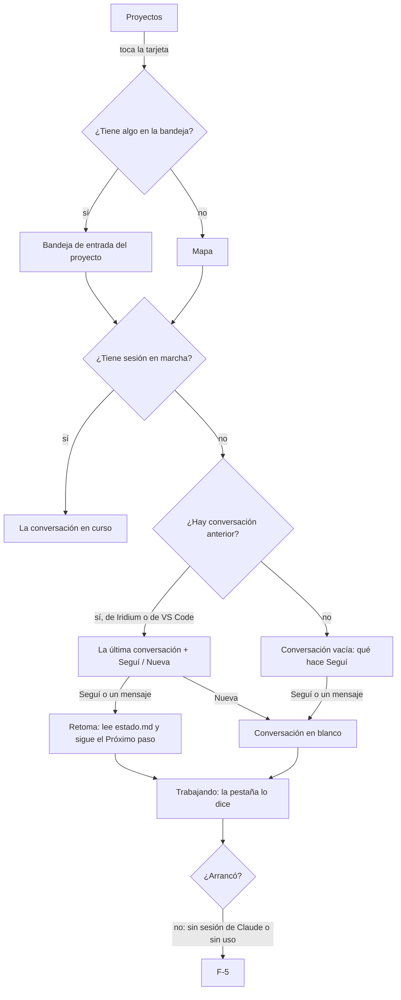
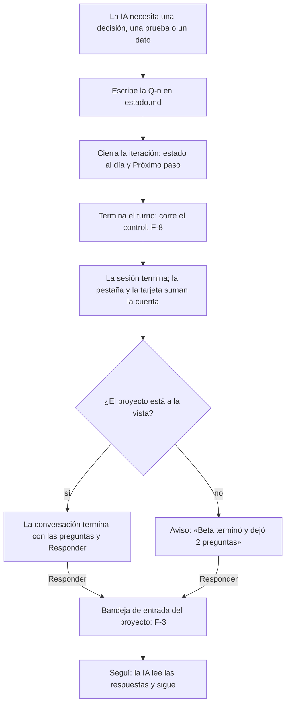
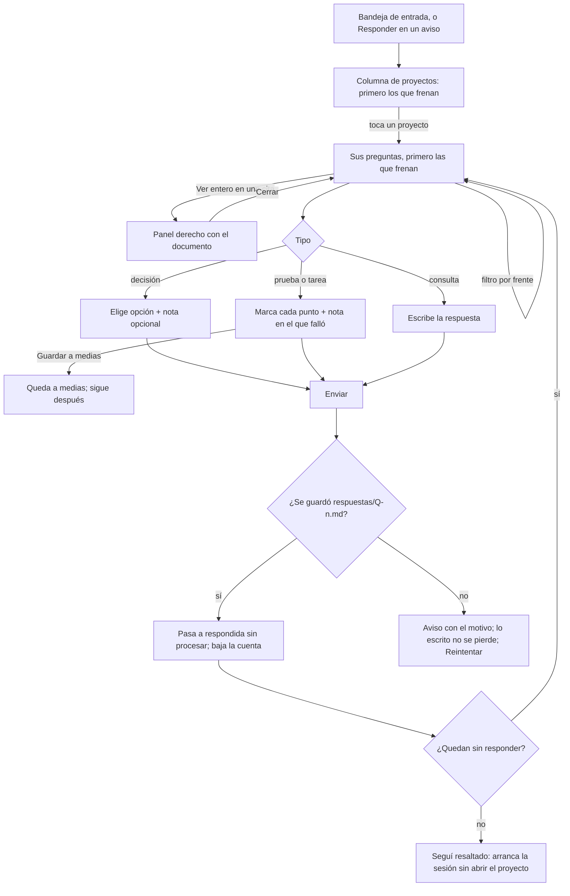
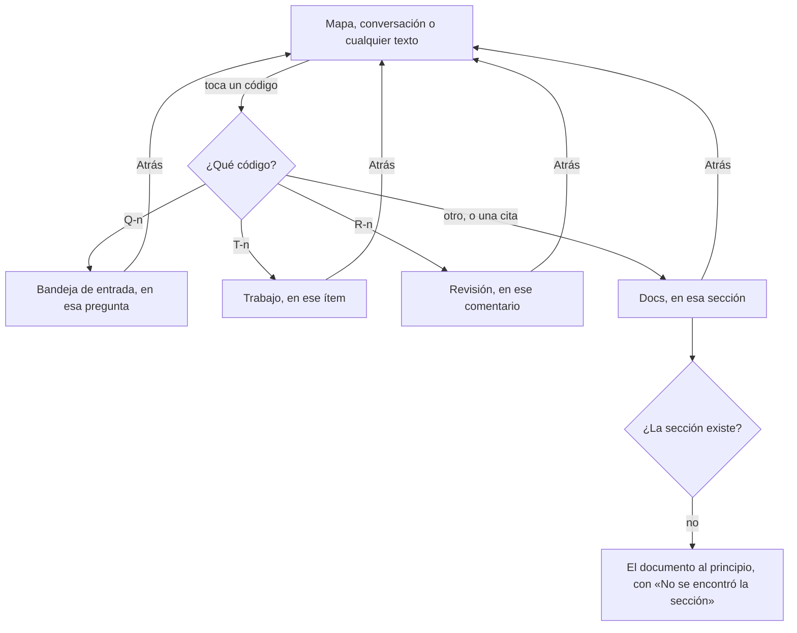
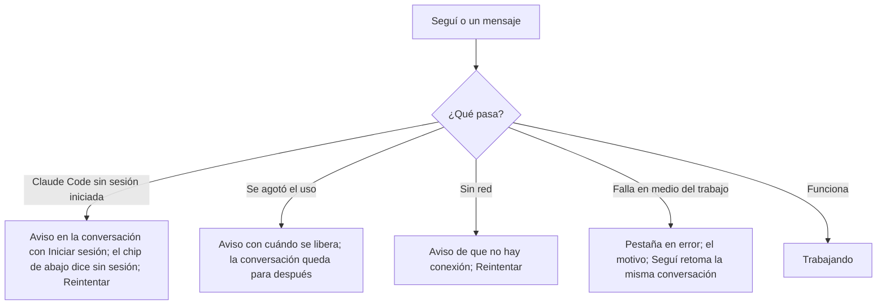
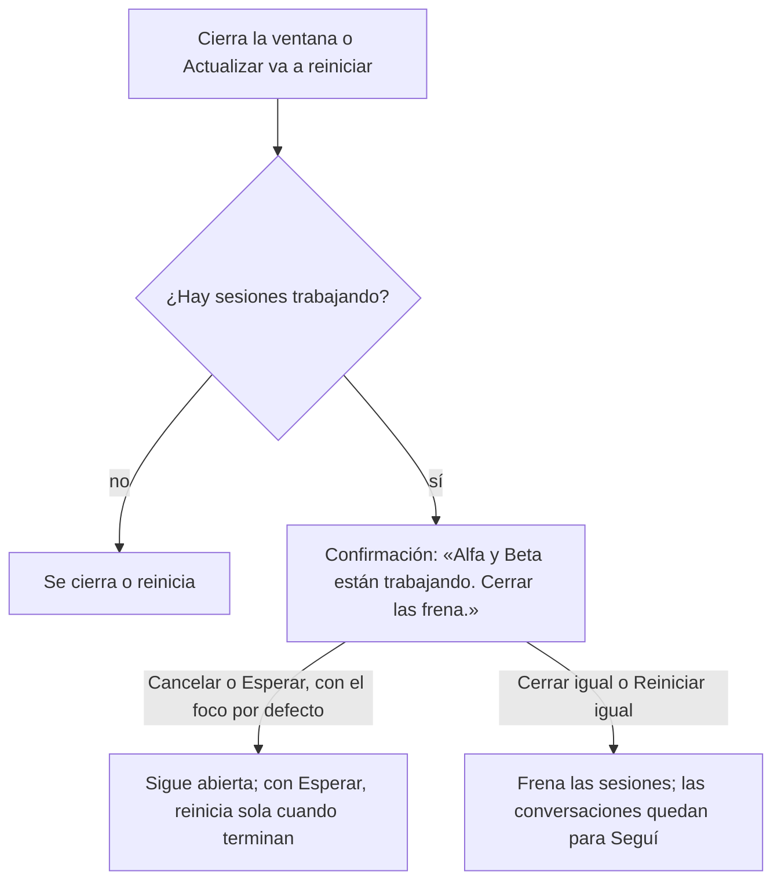
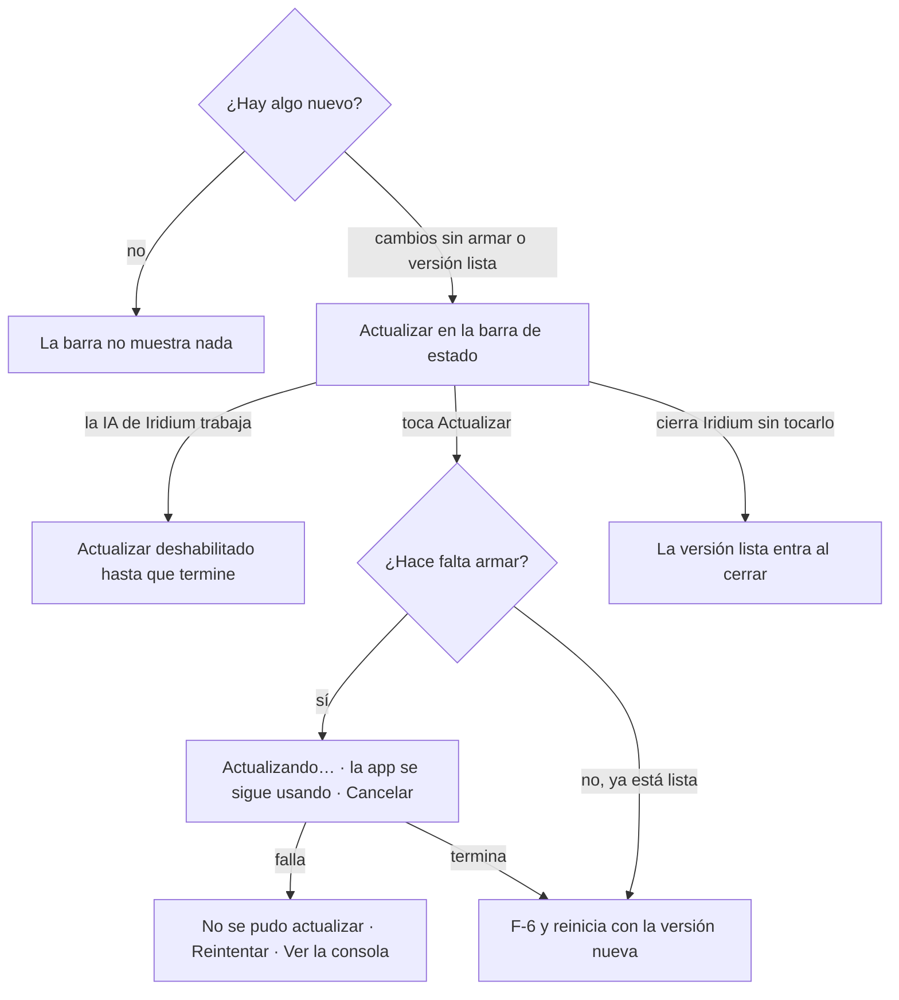
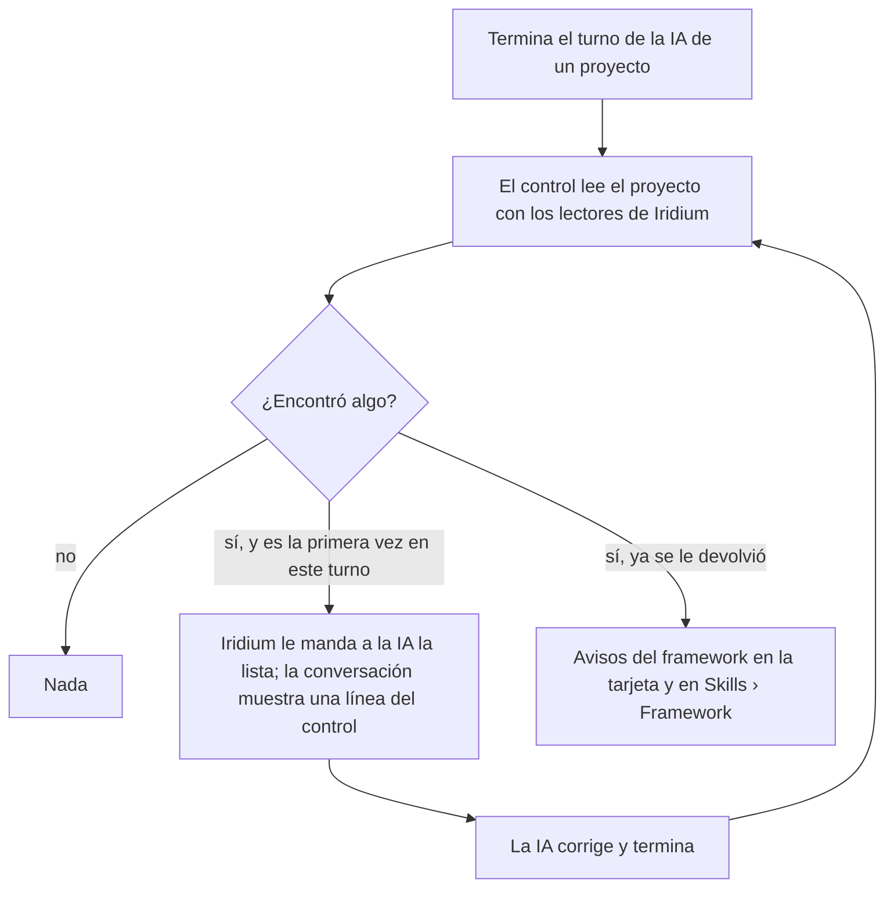
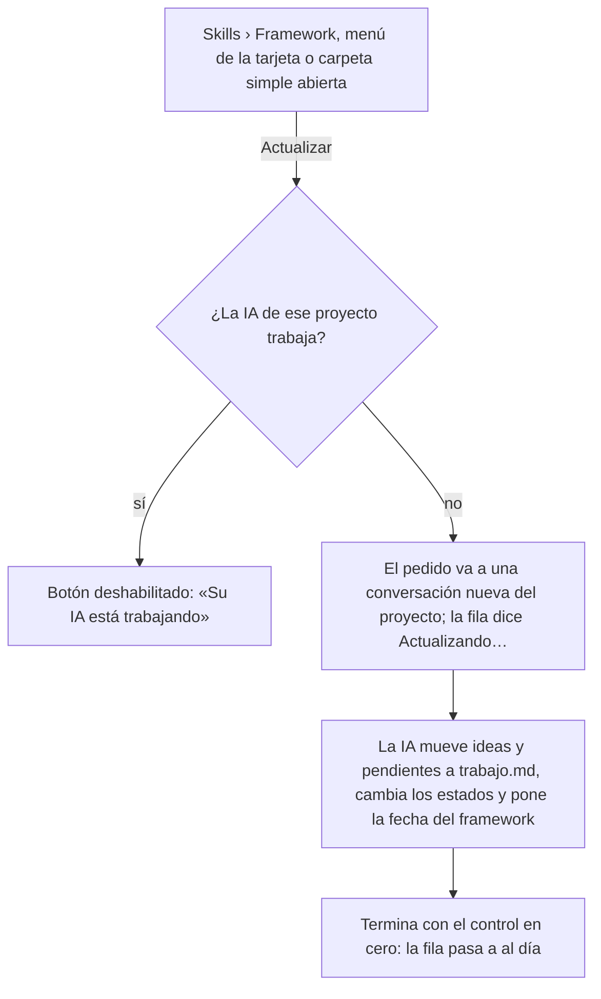

# UX

**Fecha:** 2026-11-06 (reescrito entero por el frente Orden, D-091; la versión anterior, del 2026-10-22, está en git)

Cómo se usa Iridium, tal como queda con el frente Orden: las historias, los flujos, la arquitectura de información y cada pantalla con sus estados. Baja fidelidad: los colores, las letras y las medidas están en `06-ui.md`. No hay notas «Ajustado por…»: lo que cambió una decisión ya está escrito acá, y la decisión se cita.

Las historias, flujos y piezas de los módulos siguen en su `ux.md` como historia de su diseño (`modulos/revision/ux.md`, `skills/ux.md`, `apariencia/ux.md`, `inicio/ux.md`, `compartir/ux.md`, `orden/ux.md`); las pantallas de todas las secciones están acá. Hasta que el frente Orden se construya, la app difiere de esto en lo que dicen sus iteraciones (`modulos/orden/estado.md`).

**Palabras:** lo que espera del usuario está en su **bandeja** (D-097); lo que hace la IA es **trabajo** (`T-n`, D-094); las reglas con las que se trabaja un proyecto son el **framework** y lo que Iridium revisa contra ellas, el **control** (D-092, D-099). Una carpeta sin `docs/estado.md` es una **carpeta simple** (D-095).

## Historias de usuario
El usuario es siempre el mismo: quien dirige sus proyectos con la IA.

### H-1 — Ver todos mis proyectos y lo que esperan de mí
- Como usuario quiero abrir Iridium y ver todos mis proyectos, con su hito y cuántas cosas esperan de mí, para saber en segundos dónde tengo que entrar (C-1).
  - Criterios de aceptación:
    - [ ] Al abrir la app se ve Proyectos: una tarjeta por carpeta, primero los proyectos ordenados por estado y después las carpetas simples, en su grupo.
    - [ ] Cada tarjeta de proyecto muestra el ícono, el nombre (`nombre` de la ficha o la carpeta), el hito, la línea del frente activo (o el Próximo paso, si no tiene frentes) y, arriba a la derecha, cuántas cosas tiene en la bandeja.
    - [ ] La cuenta es neutra; si algo frena, es amarilla y lleva «!» (no solo color).
    - [ ] El botón de inicio tiene el total de la bandeja de todos los proyectos, con la misma regla; es el único total de la app.
    - [ ] Los archivados no se ven, salvo con el filtro «Archivados».
    - [ ] Los datos se actualizan solos cuando cambia un archivo, sin recargar.

### H-2 — Ver qué IA está trabajando, terminada o con error
- Como usuario quiero ver en todo momento qué proyectos tienen su IA trabajando, terminada o con error, para no dejar un proyecto frenado sin darme cuenta (C-50).
  - Criterios de aceptación:
    - [ ] Cada proyecto abierto es una pestaña en la barra de título, con su estado en palabra o símbolo: trabajando · terminada sin ver · error · nada.
    - [ ] La tarjeta del proyecto muestra el mismo estado.
    - [ ] Ninguna sesión espera al usuario (D-021).

### H-3 — Abrir un proyecto y trabajar enfocado en él
- Como usuario quiero abrir un proyecto y que todo lo que veo sea de ese proyecto, para conversar con la IA mirando lo que espera de mí y en qué está (C-49, C-2).
  - Criterios de aceptación:
    - [ ] Tocar la tarjeta abre el proyecto: la Bandeja de entrada si tiene algo, si no el Mapa; la conversación a la derecha.
    - [ ] La conversación mide 360 px, su borde se arrastra entre 300 px y la mitad de la ventana y la app recuerda el ancho de cada vista (D-098).
    - [ ] Nada de la vista muestra datos de otro proyecto, salvo las pestañas y el total del botón de inicio.

### H-4 — Retomar un proyecto con «Seguí»
- Como usuario quiero retomar un proyecto con un botón, sin repetir contexto, para seguir donde quedó la IA (C-3).
  - Criterios de aceptación:
    - [ ] Al abrir un proyecto sin sesión en marcha se ve la última conversación (también si se empezó en VS Code) y los botones **Seguí** y **Nueva**.
    - [ ] **Seguí** arranca una sesión que lee `estado.md` y sigue el Próximo paso; no gasta uso hasta que se toca.
    - [ ] También se puede escribir un mensaje propio.

### H-5 — Que la IA trabaje sin esperarme
- Como usuario quiero que la IA trabaje sin pedirme permisos ni quedarse esperándome, y que lo que necesite de mí lo deje en mi bandeja, para que ninguna sesión quede parada (C-5, D-021).
  - Criterios de aceptación:
    - [ ] Las sesiones no piden permisos (modo *bypass*, D-038).
    - [ ] La IA no pregunta en la conversación: escribe la `Q-n` en `estado.md`, cierra la iteración (estado al día y Próximo paso) y la sesión termina.
    - [ ] Al terminar, la conversación muestra las preguntas que dejó con **Responder**.

### H-6 — Cambiar de proyecto sin cortar la IA
- Como usuario quiero pasar a otro proyecto mientras la IA del primero sigue, para no esperar (C-50).
  - Criterios de aceptación:
    - [ ] Cambiar de proyecto o de sección no frena ni reinicia ninguna sesión.
    - [ ] Al volver a un proyecto está como lo dejé: la sección, la conversación, el documento abierto y la posición.

### H-7 — Ver en qué está el proyecto
- Como usuario quiero ver el plan del proyecto y, en operación, en qué está cada frente, para saber qué está hecho, qué está en curso y qué falta (C-13, A-5).
  - Criterios de aceptación:
    - [ ] Los hitos van en una fila corta, con su estado en palabra o símbolo; tocar uno abre su detalle.
    - [ ] Antes de operación manda el hito actual: su Próximo paso, sus pasos o iteraciones y «En tu bandeja».
    - [ ] En operación mandan los frentes: el activo con su paso `en curso` (no el primero sin completar), su Próximo paso, su trabajo `en curso` y sus preguntas; una línea para los que esperan y otra para los que están en operación.
    - [ ] El Mapa lee solo las palabras del vocabulario de estados; una palabra de afuera se muestra tal cual, en gris, con un aviso del framework.

### H-8 — Abrir el documento de lo que veo
- Como usuario quiero tocar algo del Mapa o un código y leer la sección que lo detalla, para ir al detalle sin buscar (C-14).
  - Criterios de aceptación:
    - [ ] Tocar un hito, un paso o un frente abre su documento en la sección que corresponde.
    - [ ] Un código lleva a donde nace: `Q-n` a la Bandeja de entrada, `T-n` a Trabajo, `R-n` a Revisión, el resto a Docs; una cita `archivo.md` › Título, a esa sección.
    - [ ] Se vuelve en un paso (Atrás o el botón lateral del mouse).

### H-9 — Ver mi bandeja por proyecto y por frente
- Como usuario quiero ver qué proyectos esperan algo de mí y, al elegir uno, todo lo suyo junto y separado por frente, con lo necesario para decidir, para responder en tanda sin buscar el contexto (C-21, D-022, OR-6).
  - Criterios de aceptación:
    - [ ] La Bandeja de entrada general tiene una columna con los proyectos y su cuenta, primero los que tienen algo que frena.
    - [ ] Al elegir uno se ven todas sus preguntas, primero las que frenan; cada una dice su frente si no es del núcleo.
    - [ ] Si hay preguntas de más de un frente, arriba hay filtros por frente con su cuenta («Todos 3 · Núcleo 2 · Compartir 1»).
    - [ ] Lo que cita una pregunta se ve dentro de ella, plegado si es largo; **Ver entero** abre el documento en el panel derecho.
    - [ ] Las respondidas sin procesar van debajo, se pueden corregir; las preguntas en pausa van al final, plegadas, y no se cuentan.

### H-10 — Responder una decisión
- Como usuario quiero elegir una opción y agregar una nota, para responder una decisión en tres pasos o menos (C-22).
  - Criterios de aceptación:
    - [ ] Se ven el contexto y las opciones, con la recomendada marcada.
    - [ ] Elegir, escribir la nota opcional y **Enviar**; la respuesta queda en `docs/respuestas/Q-n.md`.
    - [ ] Se puede responder con texto libre («Otro»); un «Otro» con texto y sin nota ya es una respuesta (R-11).

### H-11 — Hacer una prueba como lista
- Como usuario quiero marcar cada punto de una prueba y escribir en el que falló, para que la IA sepa exactamente qué arreglar (C-23).
  - Criterios de aceptación:
    - [ ] Cada punto es una casilla con un campo de nota; no hay opciones «Todo bien · Algo falla».
    - [ ] La respuesta repite cada punto, marcado o no, con su nota (D-019).
    - [ ] Se puede guardar a medias y seguir después.

### H-12 — Ver el uso y el contexto
- Como usuario quiero ver siempre cuánto llevo usado de la suscripción y cuánto contexto lleva cada conversación, para saber si me alcanza y cuándo conviene un chat nuevo (C-7, D-023).
  - Criterios de aceptación:
    - [ ] La barra de estado muestra el porcentaje usado de la ventana de 5 horas y de la semana; tocarlos dice cuándo se libera cada una y si el ritmo alcanza (D-031, D-045, D-059).
    - [ ] Se actualiza con cada respuesta; al abrir la app se lee sin gastar uso.
    - [ ] Cada conversación muestra su contexto usado; pasado el 80 % se marca y sugiere una conversación nueva.
    - [ ] En la conversación se eligen el modelo y el esfuerzo; cada proyecto recuerda los suyos (C-58).

### H-13 — Enterarme cuando una sesión termina
- Como usuario quiero un aviso cuando la IA de un proyecto que no estoy mirando termina, deja preguntas o falla, para responder sin vigilar las pestañas (C-51, D-022).
  - Criterios de aceptación:
    - [ ] El aviso dice el proyecto y qué pasó («Beta terminó y dejó 2 preguntas»), con **Responder** (su Bandeja de entrada) si dejó preguntas, y **Abrir**.
    - [ ] Si el proyecto está a la vista no hay aviso: se ve en la conversación.
    - [ ] No queda una lista de avisos: queda la pestaña.

### H-14 — Detener a la IA
- Como usuario quiero frenar a la IA en el acto si va por mal camino (C-54, D-024).
  - Criterios de aceptación:
    - [ ] Mientras la sesión trabaja, la conversación muestra **Detener**.
    - [ ] Detener frena en el acto, sin confirmación; lo hecho queda y la conversación dice «Detuviste a la IA».
    - [ ] Se retoma con **Seguí** o con un mensaje, con todo el contexto.

### H-15 — Mirar los archivos del proyecto
- Como usuario quiero ver los archivos del proyecto tal cual, para mirar «bajo el capó» sin abrir VS Code (C-55, D-041).
  - Criterios de aceptación:
    - [ ] Archivos muestra el árbol sin `node_modules` ni `.git`; un archivo de texto se ve con colores y números de línea, una imagen se ve, un markdown como texto.
    - [ ] No se edita nada; un archivo muy grande o binario lo dice.

### H-16 — Mirar el git del proyecto
- Como usuario quiero ver qué cambió en el proyecto y cuándo, para controlar lo que hizo la IA (C-56, D-041, D-058, D-081).
  - Criterios de aceptación:
    - [ ] Git muestra la rama, si está solo en la PC o también en GitHub (y cuántos commits faltan subir), los cambios sin guardar y el historial, en secciones que se pliegan.
    - [ ] Al elegir un commit se ven sus archivos y, al elegir uno, el antes y el después, con signo además del color.
    - [ ] Sin repositorio, **Inicializar repositorio**; solo en la PC, **Publicar en GitHub**.

### H-17 — Volver a una conversación anterior
- Como usuario quiero ver las conversaciones anteriores del proyecto y abrir una, para no perderlas al empezar una **Nueva** (C-57).
  - Criterios de aceptación:
    - [ ] El historial de la conversación lista las del proyecto, la más nueva arriba, con título, fecha y de dónde vienen (Iridium o VS Code).
    - [ ] Elegir una la muestra y lo que se escribe la continúa.

### H-18 — Anotar una idea sin la IA
- Como usuario quiero anotar una idea para un proyecto (o suelta) en un campo, sin abrir una sesión, para no perderla ni gastar uso (OR-4, A-4).
  - Criterios de aceptación:
    - [ ] En Ideas y en el Trabajo de un proyecto hay un campo **Anotar una idea**; en Ideas se elige el proyecto o «Suelta».
    - [ ] Al anotar, la idea aparece enseguida como `T-n` `nueva` en el `trabajo.md` del proyecto (o en `Ideas/ideas.md`), sin abrir una sesión.
    - [ ] Si no se pudo escribir, el texto queda en el campo con el motivo y **Reintentar**.

### H-19 — Ver el trabajo de un proyecto
- Como usuario quiero ver en un solo lugar las ideas y lo que la IA va a hacer, está haciendo e hizo, para saber qué falta sin juntar listas (OR-4, D-094).
  - Criterios de aceptación:
    - [ ] Trabajo muestra los `T-n` del proyecto con filtros por estado y, si hay más de un frente, por frente.
    - [ ] «Todos» muestra lo que falta y deja plegados al final los hechos y los descartados.
    - [ ] Cada ítem se despliega con su texto, su origen enlazado y lo que lo cerró.

### H-20 — Pasar un proyecto al framework
- Como usuario quiero ver qué proyectos no siguen el framework y pasarlos con un botón, para que todos se vean igual en Iridium (OR-8, A-9).
  - Criterios de aceptación:
    - [ ] Skills › Framework lista los proyectos con el framework viejo o con avisos, y las carpetas simples, cada uno con **Pasar al framework**.
    - [ ] **Pasar al framework** también está en el menú de la tarjeta y en una carpeta simple abierta.
    - [ ] El pedido va a la conversación de ese proyecto (gasta uso, y lo dice); mientras pasa, la fila dice «Pasando al framework…».

### H-21 — Que la IA no deje nada mal escrito
- Como usuario quiero que lo que la IA escribe mal (una pregunta, un estado) Iridium se lo devuelva antes de que yo lo vea, para no tener que corregir formatos (OR-2).
  - Criterios de aceptación:
    - [ ] Al terminar cada turno, si el control encuentra algo, la IA recibe un mensaje con la lista y lo corrige en la misma sesión (una vez por turno).
    - [ ] Ese mensaje se ve en la conversación como una línea del control, no como un mensaje del usuario.
    - [ ] Lo que quede sin corregir aparece en la tarjeta («! 2 avisos del framework») y en Skills › Framework.

### H-22 — Poner la versión nueva de Iridium con un botón
- Como usuario quiero un solo botón que arme la versión nueva y reinicie Iridium con ella, para no tener que entender si hay que armar o reiniciar (R-12).
  - Criterios de aceptación:
    - [ ] Cuando hay cambios sin armar o una versión lista, la barra de estado muestra **Actualizar**; si no, nada.
    - [ ] Actualizar arma si hace falta y, al terminar, reinicia solo; mientras arma, la app se sigue usando y se puede **Cancelar**.
    - [ ] Si hay sesiones trabajando al reiniciar, pregunta (F-6); si el armado falla, lo dice con **Reintentar** y **Ver la consola**.

## Flujos

### F-1 — Abrir y retomar un proyecto


### F-2 — La IA necesita algo del usuario

Ninguna sesión queda esperando (D-021): mientras el usuario no responde, la sesión está terminada y no gasta uso.

### F-3 — Responder desde la Bandeja de entrada

Una decisión se responde en tres pasos: tocar el proyecto, elegir la opción, enviar.

### F-4 — De un código a su documento y de vuelta


### F-5 — Errores del motor


### F-6 — Cerrar o reiniciar con sesiones trabajando


### F-7 — Actualizar Iridium


### F-8 — El control al terminar un turno


### F-9 — Actualizar al framework (D-133)


## Arquitectura de información

### Lo que se sigue y dónde se ve
Cada una de las cuatro cosas del modelo (`modulos/orden/definicion.md` › El modelo único) tiene una sección que la muestra entera y, en los demás lugares, solo su cuenta o un enlace:

| Qué | Sección que la muestra | Dónde aparece además |
|---|---|---|
| Preguntas (`Q-n`) | **Bandeja de entrada** (general y de cada proyecto) | la cuenta del botón de inicio, la tarjeta y la pestaña; el Mapa las enlaza |
| Trabajo (`T-n`) | **Trabajo** del proyecto; las ideas nuevas de todos, en **Ideas** | el Mapa muestra lo `en curso` |
| Comentarios (`R-n`) | **Revisión** del proyecto | — |
| Decisiones (`D-n`) | **Docs** (`decisiones.md`) | como enlaces en todo el texto |

Los scripts no se siguen: son herramientas y viven solo en **Scripts**. Una pregunta que cita un script lo muestra con su botón dentro, como cualquier cita.

### Un número que manda
- **El total** de la bandeja está en un solo lugar: el botón de inicio, arriba a la izquierda, visible desde todas las pantallas. El ícono de la Bandeja de entrada no repite el número.
- **Por proyecto,** la cuenta va en su tarjeta y en su pestaña; la cabecera del proyecto no la repite.
- **Se dice de una forma:** «3», y en el texto «3 en la bandeja».
- **El amarillo es solo para lo que frena:** una cuenta sin nada que frene es neutra; con algo que frena, amarilla y con «!». En la Bandeja de entrada, solo las preguntas que frenan llevan borde amarillo; **Enviar** es el botón principal de la app, no amarillo.
- **Las preguntas en pausa** no se cuentan y se ven aparte, plegadas.
- La cuenta de comentarios abiertos de Revisión no va en amarillo: esperan a la IA, no al usuario.

### El esqueleto
Barra de íconos a la izquierda; barra de título con el botón de inicio, una pestaña por proyecto abierto y los botones de Windows (D-041); el área principal; la conversación a la derecha, siempre a la vista (D-098); la barra de estado abajo (D-031). Toda sección usa la misma cabecera (W-9).

### Vista general (el botón de inicio)
Barra de íconos, en este orden (`Ctrl+1` a `Ctrl+3`); sin la Bandeja de todos (D-111, en la app desde DI-I3 tanda 4): lo que espera de cada proyecto está en su Bandeja de entrada y, desde la grilla, en la cuenta de su tarjeta.

1. **Proyectos** — la grilla (W-2).
2. **Skills** — las skills de la PC y, primero, **Framework**: qué proyectos lo siguen (W-13).
3. **Ideas** — las ideas sueltas, con la misma forma que Ideas de un proyecto (W-10, D-128).

Abajo, **Ajustes** (W-17). La conversación de la vista general es el chat general (la carpeta `Ideas`); en Skills es el chat de `Skills`. Las carpetas `Ideas` y `Skills` están en la carpeta de Iridium, aparte de los proyectos (D-083); **Abrir como proyecto**, en la cabecera de Ideas y de Skills, las abre en la vista de proyecto.

### Vista de un proyecto
Barra de íconos en dos grupos. Arriba, **lo que se sigue**; abajo, separado por una línea, **el proyecto por dentro**:

| Sección | Qué muestra | Pantalla |
|---|---|---|
| **Bandeja de entrada** | Las preguntas del proyecto, con filtros por frente | W-5 |
| **Mapa** | Los hitos y, en operación, los frentes | W-7 |
| **Revisión** | Los comentarios `R-n` | W-14 |
| **Docs** | Los documentos | W-8 |
| **Archivos** | El árbol del proyecto | W-15 |
| **Git** | Los cambios y el historial | W-15 |
| **Scripts** | Un botón por script | W-16 |

Abajo, **Ajustes del proyecto**. Se entra a la Bandeja de entrada si hay algo y, si no, al Mapa. Una carpeta simple muestra solo el segundo grupo (W-3).

### Cómo se va de un lado a otro
- Botón de inicio → la vista general, en la última sección elegida.
- Tarjeta → el proyecto. Pestaña → el proyecto, como se lo dejó.
- Bandeja de entrada general → **Abrir** → el proyecto, en su Bandeja de entrada.
- Mapa → una pregunta de «En tu bandeja» → la Bandeja de entrada, en esa pregunta; un trabajo `en curso` → Trabajo, en ese ítem; un frente → su `estado.md` en Docs.
- Ideas → una idea de un proyecto → su Trabajo, en ese ítem.
- Un código en cualquier texto → donde nace (F-4).
- Aviso de una sesión que terminó → **Responder** (su Bandeja de entrada) o **Abrir**.
- «! avisos del framework» de una tarjeta → el proyecto, en Docs, con la lista.
- Cambiar de sección o de proyecto no corta ni recarga nada (H-6).

## Pantallas
Los dibujos dicen qué va y dónde, no cómo se ve. Los íconos de la barra se dibujan con figuras (◆ inicio, ■ Proyectos, ▼ Bandeja de entrada, ✶ Ideas, ◇ Skills, ◈ Mapa, ▪ Trabajo, ◉ Revisión, □ Docs, ▫ Archivos, ↔ Git, ▶ Scripts, ◎ Ajustes); los de verdad están en `ui/iconos/`.

### W-1 — El esqueleto de la app
- Propósito: lo que está siempre, en cualquier pantalla.

```
┌────┬─[Alfa · 2 ×][Beta · 1! ×]────────────────────────────────[─ □ ×]┐
│◆ 3!│                                                                 │
├────┤                                                                 │
│ ■  │            área principal             │  conversación (W-12)    │
│ ▼  │                                       │                         │
│ ✶  │                                       │                         │
│ ◇  │                                       │                         │
│ ◎  │                                       │                         │
├────┴───────────────────────────────────────┴─────────────────────────┤
│ ✓ Claude · Pro  Hito 10 · Operación  [Actualizar]  5 h 15 %  Sem 22 %│
└──────────────────────────────────────────────────────────────────────┘
```
- **Botón de inicio:** lleva a la vista general y tiene el único total de la bandeja. Sin nada, sin número; con algo que frena, amarillo y «!».
- **Pestañas:** el nombre del proyecto, su cuenta (misma regla de color) y el estado de su sesión (W-4). La activa se marca con la línea de abajo, nunca en amarillo. Cada proyecto abierto queda como pestaña, también al volver a abrir la app, hasta cerrarla con × (D-043).
- **Barra de estado,** de izquierda a derecha: la cuenta de Claude (con un error, el chip rojo es un botón que inicia sesión, CO-1), el hito del proyecto abierto, **Actualizar** cuando hay algo, el uso (W-4).
- **Actualizar** (R-12, F-7) reemplaza a «Hay cambios sin armar · Armar» y a «Versión nueva lista · Reiniciar ahora»:

| Estado | Qué se ve | Qué hace |
|---|---|---|
| Al día | nada | — |
| Hay cambios sin armar, o una versión lista (armada, o bajada de GitHub en una copia compartida, D-085) | **Actualizar**, con el detalle en el título («Trae «…» (abc123) y lo anterior que falte») | Arma si hace falta y reinicia |
| Armando | «Actualizando… · 1 min», con el ícono girando, y **Cancelar** | La app se sigue usando; al terminar, reinicia sola |
| Hay sesiones trabajando al reiniciar | La confirmación de F-6, con **Esperar** y **Reiniciar igual** | Esperar deja la versión lista y reinicia sola cuando terminan |
| Falló el armado | Chip rojo «No se pudo actualizar», el motivo en el título, **Reintentar** y **Ver la consola** | — |
| La IA de Iridium está trabajando | **Actualizar** deshabilitado: «Espera a que la IA de Iridium termine» | No arma a mitad de camino |

  Si el usuario cierra Iridium con una versión lista, entra al cerrar. El armado se mira cada diez segundos y solo cuentan los commits (CO-6).

### W-2 — Proyectos
- Propósito: ver todos los proyectos y entrar a uno (H-1, H-2).

```
Proyectos · 14                      [+ Nuevo proyecto] [Abrir como proyecto]
(En desarrollo 5) (En uso 3) (Carpetas 6) (Archivados)
┌────────────────────────┐ ┌────────────────────────┐ ┌────────────────────┐
│ ◈ Alfa              2! │ │ ◈ Beta               1 │ │ □ Gamma            │
│ Hito 10 · Operación    │ │ Hito 7 · Construcción  │ │ carpeta            │
│ Orden · 4. UX          │ │ Próximo: probar la I-3 │ │                    │
│ ● Trabajando · 2 min   │ │                        │ │                    │
│ ! 2 avisos del framew… │ │                        │ │[Pasar al framework]│
└────────────────────────┘ └────────────────────────┘ └────────────────────┘
```
- **Tarjeta de proyecto:** ícono, nombre (de la ficha o de la carpeta, A-12), la cuenta de la bandeja arriba a la derecha, el hito, la línea del frente activo («Orden · 4. UX») o, sin frentes, la del Próximo paso, y el estado de su sesión si tiene una. Va con los de su estado (en desarrollo, en uso, idea, pausado, en rescate, descontinuado, para eliminar); el estado se ve con ícono y palabra (D-034).
- **Avisos del framework:** lo que el control no logró que la IA corrigiera, «! 2 avisos del framework»; al tocarlo se abre el proyecto en Docs con la lista. Sin avisos, la línea no está.
- **Framework viejo:** un proyecto que todavía no pasó al framework dice «framework viejo» junto al hito.
- **Tarjeta de carpeta simple (D-095):** ícono, nombre y «carpeta»; **Pasar al framework** aparece al pasar el mouse o con el foco. Van en su grupo, después de los proyectos.
- **Menú de la tarjeta** (clic derecho o `…`): Abrir en VS Code, Abrir la carpeta, cambiar el estado, archivar, cambiar el ícono, **Pasar al framework** (en carpetas simples y con framework viejo) y Eliminar, que pide confirmación y manda a la papelera (D-089, D-090).
- **Filtros:** los estados con su cuenta, «Carpetas» y «Archivados» (apagado los oculta; prendido, aparecen al final, más tenues). La app recuerda el filtro.
- **Nuevo proyecto** crea la carpeta con la plantilla básica del framework y la abre, sin la IA: la idea se le cuenta después en la conversación (D-101); **Abrir como proyecto** abre cualquier carpeta en la vista de proyecto.
- Estados:
  - **Cargando:** las tarjetas con su forma, sin texto.
  - **Vacío:** «Todavía no hay proyectos. **Nuevo proyecto**».
  - **Sin carpeta de proyectos** o que no se puede leer: el recuadro con la ruta y **Elegir la carpeta** (CO-4).
  - **Carpetas `Ideas` o `Skills` de antes** en la carpeta de proyectos: un aviso arriba con **Mover** (D-083).
  - **Extremos:** ficha rota → «sin clasificar», al final, gris; nombre largo → «…» y entero al pasar el mouse; más de 99 → «99+».

### W-3 — Un proyecto por dentro y la carpeta simple
- Propósito: entrar a un proyecto y moverse por sus secciones (H-3).

```
Proyecto                     Carpeta simple
┌────┐                       ┌────┐
│ ▼  │ Bandeja de entrada    │ ▫  │ Archivos ┌ Esta carpeta no sigue el framework ┐
│ ◈  │ Mapa                  │ ↔  │ Git      │ Se ve y se conversa, sin Mapa,     │
│ ▪  │ Trabajo               │ ▶  │ Scripts  │ Trabajo ni preguntas.              │
│ ◉  │ Revisión              │    │          │               [Pasar al framework] │
│ ── │                       │ ◎  │          └────────────────────────────────────┘
│ □  │ Docs                  └────┘
│ ▫  │ Archivos
│ ↔  │ Git
│ ▶  │ Scripts
│ ◎  │ Ajustes del proyecto
└────┘
```
- **Dos grupos** en la barra de íconos, separados por una línea. El ícono de la Bandeja de entrada no lleva número (lo tiene la pestaña); el de Revisión lleva los comentarios abiertos, neutro.
- **Sin cabecera del proyecto** (D-125): el nombre lo dice su pestaña y el hito, el Mapa. La Bandeja de entrada es solo bandeja: los scripts están en su sección.
- **Se entra** a la Bandeja de entrada si hay algo y, si no, al Mapa. Una carpeta simple entra a Archivos, con el recuadro arriba; Scripts aparece solo si tiene `scripts.md`.
- **El botón lateral del mouse** vuelve un paso (D-044).
- Estados: el proyecto ya no está en la carpeta de proyectos (se borró o se cambió de carpeta) → «Este proyecto ya no está en la carpeta de proyectos» y **Volver a Proyectos**.

### W-4 — Pestañas, uso y avisos
- Propósito: saber qué hace cada sesión, cuánto uso queda y enterarse cuando algo termina, desde cualquier pantalla (H-2, H-12, H-13).

```
 [Alfa · ● ×] [Beta · 2 ×] [Gamma · ✕ ×]            pestañas, arriba

                                  ┌ Beta terminó ───────────────┐
                                  │ Dejó 2 preguntas; una frena │
                                  │          [Abrir] [Responder]│
                                  └─────────────────────────────┘
 5 h 34 % · Sem 61 %                                barra de estado
```
- **Pestañas:** ● trabajando · ✓ terminada sin ver · ✕ error · su cuenta de la bandeja · nada. Tocar una abre el proyecto; × la cierra sin borrar la conversación.
- **Uso:** la ventana de 5 horas y la semana; tocarlos abre el detalle (cuándo se libera cada una y si el ritmo alcanza, D-059). Desde el 90 % se marca; agotado, «agotado · se libera a las 18:40».
- **Avisos:** cuando una sesión que no está a la vista termina, deja preguntas o falla; dentro de un proyecto van a la izquierda de la conversación. Se van solos a los pocos segundos (no con el mouse encima) o con `Esc`.
- **Extremos:** muchas pestañas → las que no entran se juntan en «+3», primero las que dejaron preguntas o fallaron; varios avisos → hasta tres y «y 2 más»; uso sin leer → «Uso —».

### W-5 — Bandeja de entrada
> **La vista general (la Bandeja de todos) está fuera desde DI-I3 tanda 4 (D-111):** queda la de cada proyecto.

- Propósito: ver qué proyectos esperan algo y responder todo lo de uno, con lo necesario para decidir ahí (H-9 a H-11, F-3).

Vista general:
```
┌ Bandeja de entrada ─┬───────────────────────────────────────────────────────┐
│ ◈ Alfa         2!   │ Alfa · 2                            [Abrir] [▶ Seguí] │
│ ◈ Beta         1    │ (Todos 2) (Núcleo 1) (Compartir 1)                    │
│ ◈ Delta        1    │ ┃ Q-126 tarea · Compartir · Frena                     │
│                     │ ┃ Invitá a la otra persona al repo de Iridium         │
│                     │ ┃ › Mostrar detalles                                  │
│                     │ ┃ [ ] Le pasé la carpeta…      [Nota, si falló     ]  │
│                     │ ┃                    [Guardar a medias] [Enviar]      │
│                     │   Q-130 prueba                                        │
│                     │   …                                                   │
│                     │ Respondidas sin procesar · 1                          │
│                     │ › En pausa · 2                                        │
└─────────────────────┴───────────────────────────────────────────────────────┘
```
- **La columna:** los proyectos con algo en la bandeja, primero los que tienen algo que frena, después por la pregunta más vieja. El «!» se explica en su título («frena el proyecto»). Se entra con el primero; desde un aviso o un proyecto, con ese.
- **La cabecera del proyecto elegido:** nombre y cuenta, **Abrir** y **Seguí** (arranca la sesión sin abrirlo; se resalta cuando no queda nada sin responder; no está si la sesión ya trabaja).
- **Las preguntas,** una debajo de la otra: primero las que frenan (borde amarillo y chip **Frena**), después las a medias y las demás. Cada una dice su tipo y su frente si no es del núcleo.
- **Filtros por frente,** solo si hay preguntas de más de uno, con su cuenta.
- **Contexto dentro:** en «Mostrar detalles», cada código y cada cita del contexto con su texto; lo largo, plegado. **Ver entero** abre el documento en el panel derecho (angosto, se cierra con × o `Esc`), con los códigos como enlaces. Un script citado se muestra con su botón.
- **El formulario:** decisión (opciones con la recomendada marcada, Otro, nota), prueba o tarea (W-6), consulta (texto). Cada pregunta tiene su **Enviar** y **Postergar**. Lo escrito en una no se pierde al pasar a otra ni a otro proyecto.
- **Respondidas sin procesar:** debajo, con lo elegido y **Corregir**, hasta que la IA las procesa. **En pausa:** al final, plegadas, sin contar.
- **En un proyecto:** la misma lista, sin la columna; la cabecera dice «Bandeja de entrada · 2».
- Estados:
  - **Vacía:** «Nada en tu bandeja. Cuando la IA necesite algo de vos, aparece acá».
  - **Cargando:** siluetas en la columna y en la lista.
  - **No se pudo leer un proyecto:** en la columna, «No se pudo leer» con el motivo.
  - **No se pudo guardar:** aviso en esa pregunta, lo escrito queda, **Reintentar**.
  - **La respuesta cambió afuera mientras se respondía:** aviso, sin pisar ninguna de las dos.
  - **Una pregunta mal escrita:** «La IA la corrige al terminar el turno», sin formulario hasta entonces (F-8).
  - **Cita que no se encuentra:** la cita como texto, con «No se encontró la sección».

### W-6 — Responder una prueba
- Propósito: cómo se ve, dentro de la Bandeja de entrada, una prueba o una tarea (H-11).

```
┃ Q-12 prueba · Frena
┃ ¿La I-4 funciona como esperabas?
┃ › scripts.md › Instalar la última versión            [Ejecutar]
┃
┃ [x] Abre la app sin errores          [nota                    ]
┃ [ ] Clasifica en la bandeja          [no aparece la de Beta   ]
┃ [x] La cuenta baja al responder      [nota                    ]
┃
┃ Nota general: [                                               ]
┃                       [Guardar a medias] [Postergar] [Enviar]
```
- Una casilla por punto, cada una con su nota; sin opciones (H-11).
- **Guardar a medias** guarda sin enviar, en los datos de Iridium (D-039): queda «a medias» y la IA no la ve.
- Estados: los de W-5.

### W-7 — Mapa de un proyecto
- Propósito: ver en qué está el proyecto y llegar al detalle (H-7, H-8).

En operación:
```
Alfa · Hito 10 · Operación                           [Abrir 10-operacion.md]
Hitos  0 1 2 3 4 5 6 7 8 9 ■10                               9 de 10 hechos
┌ Frente activo ────────────────────────────────────────────────────────────┐
│ Orden   4. UX · en curso                                [Abrir estado.md] │
│ Próximo paso                                                              │
│ Con las pantallas aprobadas, reescribir 04-ux.md sin capas.               │
│ En curso                          │ En tu bandeja · 1                     │
│ T-12 Bandeja agrupada por frente  │ Q-139 ¿Las pantallas van así? Frena › │
├───────────────────────────────────────────────────────────────────────────┤
│ En espera      Diseño · Capacidades                                       │
│ En operación   Compartir · Skills · Inicio · Apariencia · Revisión        │
└───────────────────────────────────────────────────────────────────────────┘
Lo último de la IA: «Escribí las pantallas de Orden…» · hace 10 min  [Ver]
```
- **Hitos:** una fila corta, cada uno con su estado (`hecho` ✓, `en curso` ■, `pendiente` □, `en pausa` y `descartado` con su palabra). Tocar uno abre su detalle debajo: su portón y, en el de construcción, sus iteraciones.
- **En operación** (o con frentes): manda el bloque de frentes. El activo, grande, con su paso `en curso`, su Próximo paso, su trabajo `en curso` y las preguntas de ese frente. Debajo, una línea para los `pendiente` («En espera») y otra para los `hecho` («En operación»). Tocar un frente abre su `estado.md` en Docs.
- **Antes de operación:** el detalle del hito actual, con su Próximo paso, sus pasos o iteraciones y «En tu bandeja».
- **Lo último de la IA:** la primera línea de su última respuesta, con **Ver** (la conversación) (D-035).
- Estados:
  - **Sin `estado.md`:** es una carpeta simple (W-3).
  - **Sin frentes en operación:** el detalle del hito 10 en lugar del bloque.
  - **Hito sin documento o sin portón:** el hito sin pasos, con su estado.
  - **Un estado fuera del vocabulario:** el chip dice la palabra tal cual, en gris, y hay un aviso del framework.
  - **Extremos:** muchas iteraciones → las últimas y «+12 anteriores».

### W-8 — Docs del proyecto
- Propósito: leer los documentos con los códigos como enlaces (H-8).

```
[estado.md ▾] [Próximo paso ▾]                         [← Atrás] [Ancho ▾]
┌──────────────────────────────────────────────────────────────────────────┐
│ ## Próximo paso                                                          │
│ Orden: reescribir 04-ux.md … (D-091) ← enlace                            │
│                                                                          │
│ | Módulo | Paso | Estado |   ← la tabla usa el ancho de la sección       │
└──────────────────────────────────────────────────────────────────────────┘
```
- El documento y la sección se eligen con menús arriba; la hoja va centrada con un ancho de lectura elegible (D-035).
- **Tablas (A-10):** usan el ancho de la sección y, si no entran, se desplazan de costado dentro de su recuadro, no la página entera.
- **Dibujos en texto:** con la letra de ancho fijo, que tiene las líneas de cuadro y las figuras (R-13).
- Los diagramas Mermaid se ven como código.
- Estados: documento que no existe → aviso y el menú; sección que no existe → el principio, con «No se encontró la sección»; el documento cambia mientras se lee → se actualiza sin perder la posición.

### W-9 — La cabecera de una sección
- Propósito: que todas las secciones se lean igual (A-8).

```
┌────────────────────────────────────────────────────────────────┐
│ Trabajo · 34                          [+ Anotar una idea]  […] │
│ (Todos 25) (Nuevas 6) (Pendientes 9) (En curso 2) …  Frente ▾  │
├────────────────────────────────────────────────────────────────┤
```
- Título y cuenta a la izquierda; una o dos acciones a la derecha (lo demás en `…`); filtros en la segunda fila. La misma altura en todas las secciones.
- **Vacía:** debajo de la cabecera, una línea de para qué es y la acción principal («Acá van las ideas y lo que la IA va a hacer. **Anotar una idea**»). Con contenido, esa línea no está.
- El foco del teclado entra al primer elemento del contenido; `Ctrl+F` va al primer filtro donde lo hay.

### W-10 — Ideas
> **Reemplazada por D-128 (2026-11-16, Q-180):** Ideas es una lista de ideas con su estado y enlaces para revisar, en la barra de cada proyecto y en el inicio (las sueltas). Cómo se usa, en `modulos/ideas/ux.md`; las maquetas, `docs/diseno/pantallas/ideas-proyecto-c.html` e `ideas-inicio-c.html`. Mientras se construye, la app sigue con el bloc.

> **Reemplazada por D-112 y D-126 (2026-11-16):** Ideas es un bloc de notas, una sola hoja libre (`notas.md` de la carpeta Ideas; la maqueta, `docs/diseno/pantallas/ideas.html`). Lo de abajo es la versión anterior, que ya no está en la app.

- Propósito: anotar ideas sin la IA y ver las nuevas de todos los proyectos juntas (H-18, IN-1, IN-2).

```
Ideas · 12                                             [Abrir como proyecto]
┌──────────────────────────────────────────────────────────────────────────┐
│ [Una idea…                                          ] [Alfa ▾] [Anotar]  │
└──────────────────────────────────────────────────────────────────────────┘
Alfa · 5
  T-41  Exportar el plan como imagen                          2026-11-05
  T-38  Un atajo para Seguí desde la grilla                   2026-11-02
Beta · 3
  …
Sueltas · 4
  Una app de recetas con fotos                                2026-10-30
```
- **Anotar una idea:** el campo, a qué proyecto va (los que siguen el framework y «Suelta»; empieza en el último elegido) y **Anotar** (o `Enter`). Iridium la escribe como `T-n` `nueva` en el `trabajo.md` del proyecto (o en `Ideas/ideas.md` si es suelta), sin abrir una sesión. Aparece arriba de su grupo y el campo se vacía.
- **La lista:** solo las ideas `nueva`, agrupadas por proyecto (el de la idea más reciente primero) y las sueltas al final. Tocar una de un proyecto abre su `trabajo.md` en Docs, en ese ítem (D-112). Una suelta se despliega ahí mismo con su texto y **Hablar de esta idea**, que pone «Sobre la idea …» arriba del cuadro del chat general. Una idea que la IA pasa a `pendiente` sale de acá.
- **Proyectos con framework viejo:** al final, «Las ideas de 3 proyectos no aparecen: todavía no pasaron al framework. **Ver en Framework**».
- Estados: vacía («Todavía no hay ideas nuevas»); cargando (siluetas); no se pudo anotar (el texto queda en el campo, con el motivo y **Reintentar**); sin carpeta `Ideas` (se crea al anotar la primera suelta).

### W-11 — Trabajo de un proyecto
> **Fuera desde DI-I3 tanda 4 (D-112):** un proyecto ya no tiene la sección Trabajo; `trabajo.md` se lee en Docs y lo que está en curso se ve en el Mapa. Lo de abajo queda como historia.

- Propósito: ver las ideas y el trabajo de la IA en un solo lugar (H-19, H-18).

```
Trabajo · 34                                              [+ Anotar una idea]
(Todos 25) (Nuevas 6) (Pendientes 9) (En curso 2) (En pausa 1) (Hechos 7) …
En curso · 2
  T-12  Bandeja agrupada por frente             Orden    2026-11-05   ›
  T-15  El control de las preguntas             Orden    2026-11-06   ›
Pendientes · 9
  T-07  Respaldo de .iridium en GitHub          Núcleo   2026-11-04   ›
  …
Nuevas · 6
  …
› Hechos · 7     › Descartados · 2
```
- **Filtros por estado** con su cuenta; «Todos» muestra lo que falta (nuevas, pendientes, en curso, en pausa) y deja plegados al final los hechos y los descartados. **Frente ▾** filtra cuando hay más de uno.
- **Cada ítem:** código, título, frente y fecha. Tocarlo lo despliega con su texto, su origen enlazado (`D-n`, `R-n`…) y lo que lo cerró si está hecho. No se editan desde acá: los cambia la IA.
- **Anotar una idea:** el mismo campo que en Ideas, ya con este proyecto.
- Estados: vacío (W-9); framework viejo («Este proyecto todavía no pasó al framework: sus ideas y pendientes están repartidos en sus documentos. **Pasar al framework**»); un ítem mal escrito (al final, «Sin estado», con el aviso del framework).

### W-12 — La conversación
- Propósito: hablar con la IA del proyecto (o con la general, o la de Skills) sin perder de vista la sección (H-4, H-5, H-12, H-14, H-17).

```
┌ Sin conversación todavía ── [◔] [+ Nueva] [▶ Seguí] ┐
│                                                     │
│  Seguí lee el estado del proyecto y hace el         │
│  próximo paso (está en el Mapa). O escribile lo     │
│  que quieras.                                       │
│                                                     │
│ ┌─────────────────────────────────────────────────┐ │
│ │ Escribile a la IA…                              │ │
│ │ Opus · Medio                                [↑] │ │
│ └─────────────────────────────────────────────────┘ │
└─────────────────────────────────────────────────────┘
```
- Siempre a la vista, a la derecha, **360 px** (D-098); su borde se arrastra entre 300 px y la mitad de la ventana y la app recuerda el ancho de la vista general, de Skills y de cada proyecto. En una ventana de menos de 1100 px arranca en 300 px.
- **Cabecera:** el título de la conversación y su contexto usado; ◔ el historial (H-17), **Nueva** y **Seguí**.
- **Vacía:** una línea con qué hace **Seguí**, sin repetir el Próximo paso (A-7). En la vista general: «Preguntale lo que quieras sobre tus proyectos».
- **Con una conversación anterior, sin sesión:** la última, con su fecha y de dónde viene (Iridium o VS Code), y **Seguí** · **Nueva**.
- **Trabajando:** los mensajes llegan a medida que se escriben; el campo sigue disponible y, a su lado, **Detener** (H-14).
- **Terminada con preguntas:** al final, las que dejó, con **Responder** (H-5).
- **El control:** si devolvió algo, una línea «El control encontró 2 cosas mal escritas; la IA las corrige» (H-21), plegable con la lista.
- **Un comentario de la Revisión enviado:** un mensaje tuyo con su captura chica; tocarlo abre el comentario (W-14).
- **Abajo:** el modelo y el esfuerzo, que cada proyecto recuerda (C-58); en Skills e Ideas, «Sobre la skill …» o «Sobre la idea …» arriba del cuadro, con ✕.
- Estados: contexto alto (pasado el 80 %, se marca y una línea sugiere **Nueva**); errores (F-5); conversación muy larga (se carga lo último y lo anterior al subir); también usada en VS Code (aviso «Esta conversación también se usó en VS Code el …»).

### W-13 — Skills
- Propósito: ver qué proyectos siguen el framework, ver las skills de la PC por origen y hablar de ellas (H-20, SK-1 a SK-3).

Framework, la primera entrada:
```
┌ Skills ─────────────┬───────────────────────────────────────────────────────┐
│ ◇ Framework     3   │ Framework · 3 fuera                                   │
│ ─────────────────── │ (Todos 14) (Fuera del framework 3) (Carpetas 6)       │
│ Propias        12   │ ◈ Beta     framework viejo · 2026-10-20  [Pasar al…]  │
│ De plugins      8   │ ◈ Delta    framework viejo · sin fecha   [Pasar al…]  │
│                     │ ◈ Épsilon  2 avisos del framework        [Pasar al…]  │
│                     │ □ Gamma    carpeta simple                [Pasar al…]  │
│                     │ ◈ Alfa     al día · 2026-11-06                        │
└─────────────────────┴───────────────────────────────────────────────────────┘
```
- **Framework** (reemplaza a «Proyectos atrasados»): su cuenta son los proyectos fuera del framework (framework viejo o con avisos); las carpetas simples no cuentan. Cada fila: el proyecto, cómo está y **Actualizar** (F-9, D-133), que manda el pedido a una conversación nueva de ese proyecto (gasta uso; lo dice el título del botón). Mientras pasa, «Actualizando…» y **Ver la conversación**.
- **Las skills:** en grupos por origen (propias, copias de terceros, de complementos, desde la cuenta), los de afuera plegados si pasan de diez. Elegir una muestra su detalle en la columna del medio: **Resumen** (avisos y descripción) y el árbol de su carpeta con el visor de Archivos (Q-95). Solo lectura: los cambios se piden en el chat (D-018).
- **Dobles:** una skill que está dos veces lleva «!» y, en su detalle, el aviso con cuál sobra y **Pedir que la saquen** (D-014).
- **El chat de `Skills`** a la derecha, con «Sobre la skill …» arriba del cuadro.
- **Abrir como proyecto** en la cabecera.
- Estados: todo al día («Todos los proyectos siguen el framework»); la IA de ese proyecto ocupada (el botón deshabilitado, «Su IA está trabajando»); cargando (siluetas); sin skills («No hay skills en esta PC» con la ruta que se miró); cambios hechos afuera (la lista se actualiza sola).

### W-14 — Revisión
- Propósito: ver los comentarios del proyecto, su estado y reabrir (H-R5; los comentarios se dejan con `F8` en la app que se revisa, `modulos/revision/ux.md`).

```
Revisión · 3                                      (Abiertos 3) (Anotados 2) (Cerrados 12)
┌────┐ el botón queda muy pegado al título; separalo
│cap.│ Tarjeta.tsx:6 · hoy 14:32
└────┘
┌────┐ el menú no se cierra al tocar afuera
│cap.│ Menu.tsx:41 · ayer
└────┘
```
- **Grupos:** abiertos (los ve la IA), anotados (la IA los dejó para después, con dónde) y cerrados.
- **Un comentario** reemplaza la lista (**Atrás** vuelve): la captura grande, el texto, dónde (archivo y línea como enlace a Archivos), la página y la historia. Abierto: **Enviar ahora** (a la conversación). Cerrado: **Reabrir**, con una nota opcional.
- **La ronda de UX** (D-096): con cinco comentarios juntados, el control le avisa a la IA que toca.
- Estados: vacío («Todavía no hay comentarios. Abrí la app en modo desarrollo y apretá `F8`», con la extensión conectada o no); una app Electron sin la línea de la extensión (**Pedírselo a la IA**, H-R7); un comentario que no se puede leer (al final, como texto); captura que falta («sin captura»); archivo que ya no está (el enlace lo dice).

### W-15 — Archivos y Git
- Propósito: mirar el proyecto por dentro (H-15, H-16).
- **Archivos:** el árbol a la izquierda, el archivo a la derecha (texto con colores y números de línea, imágenes, markdown como texto). Un archivo muy grande o binario lo dice.
- **Git:** como el panel de VS Code (D-058): arriba, la rama y dónde está («Solo en esta PC» con **Publicar en GitHub**, o «En GitHub · usuario/nombre» con los commits por subir); debajo, Cambios e Historial, que se pliegan. Al elegir un commit, sus archivos; al elegir uno, el antes y el después. Sin repositorio, **Inicializar repositorio** (D-081).
- Estados: sin git («Este proyecto no tiene git» con **Inicializar repositorio**); sin sesión de GitHub (Publicar abre la ventana de git para iniciarla).

### W-16 — Scripts
- Propósito: lo que el usuario ejecuta a mano, en un solo lugar (A-3).
- Un botón por script de `docs/scripts.md`, con su descripción, en el orden del archivo. **Ejecutar** abre una consola (un comando) o el programa con Windows; **Abrir**, la carpeta o el archivo.
- Estados: sin `scripts.md` (la sección no aparece); sin scripts («Todavía no hay scripts»); un script que falla (la consola queda abierta con el error).

### W-17 — Ajustes
- Propósito: lo poco que se configura, sin salir de lo que se está haciendo (AJ-1 a AJ-3).
- Una ventana sobre la app oscurecida, con las secciones a la izquierda (Q-84):
  - **Perfil:** tu nombre (se ve en la conversación en lugar de «Vos»).
  - **IA:** la cuenta de Claude (estado en palabras e **Iniciar sesión** o **Cambiar de cuenta**, CO-1), el nombre de la IA y el tono (Normal, Explicativo, Aprendizaje).
  - **Apariencia:** el tema, con miniaturas (Iridium y Carbón, D-066).
  - **Proyectos:** la carpeta de proyectos y **Cambiar…** (CO-4); no se puede tocar mientras la IA trabaja en un proyecto.
  - **Acerca de:** la versión de Iridium, su commit y cuándo se armó (CO-5).
- Se cierra con ✕ o `Esc`; lo elegido vale en el acto.
- Estados: nombre vacío («Cómo querés que te llame»); estilos de tono cargando; carpeta de proyectos que no se encuentra (en rojo, con **Cambiar…** como principal).

## Principios de interacción
- **Cambiar de lugar no corta nada.** Ninguna navegación frena, reinicia ni recarga una sesión o una vista (H-6).
- **La IA no gasta uso sin que el usuario lo pida.** Arranca con **Seguí**, con un mensaje o con un botón que dice que gasta (Pasar al framework). Anotar una idea no gasta.
- **La IA no se queda esperando.** Lo que necesita del usuario lo deja en su bandeja y cierra su iteración (D-021).
- **Cada cosa tiene un lugar que la muestra entera;** en los demás, solo su cuenta o un enlace.
- **Un número que manda,** y el amarillo solo para lo que frena.
- **Para decidir no hace falta buscar.** Una pregunta trae dentro lo que cita (D-022).
- **El uso y el contexto se ven siempre** (D-023).
- **El estado no se comunica solo por color:** lleva palabra o símbolo.
- **Lo escrito no se pierde.** Una respuesta o una idea a medio escribir queda aunque se cambie de lugar; si no se puede guardar, se avisa y se conserva.
- **Las respuestas se envían a propósito** (Enviar); **Guardar a medias** existe para las pruebas largas.
- **Solo se confirma frenar el trabajo de la IA sin querer** (cerrar o reiniciar con sesiones trabajando, F-6) y eliminar un proyecto (D-090). **Detener** no se confirma.
- **La interfaz no crece a parches:** cada frente que termina y cada cinco comentarios de la Revisión, una ronda de UX (D-096).
- **Teclado:** `Enter` envía en la conversación y `Shift+Enter` hace un salto de línea; `Esc` cierra lo desplegado; `Ctrl+1` Proyectos, `Ctrl+2` Skills, `Ctrl+3` Ideas (D-111); `Ctrl+F` el primer filtro; `Tab` recorre todo.
- **Todo en español,** con textos cortos.

## Accesibilidad
El usuario no tiene necesidades especiales declaradas; igual se cuida lo básico, que sirve para todos:
- Todo se puede hacer con teclado, con el foco visible; al entrar a una sección, el foco va al contenido.
- El estado nunca va solo por color: el «!» de lo que frena, los símbolos de las pestañas y las palabras de los estados.
- Los íconos de la barra tienen su nombre al pasar el mouse y para lectores de pantalla.
- El texto se puede agrandar sin que se rompa la pantalla; el contraste se mide en los dos temas (`08-calidad.md`, tanda 5).

## Para el diseño técnico
Del frente Orden (`modulos/orden/` › diseño técnico):
- Actualizar une Armar y Reiniciar ahora: Iridium sabe que el armado lo pidió Actualizar para reiniciar al terminar, y Cancelar corta la consola.
- Anotar una idea escribe `trabajo.md` desde Iridium mientras una sesión puede estar escribiéndolo.
- El control corre al terminar el turno con los lectores de la pantalla; sus avisos se ven en la tarjeta, la Bandeja de entrada y Skills › Framework.
- El ancho de la conversación de cada vista se guarda con la configuración de la ventana.

## Portón
- [x] Historias de usuario con criterios de aceptación para todo el MVP y el frente Orden.
- [x] Flujos principales diagramados, incluidos los de error.
- [x] Arquitectura de información definida.
- [x] Wireframes de todas las pantallas.
- [x] Estados (vacío, carga, error, extremos) definidos.
- [x] Principios de interacción escritos.
- [x] El usuario recorrió los flujos y los aprobó (MVP: Q-34 y Q-37; Orden: Q-136 a Q-139).
