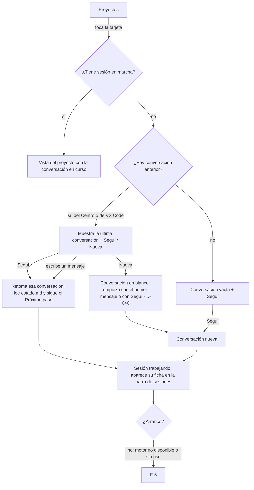
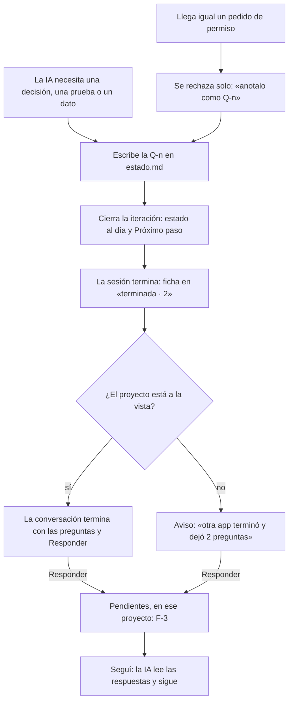
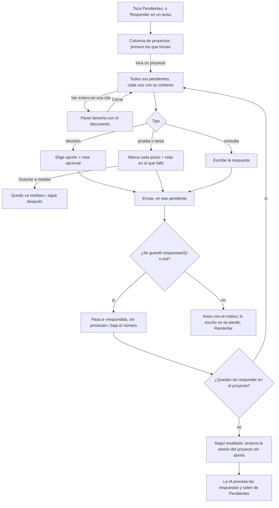
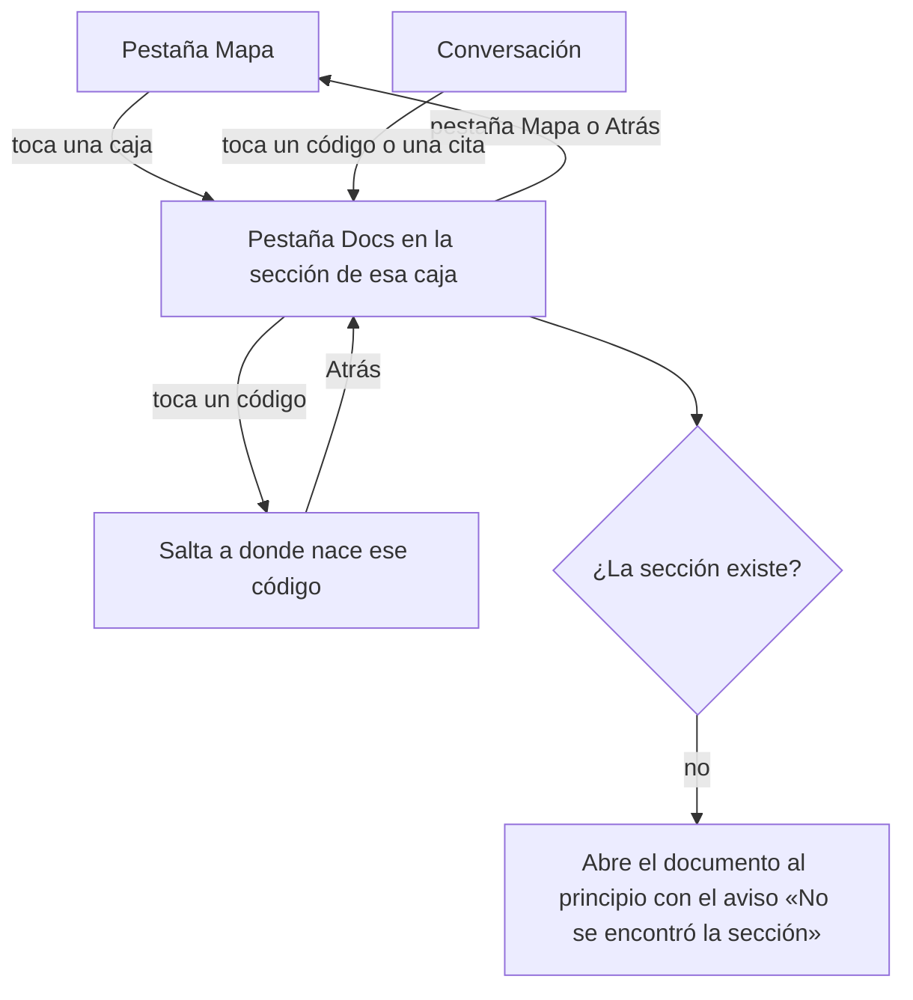
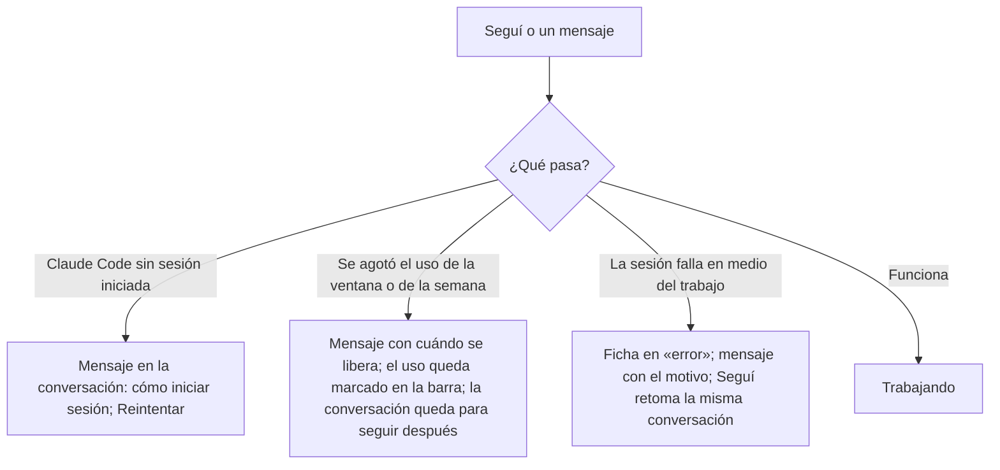
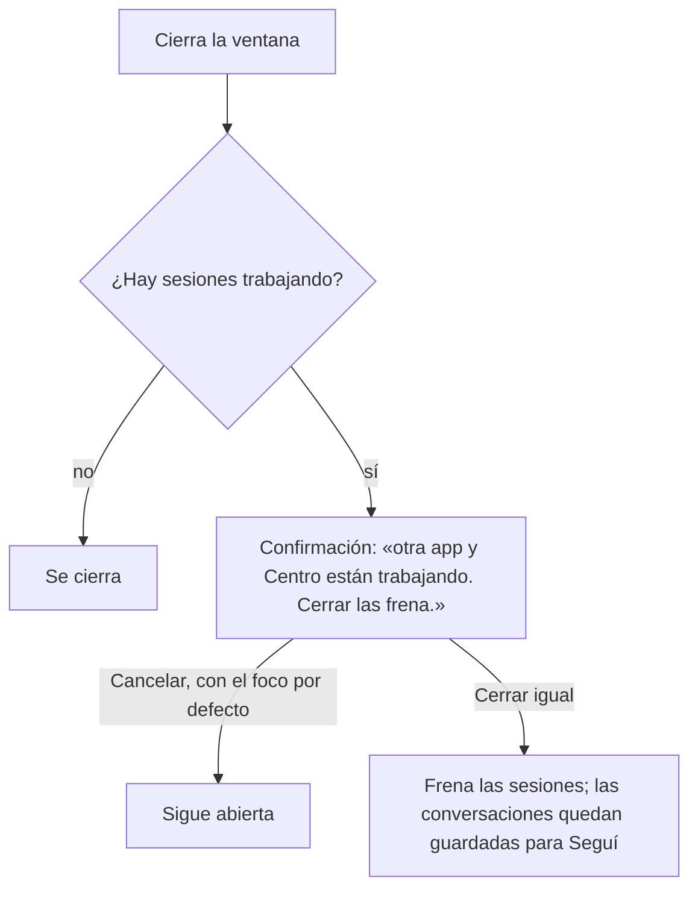

# UX

**Fecha:** 2026-10-22 (cambios del recorrido de Q-34: 2026-10-23)

Diseña cómo se usa el MVP (`02-definicion.md` › MVP en un párrafo): catorce casos *Must*, cinco funcionalidades (C-7, C-51 y C-54 se sumaron en este hito, D-022 a D-024). Baja fidelidad, sin estilo visual: los colores y tamaños son del hito 6.

## Historias de usuario
Una por caso *Must*. El usuario es siempre el mismo: quien dirige sus proyectos con la IA.

### H-1 — Ver todos mis proyectos y lo que esperan de mí
- Como usuario quiero abrir el Centro y ver todos mis proyectos, con su hito y cuántas cosas esperan de mí, para saber en segundos dónde tengo que entrar (C-1).
  - Criterios de aceptación:
    - [ ] Al abrir la app se ve la sección Proyectos: una sola grilla con una tarjeta por proyecto, sin grupos plegables, ordenada por estado (en desarrollo, en uso, idea, pausado, en rescate, descontinuado, para eliminar; D-022).
    - [ ] Cada tarjeta muestra el nombre, el ícono, el hito actual, su estado con un color y su nombre, y, arriba a la derecha, el número de `Q-n` sin responder (sin número si no hay ninguna).
    - [ ] Si alguna de esas `Q-n` frena, el número se distingue de los que no frenan (no solo por color).
    - [ ] Los archivados no se ven, salvo que se active «Archivados».
    - [ ] Los datos se actualizan solos cuando cambia un `estado.md` o una respuesta, sin recargar.

### H-2 — Ver qué IA está trabajando, terminada o con error
- Como usuario quiero ver en todo momento qué proyectos tienen su IA trabajando, terminada o con error, para no dejar un proyecto frenado sin darme cuenta (C-50).
  - Criterios de aceptación:
    - [ ] Arriba a la derecha hay una barra de sesiones con una ficha por cada sesión abierta, visible desde cualquier sección.
    - [ ] Cada ficha dice el proyecto y su estado con palabra o símbolo: trabajando · terminada (con cuántas preguntas nuevas dejó, si dejó) · error. No hay «te espera»: ninguna sesión espera al usuario (D-021).
    - [ ] Tocar una ficha abre ese proyecto con su conversación.
    - [ ] La tarjeta del proyecto en la sección Proyectos muestra el mismo estado.

### H-3 — Abrir un proyecto y trabajar enfocado en él
- Como usuario quiero abrir un proyecto y que todo lo que veo sea de ese proyecto, para conversar con la IA mirando su estado y sus docs (C-49, C-2).
  - Criterios de aceptación:
    - [ ] Tocar la tarjeta abre la vista del proyecto: la sección elegida (Mapa, Docs, Archivos, Git, Scripts) en el área grande y la conversación a la derecha (D-041).
    - [ ] El panel de la conversación se ensancha arrastrando su borde; la app recuerda el ancho.
    - [ ] Nada de la vista muestra datos de otro proyecto (salvo la barra de sesiones y la barra lateral).

### H-4 — Retomar un proyecto con «Seguí»
- Como usuario quiero retomar un proyecto con un botón, sin repetir contexto, para seguir donde quedó la IA (C-3).
  - Criterios de aceptación:
    - [ ] Al abrir un proyecto sin sesión en marcha se ve la última conversación (también si se empezó en VS Code) y los botones **Seguí** y **Nueva**.
    - [ ] **Seguí** arranca una sesión que lee `estado.md` y sigue el **Próximo paso**; no gasta uso hasta que se toca.
    - [ ] También se puede escribir un mensaje propio en lugar de tocar **Seguí**.

### H-5 — Que la IA trabaje sin esperarme
- Como usuario quiero que la IA trabaje sin pedirme permisos ni quedarse esperándome, y que lo que necesite de mí lo deje como `Q-n` al cerrar su iteración, para que ninguna sesión quede parada (C-5, D-021).
  - Criterios de aceptación:
    - [ ] Las sesiones del Centro no piden permisos (modo *bypass*).
    - [ ] La IA no pregunta con opciones en la conversación: escribe la `Q-n` en `estado.md`, cierra la iteración (estado al día y **Próximo paso**) y la sesión termina.
    - [ ] Al terminar, la conversación muestra las preguntas que dejó con un botón **Responder**, y la ficha dice cuántas son.
    - ~~Si igual llega un pedido de permiso, se rechaza solo, con un mensaje que le pide a la IA anotarlo como `Q-n`; la conversación lo muestra en una línea.~~ Sin efecto: en *bypass* el SDK no consulta permisos (D-038).

### H-14 — Detener a la IA
- Como usuario quiero frenar a la IA en el acto si va por mal camino, para que no siga haciendo cambios que no quiero (C-54, D-024).
  - Criterios de aceptación:
    - [ ] Mientras la sesión trabaja, la conversación muestra **Detener** junto al campo de texto.
    - [ ] Detener frena la sesión en el acto, sin confirmación; lo que ya hizo queda (se deshace con git) y la conversación dice «Detuviste a la IA».
    - [ ] La ficha pasa a terminada y la conversación se retoma con **Seguí** o con un mensaje propio, con todo el contexto.

### H-6 — Cambiar de proyecto sin cortar la IA
- Como usuario quiero pasar a otro proyecto mientras la IA del primero sigue, para no esperar (C-50).
  - Criterios de aceptación:
    - [ ] Cambiar de proyecto o de sección no frena ni reinicia ninguna sesión.
    - [ ] Al volver a un proyecto está como lo dejé: la conversación, el documento abierto y la posición, sin recargar.

### H-7 — Ver el mapa del plan
- Como usuario quiero ver el plan del proyecto como cajas dentro de cajas, para saber qué está hecho, qué está en curso y qué falta (C-13).
  - Criterios de aceptación:
    - [ ] Una caja por hito, con su estado, y dentro sus pasos (los ítems del portón, D-019; las iteraciones en el hito 7; los pasos de cada módulo).
    - [ ] Cada caja muestra hecho · en curso · pendiente con palabra o símbolo, no solo color.
    - [ ] El mapa coincide con `estado.md` y se actualiza solo cuando cambia.

### H-8 — Abrir el documento de una caja
- Como usuario quiero tocar una caja del mapa y leer la sección que la detalla, con los códigos como enlaces, para ir al detalle sin buscar (C-14).
  - Criterios de aceptación:
    - [ ] Tocar una caja abre el documento en la sección que corresponde.
    - [ ] Los códigos (`D-n`, `Q-n`, `H-n`…) son enlaces a donde nacen, y las citas `archivo.md` › Título llevan a esa sección.
    - [ ] Hay una forma de volver al mapa en un paso.

### H-9 — Ver los pendientes por proyecto
- Como usuario quiero ver qué proyectos esperan algo de mí y, al elegir uno, todos sus pendientes juntos con lo necesario para decidir, para responderlos en tanda sin ir a buscar el contexto (C-21, D-022).
  - Criterios de aceptación:
    - [ ] Pendientes es una sección de la barra lateral, con el total sin responder en su ícono.
    - [ ] Una columna angosta lista los proyectos con pendientes y su número; primero los que tienen alguno que frena.
    - [ ] Al elegir un proyecto, el área grande muestra todos sus pendientes, uno debajo del otro: código, pregunta, tipo y si frena; primero los que frenan.
    - [ ] Las decisiones, historias y secciones que cita un pendiente se ven dentro de él (plegadas si son largas); **Ver entero** abre el documento en un panel a la derecha.
    - [ ] Las respondidas que la IA todavía no procesó se distinguen de las abiertas.

### H-10 — Responder una decisión
- Como usuario quiero elegir una opción y agregar una nota, para responder una decisión en tres pasos o menos (C-22).
  - Criterios de aceptación:
    - [ ] Se ven el contexto y las opciones, con la recomendada marcada.
    - [ ] Elegir, escribir la nota opcional y enviar; la respuesta queda en `docs/respuestas/Q-n.md` con el formato de la guía.
    - [ ] Se puede responder con texto libre («Otro»).

### H-11 — Hacer una prueba como lista
- Como usuario quiero marcar cada punto de una prueba y escribir en el que falló, para que la IA sepa exactamente qué arreglar (C-23).
  - Criterios de aceptación:
    - [ ] Cada punto de la prueba es una casilla con un campo de nota.
    - [ ] La respuesta repite cada punto, marcado o no, con su nota (D-019).
    - [ ] Se puede guardar a medias y seguir después.

### H-12 — Ver el uso y el contexto
- Como usuario quiero ver siempre cuánto llevo usado de la suscripción y cuánto contexto lleva cada conversación, para saber si me alcanza y cuándo conviene un chat nuevo (C-7, D-023).
  - Criterios de aceptación:
    - [ ] La barra de estado (al pie) muestra el porcentaje usado de la ventana de 5 horas y de la semana y cuándo se libera cada una (D-031, D-045).
    - [ ] Se actualiza con cada respuesta de cualquier sesión; al abrir la app se lee sin gastar uso.
    - [ ] Cada conversación muestra el porcentaje de contexto usado; pasado el 80 % se marca y sugiere un chat nuevo.
    - [ ] En la barra de la conversación se eligen el modelo y el nivel de esfuerzo; cada proyecto recuerda los suyos y valen desde el próximo mensaje (C-58, D-045).

### H-13 — Enterarme cuando una sesión termina
- Como usuario quiero un aviso dentro de la app cuando la IA de un proyecto que no estoy mirando termina, deja preguntas o falla, para responder sin vigilar la barra de sesiones (C-51, D-022).
  - Criterios de aceptación:
    - [ ] El aviso aparece abajo a la derecha y dice el proyecto y qué pasó («otra app terminó y dejó 2 preguntas»).
    - [ ] Tiene **Responder** (Pendientes, en ese proyecto) si dejó preguntas, y **Abrir** (el proyecto).
    - [ ] Si el proyecto está a la vista no hay aviso: se ve en la conversación.
    - [ ] No hay una lista de avisos: lo que queda después es la ficha en la barra de sesiones.

### H-15 — Mirar los archivos del proyecto
- Como usuario quiero ver los archivos del proyecto tal cual, para mirar «bajo el capó» sin abrir VS Code (C-55, D-041).
  - Criterios de aceptación:
    - [ ] Archivos muestra el árbol del proyecto sin `node_modules` ni `.git`; las carpetas se abren y se cierran.
    - [ ] Un archivo de texto se ve con colores y números de línea; una imagen se ve; un markdown, como texto.
    - [ ] No se puede editar nada; un archivo muy grande o binario lo dice en vez de mostrarse.

### H-16 — Mirar el git del proyecto
- Como usuario quiero ver qué cambió en el proyecto y cuándo, para controlar lo que hizo la IA (C-56, D-041).
  - Criterios de aceptación:
    - [ ] Git muestra la rama, los archivos sin guardar y el historial de commits con mensaje, fecha y cuántos archivos tocó.
    - [ ] Al elegir un commit (o los cambios sin guardar) se ve la lista de sus archivos; el antes y después aparece solo al elegir uno (Q-61), con lo agregado en verde y lo quitado en rojo, con signo además del color.
    - [ ] No hay botones de acción; un proyecto sin git lo dice.
    - [ ] El panel es como el de VS Code: dice si el repositorio está solo en la PC o también en GitHub (y cuántos commits faltan subir), y Cambios e Historial son secciones que se pliegan (D-058).
    - [ ] Sin repositorio, ofrece **Inicializar repositorio**; solo en la PC, **Publicar en GitHub**, privado o público (D-081). Se pueden ignorar.

### H-17 — Volver a una conversación anterior
- Como usuario quiero ver las conversaciones anteriores del proyecto y abrir una, para no perderlas al empezar una **Nueva** (C-57, D-041).
  - Criterios de aceptación:
    - [ ] El botón de historial de la barra de la conversación lista las del proyecto, la más nueva arriba, con título, fecha y de dónde vienen (Iridium o VS Code).
    - [ ] Elegir una la muestra y lo que se escribe la continúa; la abierta está marcada.

## Flujos

### F-1 — Abrir y retomar un proyecto


### F-2 — La IA necesita algo del usuario

Ninguna sesión queda esperando (D-021): mientras el usuario no responde, la sesión está terminada y no gasta uso; el número en la tarjeta, en Pendientes y en la ficha lo muestra.

### F-3 — Responder desde Pendientes

Una decisión se responde en tres pasos: tocar el proyecto, elegir la opción, enviar (criterio de éxito de `02-definicion.md`). **Seguí** está siempre en la cabecera del proyecto (salvo que su sesión ya esté trabajando); se resalta cuando no queda nada sin responder.

### F-4 — Del mapa a un documento y de vuelta


### F-5 — Errores del motor


### F-6 — Cerrar la app con sesiones trabajando


## Arquitectura de información
> Ajustada por D-041: barra de título propia con las sesiones; la barra de íconos cambia entre el inicio y el proyecto abierto; la vista de un proyecto tiene tres paneles. Lo que sigue describe la versión anterior, salvo donde lo dice esta nota.
> - **Inicio** (el botón de arriba a la izquierda): barra con Proyectos y Pendientes.
> - **Proyecto abierto:** barra con Mapa, Docs, Archivos, Git y Scripts (después, Diseño y Assets); la vista principal muestra la elegida y la conversación va siempre a la derecha.
> - **Revisión** (módulo, D-046): un ícono más en la barra del proyecto, después de Archivos, con los comentarios abiertos (`modulos/revision/ux.md`).

La app tiene tres zonas fijas (D-020) y dos que aparecen cuando hacen falta (D-022):

- **Barra lateral de íconos**, a la izquierda, siempre visible. Cada ícono es una sección de la vista general. En el MVP: **Proyectos** y **Pendientes** (con el total sin responder); el módulo Skills suma **Skills** como tercero (D-068) y el módulo Inicio, **Ideas** como cuarto (`Ctrl+4`, `modulos/inicio/ux.md` › IN-W1). Las carpetas que tienen su sección (`Ideas`, `Skills`) están en la carpeta Iridium, aparte de los proyectos (D-083): no salen en la grilla y sus vistas de proyecto se abren con **Abrir como proyecto** desde esa sección (Q-113). Si las de antes siguen en la carpeta de proyectos, arriba de la grilla un aviso ofrece **Mover**. Las áreas que vienen después (Diseño…) suman su ícono acá, sin tocar las demás (B-11).
- **Barra de arriba**, siempre visible: a la derecha, el uso de la suscripción (D-023) y la barra de sesiones, con una ficha por cada sesión abierta y su estado. Las fichas son el atajo para volver a un proyecto.
- **Área principal**: la sección elegida (Proyectos, Pendientes) o la vista del proyecto abierto.
- **Panel derecho**, cerrado salvo que se pida: en Pendientes, un documento entero; más adelante, el lienzo de Diseño.
- **Avisos**, abajo a la derecha, cuando una sesión que no está a la vista termina, deja preguntas o falla (H-13).

Ir y volver:
- Proyectos → tocar una tarjeta → vista del proyecto.
- Ideas o Skills → **Abrir como proyecto** → la vista de proyecto de esa carpeta.
- Vista del proyecto → ícono Proyectos → vuelve a la grilla.
- Vista del proyecto → «2 pendientes» en la cabecera → Pendientes, en ese proyecto; de ahí, **Abrir** vuelve al proyecto.
- Aviso → **Responder** → Pendientes, en ese proyecto; **Abrir** → el proyecto.
- Cualquier lugar → ficha de la barra de sesiones → ese proyecto.
- Cambiar de sección o de proyecto no recarga nada: cada proyecto guarda cómo se lo dejó y las sesiones siguen (H-6).

Dentro de la vista de un proyecto:
- **Conversación** con la IA, con su contexto usado.
- **Mapa** del plan: hitos en fila (W-7).
- **Docs**: la lista de documentos y el abierto (W-8); también se llega desde el mapa y desde los códigos de la conversación.

**Pendientes** es una columna de proyectos más todos los pendientes del elegido (W-5).

## Pantallas

### W-1 — Marco de la app
> Ajustado por D-031: las sesiones van como pestañas arriba (a lo ancho) y el uso pasa a una barra de estado fina abajo, junto con el estado de la sesión, el hito y el contexto. Prototipo: `ui/vista-proyecto.html`.
> Ajustado por D-041: no hay marco de Windows; las pestañas van en la barra de título propia, con los botones de Windows a la derecha. Arriba a la izquierda, el botón de inicio con el número de preguntas; la barra de íconos cambia según dónde se esté.

- Propósito: lo que está siempre, en cualquier pantalla.
- Wireframe:

```
┌───┬──────────────────────────────────────────────────────────────┐
│   │ Uso 5 h 34 % · sem. 61 %   [● Centro] [✓ otra app · 2] [✕ otro proyecto]│ ← barra de arriba
│ ▦ │──────────────────────────────────────────────────────────────│
│ ✉3│                                                              │
│   │                                                              │
│   │                 área principal                               │
│   │        (Proyectos, Pendientes o un proyecto abierto)         │
│   │                                                              │
│   │                              ┌ otra app terminó ───────────────┐ │
│   │                              │ Dejó 2 preguntas            │ │ ← aviso
│ ⚙ │                              │          [Abrir] [Responder]│ │
│   │                              └─────────────────────────────┘ │
└───┴──────────────────────────────────────────────────────────────┘
 ▦ Proyectos   ✉ Pendientes (3 sin responder)   ⚙ Ajustes
 ● trabajando   ✓ terminada (· 2: dejó dos preguntas)   ✕ error
```

### W-2 — Proyectos
- Propósito: ver todos los proyectos y entrar a uno (H-1).
- Wireframe:

```
┌───┬──────────────────────────────────────────────────────────────┐
│   │ Proyectos · 12   [ ] Archivados   Uso 34 % · 61 %  [● Centro]│
│ ▦ │──────────────────────────────────────────────────────────────│
│ ✉3│ ┌──────────────(2)┐ ┌─────────────(1!)┐ ┌─────────────────┐  │
│   │ │▌[ícono] Centro  │ │▌[ícono] otra app    │ │▌[ícono] otro proyecto  │  │
│   │ │▌en desarrollo   │ │▌en desarrollo   │ │▌en desarrollo   │  │
│   │ │▌Hito 4 UX     ● │ │▌Hito 7 I-3  ✓ 2 │ │▌Hito 7 I-4      │  │
│   │ └─────────────────┘ └─────────────────┘ └─────────────────┘  │
│   │ ┌─────────────────┐ ┌─────────────────┐ ┌─────────────────┐  │
│   │ │▒[ícono] Gestor  │ │▒[ícono] otra app   │ │░[ícono] Notas   │  │
│   │ │▒en uso          │ │▒en uso          │ │░pausado         │  │
│   │ │▒Hito 10         │ │▒Hito 10         │ │░Hito 3          │  │
│   │ └─────────────────┘ └─────────────────┘ └─────────────────┘  │
└───┴──────────────────────────────────────────────────────────────┘
 ▌▒░ el estado (en el hito 6, D-034: ícono y palabra, sin color propio)
 (2) pendientes sin responder · (1!) uno de ellos frena · ● ✓ ✕ estado de la sesión
```

- Las tarjetas van en una sola grilla, ordenadas por estado y, dentro de cada estado, por nombre. Sin títulos de grupo ni secciones plegables: el color y el nombre del estado los separan (D-022).
- **Archivados** apagado oculta los archivados; prendido, aparecen al final, más tenues. La app recuerda la elección.
- Estados:
  - **Vacío:** la carpeta de proyectos no tiene proyectos → mensaje con la ruta y botón para elegir otra carpeta.
  - **Cargando:** siluetas de tarjetas; la grilla aparece de una vez.
  - **Error:** la carpeta no existe o no se puede leer → mensaje con la ruta y botón para elegirla.
  - **Extremos:** proyecto sin `docs/estado.md` → tarjeta sin hito, con «Sin estado»; `.proyecto.json` dañado o sin estado → tarjeta al final, gris, con aviso, como en el Gestor; nombre largo → se corta con «…» y se ve entero al pasar el mouse; más de 99 pendientes → «99+».

### W-3 — Vista de un proyecto
> Ajustada por D-043: se entra a **Pendientes y scripts** (primer ícono): los pendientes del proyecto para responder ahí y un botón por script; Scripts deja de ser sección aparte.
> Ajustada por D-044: los scripts van en lista después de los pendientes y Scripts vuelve como sección, con sus descripciones; el contexto y las citas de cada pendiente, en «Mostrar detalles»; el botón lateral del mouse vuelve un paso.
> Rehecha por D-041 (reemplaza lo de D-031 y los dos wireframes de abajo, que quedan como historia): tres paneles. Prototipo: `ui/vista-proyecto.html`.
>
> ```
> ┌──┬─[● Centro ×][● otra app ×]──────────────────────────────[─ □ ×]┐
> │⌂2│ Centro · Hito 7 · I-4 [1 pregunta · frena]│ Conversación  [⟳][+ Nueva][Seguí]│
> ├──┤───────────────────────────────────────────┼──────────────────────────────────│
> │🗺│                                           │ IA: …                            │
> │📄│   vista principal: Mapa, Docs, Archivos,  │ ┌ Dejó 1 pregunta ─[Responder]┐  │
> │📁│   Git o Scripts                           │                                  │
> │⑂ │                                           │                                  │
> │▶ │                                           │ [ escribir…                  ] │
> │⚙ │                                           │                                  │
> └──┴───────────────────── barra de estado ────────────────────────────────────────┘
> ```
> El borde entre la vista y la conversación se arrastra; doble clic vuelve al ancho de entrada. ⟳ lista las conversaciones anteriores (H-17).
> Los estados de la conversación de abajo siguen valiendo.

- Propósito: conversar con la IA del proyecto mirando su mapa y sus docs (H-3 a H-8).
- Dos disposiciones; se cambia con un botón y la app recuerda la elegida.

Conversación al centro (la de entrada):
```
┌───┬──────────────────────────────────────────────────────────────┐
│   │ Centro · Hito 4 UX [2 pendientes] [⇄]  Uso 34 % · 61 % [● …] │
│ ▦ │──────────────────────────────────────┬───────────────────────│
│ ✉3│ Conversación          Contexto 42 %  │ [Mapa] [Docs]         │
│   │                                      │ ┌Hito 3 ✓┐            │
│   │  IA: Terminé los wireframes. Dejé    │ ┌Hito 4 ◐───────────┐ │
│   │  dos preguntas en estado.md y cerré  │ │ ✓ historias       │ │
│   │  la iteración.                       │ │ ◐ flujos          │ │
│   │  ┌ Dejó 2 preguntas ──────────────┐  │ │ □ wireframes      │ │
│   │  │ Q-36 · decisión · frena        │  │ └───────────────────┘ │
│   │  │ Q-37 · prueba      [Responder] │  │ ┌Hito 5 □┐            │
│   │  └────────────────────────────────┘  │                       │
│   │ [ escribir…                    ] [→] │                       │
└───┴──────────────────────────────────────┴───────────────────────┘
```
Mientras trabaja, la fila del campo de texto suma **Detener**: `[ escribir…              ] [■ Detener] [→]`.

Conversación a la derecha:
```
┌───┬──────────────────────────────────────────────────────────────┐
│   │ Centro · Hito 4 UX [2 pendientes] [⇄]  Uso 34 % · 61 % [● …] │
│ ▦ │──────────────────────────────────────┬───────────────────────│
│ ✉3│ [Mapa] [Docs]                        │ Conversación     42 % │
│   │ 04-ux.md › H-3                       │ IA: Leí estado.md...  │
│   │ ### H-3 — Abrir un proyecto…         │                       │
│   │ Como usuario quiero… (C-49, C-2)     │                       │
│   │                                      │ [ escribir…     ] [→] │
└───┴──────────────────────────────────────┴───────────────────────┘
```

- **«2 pendientes»** en la cabecera lleva a Pendientes, en este proyecto; sin pendientes, no aparece.
- Estados:
  - **Sin conversación anterior:** la conversación vacía con **Seguí** y una línea de lo que va a hacer («Lee `estado.md` y sigue el Próximo paso»).
  - **Con conversación anterior, sin sesión:** la última conversación, con su fecha y de dónde viene (Centro o VS Code), y **Seguí** · **Nueva**.
  - **Trabajando:** los mensajes de la IA aparecen a medida que llegan; el campo de texto sigue disponible y, a su lado, **Detener** (H-14).
  - **Terminada con preguntas:** al final, las `Q-n` que dejó, con **Responder** (H-5).
  - **Pedido de permiso rechazado solo:** una línea en la conversación: «Pidió permiso para …; se rechazó y lo anota como `Q-n`» (D-021).
  - **Contexto alto:** pasado el 80 %, el porcentaje se marca y una línea sugiere **Nueva** (H-12).
  - **Error:** ver F-5.
  - **Extremos:** conversación muy larga → se carga lo último y lo anterior al subir; conversación usada también en VS Code → aviso «Esta conversación también se usó en VS Code el …» (cómo evitar que se pisen se resuelve en el hito 5).

### W-4 — Fichas de sesión, uso y avisos
> Ajustado por D-043: cada proyecto abierto queda como pestaña aunque no trabaje (también al volver a abrir la app) hasta cerrarla con ×; muestra trabajando, error, las preguntas que esperan, «Terminada» sin ver, o nada.
> Ajustado por D-031: las fichas son pestañas arriba y el uso está en la barra de estado.

> Ajustado por D-059 (I-6): el detalle del uso se abre tocando los medidores (cuándo se libera cada ventana y si el ritmo alcanza, R-1); dentro de un proyecto, los avisos van a la izquierda de la conversación.

- Propósito: saber qué hace cada sesión, cuánto uso queda y enterarse cuando algo termina, desde cualquier pantalla (H-2, H-12, H-13).

```
        Uso 5 h 34 % · sem. 61 %   [● Centro] [✓ otra app · 2 ×] [✕ otro proyecto ×]

                                        ┌ otra app terminó ────────────────┐
                                        │ Dejó 2 preguntas; una frena  │
                                        │          [Abrir] [Responder] │
                                        └──────────────────────────────┘
```
- **Fichas:** una por sesión abierta desde que se abrió la app. Estados: **● trabajando** · **✓ terminada** (con el número de preguntas nuevas, si dejó) · **✕ error**. Tocar la ficha abre el proyecto. La terminada queda hasta que se abre el proyecto o se cierra con ×; cerrarla no borra la conversación.
- **Uso:** porcentaje de la ventana de 5 horas y de la semana; al pasar el mouse, cuándo se libera cada una. Desde el 90 % se marca; agotado, dice «agotado · se libera a las 18:40».
- **Avisos:** aparecen abajo a la derecha cuando una sesión que no está a la vista termina, deja preguntas o falla; se van solos a los pocos segundos (no mientras el mouse está encima) o con `Esc`. No queda una lista de avisos: queda la ficha.
- **Extremos:** muchas sesiones → las fichas que no entran se juntan en «+3», que despliega la lista, primero las que dejaron preguntas o fallaron; varios avisos a la vez → se apilan hasta tres y el resto se junta en «y 2 más»; uso todavía sin leer → «Uso —».

### W-5 — Pendientes
- Propósito: ver qué proyectos esperan algo y responder todos los pendientes de uno, con lo necesario para decidir ahí (H-9, H-10, F-3).

```
┌───┬──────────────────────────────────────────────────────────────┐
│   │ Pendientes · 5              Uso 34 % · 61 %  [● Centro] [✓ …]│
│ ▦ │──────────────┬───────────────────────────────────────────────│
│ ✉5│ otra app     2 ! │ otra app · Hito 7 · 2 pendientes   [Abrir] [Seguí]│
│   │ otro proyecto   1 ! │───────────────────────────────────────────────│
│   │ Centro   1   │ Q-8 · decisión · frena                        │
│   │ otra app    1   │ ¿La miniatura muestra el modelo 3D o la       │
│   │              │ textura plana?                                │
│   │ Respondidas  │ ▾ D-032 — Miniaturas en la galería            │
│   │ Gestor   1 ✓ │   │ Las miniaturas se generan al importar…    │
│   │              │ ▾ 04-ux.md › W-14                [Ver entero] │
│   │              │   │ Galería: grilla de cuatro columnas…       │
│   │              │ ( ) A) 3D · recomendada                       │
│   │              │ ( ) B) plana                                  │
│   │              │ ( ) Otro: [                       ]           │
│   │              │ Nota: [                           ]  [Enviar] │
│   │              │───────────────────────────────────────────────│
│   │              │ Q-9 · prueba                                  │
│   │              │ ¿El visor abre los .glb grandes? (como W-6) ↓ │
└───┴──────────────┴───────────────────────────────────────────────┘
 ! tiene alguno que frena   ✓ respondidas, sin procesar
```

Con el panel derecho abierto (**Ver entero**):
```
│ ✉5│ otra app     2 ! │ Q-8 · decisión · frena  │ 04-ux.md › W-14  [×]│
│   │ otro proyecto   1 ! │ ¿La miniatura muestra   │ ### W-14 — Galería  │
│   │ Centro   1   │ el modelo 3D o la…      │ - Propósito: ver…   │
│   │              │ ( ) A) 3D · recomendada │ (el documento, como │
│   │              │ ( ) B) plana            │  en W-8 angosto)    │
```

- **Columna de proyectos:** los que tienen pendientes sin responder, con su número; primero los que tienen alguno que frena (!), después por el pendiente más viejo. Abajo, **Respondidas**: los que tienen respuestas que la IA todavía no procesó. Se entra con el primero elegido; desde un aviso o desde un proyecto, con ese.
- **Cabecera del proyecto:** nombre, hito, cuántos quedan, **Abrir** (el proyecto) y **Seguí** (arranca la sesión sin abrirlo; se resalta cuando no queda nada sin responder; no está si la sesión ya trabaja).
- **Pendientes del proyecto**, uno debajo del otro: primero los que frenan y, dentro de eso, el más viejo; después los «a medias»; al final las respondidas sin procesar, que se pueden corregir hasta que la IA las procesa.
- **Contexto dentro:** cada código (`D-n`, `H-n`, `W-n`…) y cada cita `archivo.md` › Título del contexto se muestra con su texto, debajo de la pregunta. Lo largo empieza plegado, con las primeras líneas. **Ver entero** abre el documento en esa sección, en el panel derecho.
- **Panel derecho:** angosto, se cierra con × o `Esc`; muestra el documento como W-8 en modo angosto. Los códigos de adentro también son enlaces.
- Cada pendiente tiene su **Enviar**. Lo escrito en uno no se pierde al pasar a otro ni a otro proyecto.
- Estados:
  - **Vacío:** «Nada te espera».
  - **Cargando:** siluetas en la columna y en el área grande.
  - **Error de lectura de un proyecto:** aparece en la columna con «No se pudo leer» y el motivo al tocarlo.
  - **Error al guardar:** aviso en ese pendiente; lo escrito queda; **Reintentar** (F-3).
  - **Cita que no se encuentra:** se muestra la cita como texto, con «No se encontró la sección».
  - **Extremos:** pregunta o cita muy larga → plegada con «…», entera al desplegar; muchos pendientes en un proyecto → todos en la misma página, y la cabecera dice cuántos quedan; `Q-n` sin `Tipo:` → consulta que no frena (D-019); opciones mal escritas → se responde con texto libre.

### W-6 — Responder una prueba
- Propósito: cómo se ve, dentro de Pendientes, una prueba o una tarea (H-11).

```
│ Q-12 · prueba · frena                                   │
│ ¿I-4 (clasificar en Pendientes) funciona como esperabas?│
│ ▸ scripts.md › Instalar la última versión               │
│                                                         │
│ [x] Abre la app sin errores          [nota          ]   │
│ [ ] Clasifica en Pendientes          [no aparece la …]  │
│ [x] El número baja al responder      [nota          ]   │
│                                                         │
│ Nota general: [                                     ]   │
│                       [Guardar a medias]  [Enviar]      │
```
- **Guardar a medias** guarda la respuesta sin enviarla, en los datos de Iridium (D-039): queda como «a medias» y la IA no la ve.
- Estados: los mismos de W-5.

### W-7 — Mapa del plan
> Ajustado por D-041: siempre en la vista principal (no hay panel angosto).
> Ajustado por D-035: el Mapa muestra el estado del proyecto (línea de hitos y el hito actual con próximo paso, pasos, lo que espera y lo último de la IA), no un árbol ni las secciones de los documentos.

- Propósito: ver el plan del proyecto y llegar a cada sección (H-7, H-8).

```
[Mapa] [Docs]
┌0 Idea ✓┐┌1 Expl. ✓┐┌2 Def. ✓┐┌3 Inv. ✓┐┌4 UX ◐──────────────────┐
└────────┘└─────────┘└────────┘└────────┘│ ✓ Historias de usuario │
                                         │ ◐ Flujos               │
                                         │ □ Wireframes           │
                                         │ □ Estados              │
                                         └────────────────────────┘
┌5 Arq. □┐┌6 UI □┐┌7 Constr. □┐┌8 Calidad □┐┌9 Lanz. □┐┌10 Op. □┐
┌Módulos ─────────────────────────────┐
│ ┌Diseño □┐ ┌Revisión □┐ ┌Skills □┐  │
└─────────────────────────────────────┘
 ✓ completo   ◐ en curso   □ pendiente   ⟲ reabierto   – saltado
```
- Las cajas van de izquierda a derecha y bajan según el ancho. El hito en curso está abierto; los demás se abren al tocarlos.
- Pasos de cada hito: los ítems de su portón (D-019); en el hito 7, sus iteraciones; en un módulo, su ciclo.
- Tocar el título de una caja abre su documento; tocar un paso abre su sección (F-4).
- Estados:
  - **Proyecto sin `estado.md`:** «Este proyecto no sigue la guía todavía» y la lista de docs, si tiene.
  - **Hito sin documento o sin portón:** la caja sin pasos, con su estado.
  - **Estado que no se entiende:** la caja muestra el texto tal cual (D-019: se lee con tolerancia).
  - **Extremos:** hito 7 con muchas iteraciones → se ven las últimas y «+12 anteriores».

### W-8 — Docs del proyecto
> Ajustado por D-041: siempre en la vista principal; Scripts usa el mismo lector con `scripts.md`.
> Ajustado por D-035: lector liviano; el documento y sus secciones se eligen con menús arriba, no con una lista lateral; la hoja va centrada con ancho elegible.

- Propósito: leer los documentos del proyecto con los códigos como enlaces (H-8).

```
[Mapa] [Docs]                          [← Atrás]
▸ estado.md          │ 04-ux.md › H-3
▾ 04-ux.md           │ ### H-3 — Abrir un proyecto y trabajar…
   Historias         │ - Como usuario quiero… (C-49, C-2)
   Flujos            │   - Criterios de aceptación:
   Pantallas         │     - [ ] Tocar la tarjeta abre…
▸ decisiones.md      │       … D-020 …   ← enlace
▸ scripts.md         │
```
- La lista de docs se pliega para dar ancho al texto (en el panel angosto empieza plegada).
- Los diagramas Mermaid se ven como código en el MVP (dibujarlos es C-19, *Should*).
- Estados: documento que no existe → aviso y la lista; documento muy largo → la lista de secciones lleva a cada una; el documento cambia mientras se lee → se actualiza sin perder la posición.

## Principios de interacción
- **Cambiar de lugar no corta nada.** Ninguna navegación frena, reinicia ni recarga una sesión o una vista (H-6).
- **La IA no gasta uso sin que el usuario lo pida.** Abrir un proyecto muestra la conversación; arranca con **Seguí** o con un mensaje (H-4, D-020).
- **La IA no se queda esperando.** Lo que necesita del usuario lo deja como `Q-n` y cierra su iteración; ninguna sesión queda parada (D-021).
- **Lo que espera del usuario siempre está a la vista**: el número en las tarjetas y en el ícono de Pendientes, el estado en la barra de sesiones y un aviso cuando una sesión termina.
- **Para decidir no hace falta buscar.** Un pendiente trae dentro lo que cita (D-022).
- **El uso y el contexto se ven siempre** (D-023).
- **El estado no se comunica solo por color**: lleva palabra o símbolo.
- **Lo escrito no se pierde.** Una respuesta a medio escribir queda aunque se cambie de lugar; si no se puede guardar, se avisa y se conserva.
- **Las respuestas se envían a propósito** (botón Enviar); **Guardar a medias** existe para las pruebas largas.
- **Solo se confirma frenar el trabajo de la IA sin querer**: cerrar la app con sesiones trabajando (F-6). **Detener** no se confirma: se usa cuando hay apuro, y se retoma con **Seguí**. Nada más del MVP borra algo desde la app: **Nueva** no borra la conversación anterior y cerrar una ficha tampoco.
- **Teclado:** `Enter` envía en la conversación y `Shift+Enter` hace un salto de línea; `Esc` cierra lo desplegado; `Ctrl+1` Proyectos, `Ctrl+2` Pendientes y `Ctrl+3` Skills; `Tab` recorre todo.
- **Todo en español**, con textos cortos.

## Accesibilidad
El usuario no tiene necesidades especiales declaradas; igual se cuida lo básico, que sirve para todos:
- Todo se puede hacer con teclado, con el foco visible.
- El estado nunca va solo por color (símbolo o palabra), tampoco el color de cada estado en las tarjetas de proyecto.
- Los íconos de la barra lateral tienen su nombre al pasar el mouse y para lectores de pantalla.
- El texto se puede agrandar sin que se rompa la pantalla (contraste y tamaños, en el hito 6).

## Para el hito 5
Lo que la UX dejó para resolver en la arquitectura (el detalle está en cada decisión). Resuelto en `05-arquitectura.md` › Procesos centrales, con S-2, D-025 y D-027:
- Cada proyecto abierto guarda su vista en memoria y las sesiones siguen aunque no estén a la vista (D-020).
- Sesiones en modo *bypass*: cómo se les pasa la instrucción de dejar las preguntas como `Q-n` y qué pedidos de permiso pueden llegar igual (D-021).
- Mostrar dentro de un pendiente las secciones que cita, a partir de los lectores del Gestor (D-022).
- Leer el contexto de cada sesión y el uso al abrir la app sin gastar (D-023).
- Detener una sesión y que quede lista para retomar (D-024).
- Evitar que una conversación quede abierta a la vez en el Centro y en VS Code (W-3 › Extremos; `03-investigacion.md` › Impacto en la definición).

## Portón
- [x] Historias de usuario con criterios de aceptación para todo el MVP.
- [x] Flujos principales diagramados, incluidos los de error.
- [x] Arquitectura de información definida.
- [x] Wireframes de todas las pantallas del MVP.
- [x] Estados (vacío, carga, error, extremos) definidos.
- [x] Principios de interacción escritos.
- [x] El usuario recorrió los flujos y los aprobó (Q-34 con cambios; Q-37 aprobado).
