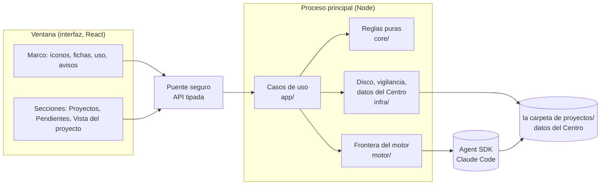

# Arquitectura técnica

**Fecha:** 2026-10-23
**Nivel de protección:** P2 — personal conectado

> Stack elegido por el usuario: Electron + TypeScript + React (Q-38, D-028). Arquitectura aprobada (Q-39).

## Requisitos no funcionales
Salen de `02-definicion.md` › Lo que la base tiene que dar y › Restricciones, `perfil-proyecto.md` y `04-ux.md` › Para el hito 5.

- **Plataforma:** app de escritorio en Windows; la tecnología no cierra una versión para Linux (Q-30).
- **Motor:** Claude Code por el Agent SDK, con la suscripción, aislado en una sola pieza (D-007). El SDK oficial es de TypeScript (y Python); lo probado en S-1 y S-2 es el de TypeScript.
- **Varias sesiones a la vez,** una por proyecto, que siguen aunque el proyecto no esté a la vista (D-015, D-020). No deben trabar la PC.
- **Cambiar de proyecto o de sección no recarga nada** (D-020): cada proyecto abierto guarda su vista en memoria.
- **Se entera sola** de que un archivo cambió (B-3): la IA escribe `estado.md` y la app lo muestra sin recargar.
- **Datos:** unas decenas de proyectos, cada uno con decenas de documentos; conversaciones de hasta miles de mensajes (se cargan por partes, W-3 › Extremos). Nada pesado de procesar.
- **Offline:** todo lo que lee archivos funciona sin internet; la conversación necesita conexión.
- **Comparte archivos con el Gestor** (`.proyecto.json`, `estado.md`, `respuestas/`) sin cambiar su formato (D-017), y lleva su código de lectura (`research/codigo-gestor.md`).
- **Sin gastar uso al mirar:** abrir la app, un proyecto o Pendientes no manda mensajes al modelo (D-020, D-023).
- **Arranque:** la ventana aparece en menos de 2 segundos con la lista de proyectos; el uso y las conversaciones llegan después.

## Stack
| Pieza | Elección (D-028) | Alternativas consideradas | Motivo |
|---|---|---|---|
| Aplicación de escritorio | **Electron** 44 | Tauri; app web local en el navegador | Ver «Opciones de stack» abajo |
| Lenguaje | TypeScript en todas las piezas | Python (el SDK también existe) | El SDK probado, el código del Gestor y otras apps están en TypeScript (D-026) |
| Interfaz | React 19 + Vite (con `electron-vite`) | Svelte, Vue | La del Gestor, otras apps; la IA la conoce a fondo |
| Estado de la interfaz | Zustand | Redux, contexto de React | Liviano; guarda la vista de cada proyecto abierto sin recargar (D-020). Ya se usa en otra app |
| Motor de IA | `@anthropic-ai/claude-agent-sdk`, versión fija | — (D-006, D-007) | Se actualiza a propósito, no solo (`03-investigacion.md` › Versiones soportadas) |
| Markdown | `markdown-it` (como el Gestor) | — | Ya probado y seguro, sin HTML crudo |
| Diagramas | Mermaid, en la interfaz | — | Los docs ya los usan; *Should* (C-19), no MVP |
| Validación | Zod | — | Valida lo que cruza de la ventana al proceso principal y los archivos propios |
| Mapas de fuentes | `@jridgewell/trace-mapping`, versión fija | bippy | Revisión: de la pila de React al archivo y la línea (D-048); ya viene con Vite |
| Vigilar archivos | `fs.watch` recursivo de Node | chokidar | Viene con Node en Windows y Linux; una dependencia menos |
| Pruebas | Vitest (lógica) + Playwright (la app abierta) | Jest | Los del Gestor y otra app; las pruebas del Gestor se copian tal cual |
| Estilo de código | Biome | ESLint + Prettier | El del Gestor y otra app |
| Paquetes | pnpm, Node 24 | npm | El del Gestor y otra app |
| App de uso diario | electron-builder (carpeta con el ejecutable y acceso directo, D-036) | Instalador NSIS | El mismo de otra app |

### Opciones de stack (Q-38, D-028)
Lo que importa es qué permite cada una, qué limita y cuánto cuesta cambiar después.

**A) Electron + TypeScript + React (recomendada).** Una app de escritorio que lleva adentro su propio navegador (Chromium) y su propio Node.
- A favor: el SDK corre directo en el proceso principal (probado en S-2, con Electron 44); se copia el código del Gestor sin reescribir (~2.000 líneas con sus pruebas); es la misma base de otras apps, con su instalador ya resuelto; muestra páginas web dentro de la app (B-5) y tiene versión para Linux; es lo que la IA mejor conoce.
- En contra: el instalador pesa ~100 MB y la app usa más memoria que una nativa (~200–300 MB abierta). Para una sola PC no pesa.
- Cambiar después: la interfaz y la lógica se llevan a otra base; lo que se rehace es el «cascarón» (ventana, menús, instalador).

**B) Tauri (cascarón en Rust) + TypeScript + React.** Usa el navegador que ya trae Windows; instalador de ~10 MB.
- A favor: más liviana.
- En contra: el SDK necesita Node, así que hay que empaquetar un Node aparte y comunicarse con él (una pieza más que puede fallar); suma Rust al proyecto; en Linux el navegador del sistema se comporta distinto; la IA tiene menos patrones probados.
- Cambiar después: igual que A.

**C) App web local (un servidor Node en la PC + la interfaz en el navegador).** Se abre como una pestaña o una «app» instalada del navegador.
- A favor: sin cascarón; anda igual en Windows y Linux.
- En contra: depende de un servidor que hay que arrancar y dejar corriendo; los avisos, los atajos y cerrar con sesiones trabajando (F-6) quedan limitados por el navegador; un puerto abierto en la PC más para cuidar (P2).
- Cambiar después: lo más fácil de pasar a Electron más adelante, porque el servidor ya es Node.

**Recomendación: A, elegida por el usuario (D-028).** Es la única donde el SDK, el código del Gestor y lo que ya funciona en otras apps encajan sin piezas extra. El peso extra no importa en una PC personal. Claude Desktop y la app de escritorio de Codex también están hechas con Electron.

## Componentes



| Componente | Responsabilidad | Lo prueba |
|---|---|---|
| **Ventana** (`renderer/`) | Lo que el usuario ve: marco (W-1), secciones y vista del proyecto. Guarda en memoria la vista de cada proyecto abierto. No toca disco ni motor: todo pasa por el puente | Playwright |
| **Puente** (`preload/` + `ipc/`) | La única puerta entre la ventana y el proceso principal: una lista cerrada de pedidos (`listarProyectos`, `seguir`, `detener`, `responder`…) y de eventos (sesión cambió, archivo cambió, uso). Valida todo lo que llega con Zod | Vitest |
| **Casos de uso** (`main/app/`) | Arman cada acción del usuario con las piezas de abajo: abrir un proyecto, armar el mapa, juntar los pendientes con sus citas, responder una `Q-n`, Seguí, Detener, avisos | Vitest con carpetas temporales y un motor falso |
| **Reglas puras** (`main/core/`) | Entender el formato de la guía: `estado.md`, hitos, portón, `Q-n` con tipo y casillas, códigos y citas, `.proyecto.json`. Reglas de sesión (estados, cuándo avisar, contexto alto). Sin disco ni red. Base: el código del Gestor (D-026) | Vitest, sin nada externo |
| **Disco y datos** (`main/infra/`) | Leer la carpeta de proyectos, escribir sin dejar archivos a medias, vigilar cambios, datos propios del Centro | Vitest con carpetas temporales |
| **Frontera del motor** (`main/motor/`) | El **único** lugar que importa el SDK (D-007, D-025). Expone una interfaz propia `Motor`; nada fuera de esta carpeta conoce los tipos del SDK | Vitest con el SDK simulado; prueba real a mano con un modelo barato |

### La interfaz `Motor` (frontera, D-025)
Lo que el resto de la app puede pedirle al motor, en palabras de la app y no del SDK:

| Operación | Qué hace | Cómo se cumple hoy (SDK 0.3.309) |
|---|---|---|
| `abrir(proyecto, conversación?)` | Abre una sesión: nueva o retomando una conversación. Se cierra sola al terminar el turno sin nada en cola (D-037) | `query` con `resume`; modo *bypass*, instrucción del Centro y sin preguntas con opciones (ver Procesos) |
| `enviar(sesión, texto)` | Manda un mensaje a una sesión abierta; lo que llega mientras trabaja se suma al turno | Entrada en modo *streaming* |
| `detener(sesión)` | Corta el turno en el acto; la conversación queda para retomar | `interrupt()`; el SDK lo informa como error y la frontera lo traduce a «detenida» (S-2) |
| `cerrar(sesión)` | Termina la sesión (al cerrar la app) | Fin de la entrada |
| Eventos | `conversacion`, `mensaje` (texto o herramienta), `turno` (ok · detenida · error, con motivo y si fue sin sesión, uso agotado u otra falla), `contexto` y `uso` al terminar cada turno, `cerrada` | Mensajes y resultados; `rate_limit_event`; el error de cada mensaje |
| `conversaciones(proyecto)` | Lista las conversaciones guardadas del proyecto, de la app y de VS Code | `listSessions` |
| `mensajes(conversación, desde)` | Lee una conversación por partes | `getSessionMessages` |
| `uso()` | Uso de la ventana de 5 horas y de la semana, sin mandar mensajes | Método de uso del SDK (experimental; si cambia, el `rate_limit_event` de cada respuesta) |
| `contexto(conversación)` | Cuánto contexto lleva usado, sin escribir nada (D-059); con su desglose y cuánto dura la caché (D-060) | En una sesión abierta, `getContextUsage` (resumen, con sus categorías) y la caché de la última respuesta; en una guardada, la última respuesta de su historial y el tamaño de la ventana del modelo (una sesión nueva sin mensajes), sin desglose |
| Modelo y esfuerzo | Los que ofrece la suscripción; se eligen por proyecto (C-58) | `supportedModels`, las opciones `model` y `effort`, y `setModel` y `applyFlagSettings` en una sesión abierta |
| `estilos()` y el tono | Los estilos de respuesta de Claude Code (los suyos y los de `~/.claude/output-styles/`), sin mandar mensajes; el elegido en Ajustes va a cada sesión (D-065) | `initializationResult().available_output_styles` en una sesión sin mensajes con los ajustes del usuario; la opción `settings: { outputStyle }` (solo de esa sesión: no toca los ajustes de Claude Code de la PC) y `applyFlagSettings` en una sesión abierta |
| `verificar()` | Que haya sesión iniciada y que use la suscripción, no una clave de API | Arranque del SDK (`apiKeySource`) y sus motivos de falla |

Funciones exclusivas de Claude que se usan, listadas como pide D-007: el modo *bypass*, la instrucción agregada al sistema, desactivar una herramienta, el método de uso y el de contexto. Si se cambia de motor, son las que hay que reemplazar; ninguna está fuera de la frontera.

## Modelo de datos
Los archivos de cada proyecto son la fuente de verdad: el Centro los lee y los muestra, y escribe lo mínimo. Lo propio del Centro va aparte.

| Entidad | Qué tiene | Dónde vive | Quién escribe |
|---|---|---|---|
| **Proyecto** | Carpeta, nombre, ficha (estado, descripción, ícono, archivado) | `la carpeta de proyectos/<proyecto>/` y `.proyecto.json` | La IA; Iridium cambia el estado, archivado y el ícono desde el menú de la tarjeta y crea la carpeta de un proyecto nuevo con la plantilla básica del framework (D-089, D-101) |
| **Estado** | Hito actual, tabla de hitos con su estado, en qué estamos, pendientes, preguntas abiertas, próximo paso | `docs/estado.md` | La IA |
| **Hito** | Número, nombre, estado (palabra fija, D-019), documento, portón como lista | Tabla de `estado.md` + el documento del hito | La IA |
| **Pregunta (`Q-n`)** | Código, pregunta, tipo, si frena, contexto, opciones, casillas, citas a otras secciones | `estado.md` › Preguntas abiertas | La IA |
| **Respuesta** | La elegida, notas, casillas marcadas, adjuntos | `docs/respuestas/Q-n.md` y `Q-n/` | **El Centro** (y el Gestor) |
| **Trabajo (`T-n`)** | Ideas y trabajo de la IA: código, título, estado del vocabulario, frente, fecha, origen y texto (D-094); las ideas llevan `Idea:` (`usuario`, `IA` o `enlace`, con su `Enlace:`) y la nota del usuario va aparte, en `docs/ideas/T-n.md` (D-130) | `docs/trabajo.md` y `docs/ideas/` | La IA; **Iridium**, desde Ideas, anota, aprueba, rechaza y guarda la nota sin abrir una sesión, sin pisar lo que escribe una sesión (`modulos/orden/diseno-tecnico.md` › `trabajo.md`; `modulos/ideas/diseno-tecnico.md`). Las ideas sueltas (`sueltas.md` de la carpeta Ideas) llegan en ID-I4 |
| **Frente y su ruta** | Un frente con carpeta (`docs/modulos/<frente>/`): su estado en la tabla «Módulos», su `## Ruta` (casillas `[x]` hecho, `[ ]` lo que viene, `[-]` descartado, con ramas; los códigos de cada línea dicen qué pregunta espera, qué trabajo es y a qué iteración lleva). El Mapa la dibuja como camino y arma al leer, con `trabajo.md`, «Aprobado, sin lugar en la ruta» y «Por empezar» (D-139, D-145) | `docs/modulos/<frente>/estado.md` y `docs/trabajo.md` | La IA; Iridium solo la lee (`core/ruta.ts`, `app/mapa.ts`) |
| **Código y cita** | Dónde nace cada `D-n`, `H-n`, `W-n`…; las citas `archivo.md` › Título | Índice armado al leer `docs/` | Nadie: se calcula |
| **Conversación** | Mensajes, herramientas usadas, resultados | `%USERPROFILE%\.claude\projects\…\<id>.jsonl` (lo guarda Claude Code, igual que en VS Code) | El motor |
| **Maquetas** | El diseño de la interfaz: índice, tokens, piezas y una maqueta HTML por pantalla (D-105) | `docs/diseno/` del proyecto | La IA; Iridium solo las muestra (DI-I1) |
| **Comentario (`R-n`)** | Texto, estado (abierto · cerrado), pistas (página, elemento, componentes, archivo y línea o la maqueta de Diseño, D-106), captura, historia. Módulo Revisión (D-048) | `docs/revision/R-n.md` y `R-n.png` | **El Centro** (guardar, reabrir) y la IA (cerrar) |
| **Respuesta a medias** | Lo marcado y escrito de una pregunta, guardado sin enviar (D-039) | Datos del Centro, `borradores.json` | El Centro |
| **Resumen de sesión** | Por conversación: proyecto, quién la empezó (Centro o VS Code), último estado, cuándo, preguntas que dejó, si se detuvo y, si la abrió el arranque, cuándo (`arranque`, D-149) | Datos del Centro, `sesiones.json` | El Centro (D-007: no depende del historial interno) |
| **Uso** | % de la ventana de 5 horas y de la semana, cuándo se libera cada una | En memoria; se pide al abrir, llega con cada respuesta (y cada 2 minutos mientras una sesión trabaja), se relee cada 5 minutos y al volver a la ventana (Defecto 16) | — |
| **Preferencias** | La carpeta de proyectos (`raiz`) y la carpeta Iridium (`carpetaIridium`, D-083), anchos de la vista (la conversación por vista, `anchoConversacion`, D-098, y las listas de Skills y de Ideas: `anchoListaSkills`, `anchoListaIdeas`), archivados visibles, pestañas y el proyecto abierto, modelo y esfuerzo por proyecto, el frente elegido en la Bandeja de cada proyecto (`filtrosBandeja`, R-55), la ventana como quedó (`ventana`: lugar, tamaño y si estaba maximizada, T-66); y los Ajustes (D-065): `tema` (`iridium` o `carbon`), `nombreUsuario`, `nombreIa` y `tono` (el nombre de un estilo de Claude Code; vacío, el suyo); abrir el período de Claude (`arranque`: prendido y la hora, D-149); y los proyectos con la actualización automática apagada (`actualizacionApagada`, D-154) | Datos del Centro, `config.json`; un valor roto vuelve al de siempre sin perder los demás | El Centro |
| **Arranques** | Lo que pasó en cada momento del arranque (cuándo, a la hora o al vencer, qué pasó, el proyecto si arrancó), de los últimos 7 días; el momento programado y hasta dónde se mostró en el aviso al volver (D-149) | Datos del Centro, `arranques.json`; roto, vacío | El Centro |
| **Armados** | Por proyecto que se arma solo (frente Abrir, D-156): el commit del último armado bueno, cómo terminó el último (`ok`, `falla`, `ocupada`, con su motivo) y el que está en curso (proceso, desde cuándo, commit); el log y la marca de fin de cada uno en `armados/<carpeta>-<hash>/` | Datos del Centro, `armados.json`; roto, vacío (vuelve la regla del `.exe` más nuevo que el último commit) | El Centro |

**Skills (D-068):** se leen de la carpeta de Claude (`%USERPROFILE%\.claude`; en las pruebas, la variable `IRIDIUM_CLAUDE`) cada vez que se entra a la sección; no se guarda nada (`modulos/skills/diseno-tecnico.md`).

**Datos del Centro:** `%APPDATA%\Centro de Desarrollo\` (`config.json`, `sesiones.json`, `borradores.json`, `escritos.json` (lo escrito en el chat sin enviar, D-060), `revision.json`, `diseno.json` (lo ya mirado de cada maqueta de Diseño, D-106), `arranques.json` (lo que hizo el arranque, D-149), `armados.json` y `armados/` (la actualización automática de las apps de los proyectos, D-156), `extension/`, `registros/`). En el MVP son chicos y se pueden rehacer: perderlos es molesto, no grave. Si `config.json` no dice otra cosa, la carpeta de proyectos es `Documentos\Proyectos` y la carpeta Iridium, `Documentos\Iridium` (con `IRIDIUM_DATOS`, las dos dentro de esa carpeta, D-083).

**La carpeta Iridium (D-083):** guarda `Ideas` (el chat general y `ideas.md`) y `Skills` (el chat de Skills y las skills propias en `skills\`), aparte de los proyectos. Al listar, Iridium crea la que falte con su `CLAUDE.md`; si en la carpeta de proyectos están las de antes (`Ideas`, `Skills`), las usa y ofrece **Mover**: las mueve con su git, rehace los enlaces de `.claude\skills`, lleva las conversaciones de Claude Code (`.claude\projects\<ruta con guiones>`) y cambia su ruta en `sesiones.json`, `escritos.json` y `config.json`. Ajustes › Proyectos la cambia de lugar con la misma mudanza (`src/main/infra/carpeta-iridium.ts`).

**Modelo externo e interno:** los `.md` se leen con tolerancia, por títulos y nombres de columna, como el Gestor; lo que no se entiende se muestra como texto (D-019). El modelo interno (objetos `Proyecto`, `Hito`, `Pregunta`) nunca se escribe de vuelta a los `.md`, salvo las respuestas.

## Procesos centrales

### Abrir la app
1. La ventana aparece y pide la lista de proyectos.
2. `infra` lee la carpeta de proyectos; `core` interpreta cada `.proyecto.json` y `estado.md` (puro). La grilla aparece.
3. En paralelo, el motor verifica la sesión de Claude y que use la suscripción (si no, aviso, F-5) y pide el uso sin mandar mensajes (probado en S-2: menos de medio segundo).
4. Empieza la vigilancia de archivos de la carpeta de proyectos.
5. El tema (D-066) se lee de `config.json` antes de crear la ventana: la ventana nace con su fondo y su barra, y la página lo recibe en la dirección (`?tema=carbon`); `tema.js` lo pone en `<html>` antes de los estilos y de React, así no hay parpadeo.

### Seguí (F-1)
1. El caso de uso mira si el proyecto ya tiene sesión abierta en el Centro: si la tiene, no abre otra (una por proyecto, D-015).
2. Busca la última conversación del proyecto. Si se tocó hace menos de 10 minutos y no la tocó el Centro, avisa que puede estar abierta en VS Code (D-027).
3. El motor abre la sesión con:
   - modo *bypass* (D-021);
   - las configuraciones del usuario y del proyecto (así cargan las skills, `CLAUDE.md` y la guía);
   - la herramienta de preguntas con opciones desactivada;
   - la instrucción del Centro agregada al sistema: «Nadie mira esta sesión en vivo. No esperes al usuario ni le preguntes en el chat: lo que necesites, anotalo como `Q-n` en `docs/estado.md` con el formato de la guía y cerrá la iteración» (los chats que se miran tienen la suya, que responde y pregunta en el chat: el de Ideas, D-060, y el de Skills en la carpeta `Skills`, D-068; se eligen por la ruta de la carpeta Iridium, D-083, y el del chat general dice dónde está la carpeta de proyectos);
   - el primer mensaje «Seguí con el proyecto» (su `CLAUDE.md` le dice que lea `estado.md`).
4. Los eventos del motor llegan a la ventana: la ficha pasa a «trabajando», los mensajes aparecen a medida que llegan.
5. Al terminar el turno: estado «terminada», se pide el contexto usado y se guarda el resumen de sesión.
6. La vigilancia detecta el cambio de `estado.md`; `core` compara las `Q-n` de antes y de después y, si hay nuevas, la ficha muestra cuántas y sale el aviso (H-13).

### Detener (H-14)
1. `detener` corta el turno en el acto; lo que la IA estaba ejecutando se frena.
2. El SDK informa un error; la frontera sabe que lo pidió el usuario y lo traduce a «detenida», no a «error».
3. El próximo **Seguí** retoma la misma conversación y le avisa a la IA que el usuario la detuvo (en S-2, sin ese aviso, la IA creyó que le habían rechazado el comando).

### Responder una pregunta (F-3)
1. `core` arma el texto de la respuesta (como el Gestor; con las casillas de D-019).
2. `infra` lo escribe en `docs/respuestas/Q-n.md` de forma atómica (primero un archivo temporal, después se renombra: nunca queda a medias).
3. No se toca `estado.md`: la IA procesa la respuesta en su próxima sesión, como hoy.
4. Antes de escribir se compara con lo que había cuando se leyó: si alguien la cambió afuera (el Gestor, a mano), no se pisa sin preguntar.
5. **Guardar a medias** no escribe en el proyecto: va a `borradores.json` de los datos del Centro (D-039).

### Pendientes con su contexto (D-022)
1. `core` arma el índice de códigos y secciones de todos los `docs/` del proyecto (lectores del Gestor).
2. Por cada `Q-n`, encuentra las citas (`D-021`, `04-ux.md` › W-3) y extrae el texto de cada una para mostrarlo dentro.
3. Todo es puro: se prueba con los `docs/` reales copiados como muestras.

### El control al terminar un turno (F-8, D-092)
En un proyecto con framework, al terminar cada turno con resultado `ok`, el control corre las reglas del framework con los lectores de la pantalla. Si encuentra algo, Iridium le manda a la misma conversación la lista como mensaje de origen `control` (una vez por turno) y la IA lo corrige; lo que quede se ve como avisos en la tarjeta. Los avisos no se guardan: se calculan al leer. Detalle en `modulos/orden/diseno-tecnico.md` › El control.

### Cerrar la app (F-6)
1. Si hay sesiones trabajando, la ventana pide confirmación.
2. Al confirmar, se detienen todas (igual que Detener) y se guarda su resumen. Las conversaciones quedan para Seguí.

## Integraciones
| Sistema | Cómo se conecta | Si falla… |
|---|---|---|
| Claude Code (Agent SDK) | Biblioteca dentro del proceso principal; abre un proceso de Claude Code por sesión. Usa el inicio de sesión de la PC (el mismo de VS Code) | Sin sesión iniciada: mensaje con cómo iniciarla. Uso agotado: cuándo se libera. Falla en medio: ficha en «error» con el motivo y Seguí retoma (F-5). El resto de la app sigue funcionando |
| Servicio de Anthropic | Lo maneja Claude Code, por HTTPS | Sin internet: la conversación no arranca; leer proyectos y responder pendientes sigue andando |
| Carpeta la carpeta de proyectos | Lectura y vigilancia de archivos | Un archivo roto o con otro formato: se muestra como texto y el proyecto no desaparece. Una carpeta que no está: aviso en Proyectos |
| el gestor anterior | No hay conexión: comparten archivos (D-017) | Si los dos escriben la misma respuesta, gana la última; escribir de forma atómica evita archivos a medias |
| VS Code | Comparten las conversaciones guardadas | Ver D-027 |

## Seguridad (nivel P2)
| Requisito | Cómo se cumple |
|---|---|
| Dependencias confiables y al día | Versiones fijas; pocas dependencias; revisión de vulnerabilidades con `pnpm audit` en cada iteración |
| Backups de lo difícil de recuperar | En el MVP los datos del Centro se pueden rehacer; la biblioteca de diseño (después) se respalda cuando exista |
| No borrar ni sobrescribir archivos del usuario sin confirmación | El Centro solo escribe `respuestas/`, `docs/revision/` (D-048), el estado, archivado e ícono de `.proyecto.json` (de forma atómica y conservando lo demás, D-089) y sus propios datos; crea la carpeta de un proyecto nuevo con la plantilla básica del framework, sin pisar una que exista (D-101), y manda un proyecto a la papelera de Windows cuando el usuario lo confirma (lo regenerable se borra, D-090). Si una respuesta ya existe, se pregunta antes de reemplazarla. Lo que hace la IA queda en git (D-021). En git, Iridium crea el repositorio y lo publica, y hace Commit y subir y Sincronizar, cuando lo pide el usuario; al crearlo, agrega al `.gitignore` las dependencias y los archivos con claves (D-081). Sola, solo trae lo del remoto que se pone encima sin juntar nada ni pisar cambios sin guardar (D-159) |
| Secretos fuera del código | El Centro no guarda credenciales: el inicio de sesión lo maneja Claude Code, y el de GitHub, el Administrador de credenciales de git (Iridium usa la clave en memoria para crear el repositorio, D-081). Al arrancar verifica que no haya una clave de API pisando la suscripción y avisa si la hay |
| Comunicación cifrada | La hace Claude Code por HTTPS |
| Validar todo contenido externo | La ventana no ejecuta Node ni tiene acceso al disco: pide todo por el puente, que valida cada pedido. Los `.md` se muestran con `markdown-it` sin HTML crudo. Los enlaces externos se abren en el navegador, solo `http`/`https`. Política de contenido que no carga nada de internet |
| Plan si se pierde la nube | Sin el motor, todo lo que lee y responde sigue funcionando (F-5) |
| La IA trabaja sin pedir permisos (D-021) | Modo *bypass*: en S-2 la IA escribió en `.git/hooks` y en `.claude/` sin preguntar, y el SDK no consulta a la app en ningún caso. Los resguardos son git en cada proyecto y Detener |
| Si llega un pedido de permiso, se rechaza solo | En *bypass* el SDK no consulta permisos (lo avisa él mismo): no hay rechazo automático (D-038). Si una versión nueva los consulta, se agrega en la frontera |
| El programa de la extensión solo escucha en la PC | Módulo Revisión (D-046, D-048): Iridium escucha solo en `127.0.0.1:47321`, acepta solo el origen de la extensión (id fijo) y el `Host` local, valida cada pedido y su tamaño, y solo escribe en `docs/revision/` (`modulos/revision/diseno-tecnico.md` › Seguridad) |

## Errores y registros
- **Al usuario:** como define F-5, en la conversación del proyecto, en palabras simples y con qué hacer (iniciar sesión, esperar a tal hora, Seguí). La frontera traduce los errores del SDK a unos pocos motivos propios (`sin-sesión`, `uso-agotado`, `falla`, `detenida`).
- **Archivos mal formados:** nunca rompen una pantalla: se muestra lo que se entiende y el resto como texto.
- **Registro:** un archivo por día en `%APPDATA%\Centro de Desarrollo\registros\`, se borran los de más de 14 días. Guarda arranques, errores del motor con su motivo y fallas de lectura; nunca el texto de las conversaciones.
- **Fallas inesperadas** en el proceso principal: se registran y la sesión afectada pasa a «error»; las demás siguen.

## Estructura del repo
```
/
├── docs/                       # la documentación de la guía
├── spikes/                     # prototipos descartables (S-1, S-2, S-3)
├── extension/                  # la extensión de Revisión y el ayudante de Electron (D-048)
├── src/
│   ├── main/                   # proceso principal (Node)
│   │   ├── core/               # reglas puras; base: el Gestor (D-026)
│   │   ├── app/                # casos de uso
│   │   ├── infra/              # disco, vigilancia, datos del Centro, registros
│   │   ├── motor/              # frontera con el SDK (único que lo importa)
│   │   ├── ipc/                # el lado principal del puente
│   │   └── index.ts            # ventana, menú, ciclo de vida
│   ├── preload/                # el puente: API tipada para la ventana
│   ├── compartido/             # tipos y esquemas del puente (los ven los dos lados)
│   └── renderer/               # la ventana (React)
│       ├── marco/              # íconos, fichas de sesión, uso, avisos
│       ├── secciones/          # una carpeta por sección (proyectos, pendientes, skills, proyecto)
│       └── ui/                 # componentes del design system (hito 6)
├── tests/
│   ├── muestras/               # docs/ reales copiados como casos
│   └── e2e/                    # Playwright con la app abierta
├── tools/                      # herramientas de la IA (capturas, medir)
└── CLAUDE.md
```

## Convenciones
- **Nombres en español,** como el Gestor y otra app (`listarProyectos`, `Pregunta`); los términos del SDK quedan dentro de `motor/`.
- **Capas:** `core` no importa nada de `infra`, `motor` ni Electron; `app` recibe sus dependencias (así se prueba con dobles); solo `motor/` importa el SDK. Una regla del estilo de código lo controla.
- **Estilo:** Biome, TypeScript estricto.
- **Commits** en español, en imperativo, uno por cambio coherente; el `.proyecto.json` y `docs/` en el mismo commit que el cambio que los afecta.
- **Dependencias** con versión fija; el SDK se actualiza a propósito, con una prueba real antes.
- **Código copiado del Gestor:** cada archivo dice de qué versión del Gestor sale (D-026).

## Estrategia de pruebas
- **Reglas puras (`core`):** pruebas automáticas de todo, empezando por las 217 del Gestor. Muestras: los `docs/` reales de los proyectos copiados a `tests/muestras/`.
- **Casos de uso (`app`) y disco (`infra`):** con carpetas temporales y un **motor falso** que imita los eventos del SDK (trabajando, texto, terminada, detenida, error, uso agotado). No gastan uso.
- **Frontera (`motor`):** contra el SDK simulado, más una prueba real a mano con un modelo barato al cambiar la versión del SDK (como S-1 y S-2).
- **La app abierta:** Playwright con Electron recorre F-1 a F-6 con el motor falso y saca capturas, que son lo que ve el usuario para aprobar. La ventana se abre fuera de la pantalla, para que el usuario pueda usar la PC mientras corren (D-072).
- **Manual (el usuario):** cada iteración termina con una prueba como `Q-n` con casillas (D-019).
- Detalle en el hito 8.

## Despliegue
- **Desarrollo:** `pnpm dev` abre la app con recarga en vivo (va a `scripts.md` cuando haya código).
- **Uso diario:** una carpeta con el ejecutable armada con electron-builder, como otra app, más un acceso directo (D-036). Las versiones nuevas se arman aparte, en `release/nueva`, y entran al cerrar Iridium (CO-I2, `modulos/compartir/diseno-tecnico.md` › Versión nueva lista).
- **Riesgo de la primera iteración, resuelto en I-1:** el SDK trae su propio Claude Code; queda fuera del archivo comprimido de la app (`app.asar.unpacked`) y desde la app armada verifica la sesión y la suscripción (`07-construccion.md` › Log de iteraciones).
- **Linux:** electron-builder también arma para Linux; no se hace hasta que se pida (Q-30).
- Detalle en el hito 9.

## Puntos de extensión
El MVP trae Proyectos, Pendientes y la vista del proyecto; después vienen Diseño, Revisión y Skills como secciones (`02-definicion.md` › Módulos previstos). No hay plugins.

- **Secciones (B-11):** cada una es una carpeta en `renderer/secciones/` con sus casos de uso en `main/app/<sección>/`, y se registra en una lista con su ícono, su nombre, su vista general, su vista por proyecto (si tiene) y su contador para la barra de íconos. Sumar una es agregar su carpeta y una línea en la lista; las demás no se tocan.
- **Lo que comparten:** lectores de `docs/` (`core`) y los documentos de cada proyecto en memoria (`app/documentos.ts`, que usan Pendientes, Docs, el Mapa y la conversación), el motor, la vigilancia de archivos (avisa también cuando cambia un documento de un proyecto), el lector de documentos de la ventana y el design system. Una sección nunca habla con el SDK: pide al motor.
- **Revisión de la app** (producto hermano): la extensión del navegador va en el mismo repo como otro paquete (como otra app), y el programa que la escucha corre en el proceso principal, solo en `127.0.0.1`. Diseño: `modulos/revision/diseno-tecnico.md` (D-048).
- **Páginas web dentro de la app (B-5)** para Diseño: las maquetas de `docs/diseno/` se muestran en un `iframe` con `sandbox` servido por el protocolo `maqueta:` (las miniaturas) y en un `webview` con `file://` (la grande, donde anda `F8`), sin acceso al puente ni a la red (S-4, D-106; `modulos/diseno/diseno-tecnico.md` › Mostrarlas vivas).

## Spikes
| ID | Pregunta | Resultado | Ubicación |
|---|---|---|---|
| S-1 | ¿El Agent SDK funciona con la suscripción, varias sesiones, estados, permisos, retomar y uso? | Sí en todo (hito 3) | `spikes/S-1-sdk-suscripcion/` |
| S-2 | Lo que dejó el hito 4: ¿qué pedidos de permiso llegan en *bypass*?, ¿se le puede dar una instrucción a la sesión y quitarle las preguntas con opciones?, ¿Detener deja retomar?, ¿se lee el contexto y el uso sin gastar?, ¿qué pasa si la misma conversación se abre dos veces?, ¿el SDK corre dentro de Electron? | **Permisos:** en *bypass* no llega ninguno; escribió en `.git/hooks` y `.claude/` sin preguntar, y el SDK avisa que ni consulta a la app. **Instrucción:** se agrega al sistema; con el `estado.md` pidiendo una decisión del usuario, la IA no eligió, anotó la `Q-n` y cerró. **Preguntas con opciones:** la herramienta desaparece de la sesión. **Detener:** corta en 2 s, no termina lo que seguía, se retoma y la IA recuerda el pedido (cree que se lo rechazaron: hay que avisarle). **Contexto y uso:** sin mandar mensajes, 1,5 s y 0,3 s. **Misma conversación dos veces:** el SDK lo permite y las dos escriben en el mismo historial (D-027). **Electron 44:** el SDK corre en el proceso principal con la suscripción | `spikes/S-2-frontera-motor/` |
| S-4 | Frente Diseño: ¿una maqueta HTML se ve viva dentro de Iridium, aislada y sin red, y `F8` anda sobre ella? | Sí: en un `iframe` con `sandbox` y el protocolo `maqueta:` no llega a la página de Iridium; en un `webview` con `file://` entra la extensión, andan los clics, `F8` y la captura. Falta medir los enlaces entre maquetas dentro del `webview` (DI-I1) | `spikes/S-4-maquetas/` |
| S-3 | Módulo Revisión: ¿la misma extensión anda en Edge y en Electron 44?, ¿le habla a `127.0.0.1`?, ¿da archivo y línea con React 19?, ¿captura? | Sí en todo; en Electron falta la captura de la pestaña y la hace la app con `capturePage` (`modulos/revision/investigacion.md`) | `spikes/S-3-revision/` |
| S-5 | Frente Paridad: ¿se tiene la lista de comandos sin gastar?, ¿cómo se manda un comando?, ¿cómo viajan una foto y un archivo? | La lista sale de una sesión sin mensajes (86 comandos, con descripción y origen). Un comando es un mensaje que empieza con «/»: los de Claude Code responden al instante sin gastar; `/clear` empieza otra conversación y `/model` cambia el modelo por fuera de Iridium. La foto va dentro del mensaje y queda en el historial; un archivo, como su ruta (`research/comandos-y-adjuntos-del-motor.md`) | `spikes/S-5-paridad/` |

## Riesgos aceptados
- **El método de uso del SDK es experimental** y su nombre va a cambiar. Está dentro de la frontera; si falla, el uso llega igual con la primera respuesta.
- **El SDK cambia casi a diario.** Versión fija y actualización a propósito.
- **Dos copias del lector de la guía** (Gestor y Centro) mientras convivan (D-026).

## Portón
- [x] Requisitos no funcionales listados.
- [x] Stack decidido, cada elección registrada en `decisiones.md` (D-028).
- [x] Diagrama de componentes con responsabilidades.
- [x] Modelo de datos.
- [x] Procesos centrales descritos.
- [x] Integraciones con su manejo de fallos.
- [x] Requisitos de seguridad del nivel asignado cubiertos.
- [x] Estructura del repo y convenciones.
- [x] Estrategia de pruebas decidida.
- [x] Riesgos técnicos validados con spikes o aceptados explícitamente (el instalador, en la primera iteración).
- [x] Puntos de extensión diseñados.
- [x] El usuario revisó la arquitectura (Q-39, aprobada).
