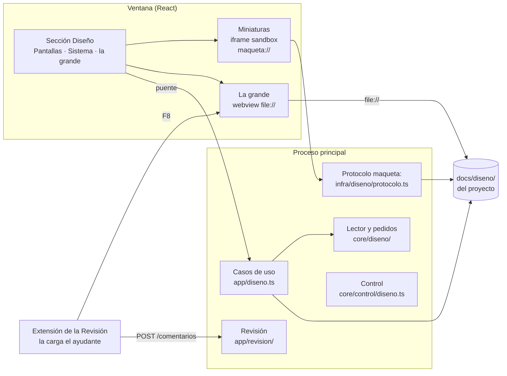

# Diseño técnico del módulo: Diseño

**Fecha:** 2026-11-08
> Respeta la arquitectura, el stack y las convenciones de `05-arquitectura.md`. Diseña lo que piden `ux.md` › Parte 2 (DS-1 a DS-13), D-105 (las pantallas son maquetas HTML) y D-106 (el orden de las iteraciones, Q-151), con lo comprobado en S-4 (`spikes/S-4-maquetas/`).

## Piezas


| Pieza | Dónde vive | Responsabilidad | Lo prueba |
|---|---|---|---|
| **Lector** | `src/main/core/diseno/` (`indice.ts`, `tokens.ts`, `maquetas.ts`, `pedidos.ts`) | Leer `docs/diseno/` (el índice, los tokens, las versiones, las direcciones), las referencias de cada maqueta, lo pendiente de pasar al código y el texto de cada pedido a la IA. Puro | Vitest, con muestras |
| **Control** | `src/main/core/control/diseno.ts` | Las reglas del formato (› El control), con los mismos lectores | Vitest |
| **Casos de uso** | `src/main/app/diseno.ts` | La vista de la sección, los vistos, los pedidos a la IA, quedarse con una versión, elegir o descartar una dirección, el aviso de cambios | Vitest con carpetas temporales y el motor falso |
| **Disco** | `src/main/infra/diseno/` (`protocolo.ts`, `vistos.ts`) | Servir las maquetas por `maqueta:`; escribir en `docs/diseno/` sin dejar archivos a medias; `diseno.json` en los datos del Centro | Vitest |
| **La grande** | `src/main/index.ts` (reglas del `webview`) y `src/renderer/secciones/proyecto/diseno/Grande.tsx` | La maqueta a todo el lienzo, viva y con `F8` | Playwright |
| **Sección** | `src/renderer/secciones/proyecto/diseno/` (`Diseno.tsx`, `Pantallas.tsx`, `Sistema.tsx`, `Miniatura.tsx`) | DS-11 a DS-13 | Playwright |
| **Revisión** | `src/main/core/revision/proyecto.ts`, `comentario.ts` y `src/compartido/mensaje-revision.ts` | Un comentario hecho sobre una maqueta va a su proyecto y dice qué maqueta es | Vitest y Playwright |
| **El framework** | `recursos/plugins/iridium/skills/iridium/` (`SKILL.md`, `referencias/06-ui.md`, `plantillas/diseno/`) | Le dice a la IA cómo se arma `docs/diseno/` (D-086: en el mismo cambio que el lector y el control) | El control sobre las muestras |

## El formato `docs/diseno/`
```
docs/diseno/
├── README.md          # el índice: las pantallas, su grupo y qué pasó a la app
├── tokens.css         # los tokens: solo variables en :root
├── piezas.css         # las piezas, con sus clases; solo usa var(--…)
├── piezas.js          # (opcional) lo que comparten las maquetas: abrir un menú, cambiar de pestaña
├── piezas.html        # la maqueta de piezas: cada pieza con sus variantes
├── pantallas/         # una maqueta por pantalla o por estado: bandeja.html, bandeja-vacia.html…
├── versiones/<maqueta>/  # otras versiones de una pantalla: a.html, b.html… (DI-I4)
├── direcciones/       # otros juegos de tokens: azul-apagado.css… (DI-I4)
└── app-hoy/           # (opcional) capturas de la app real, con el nombre de su maqueta: bandeja.png (DS-7)
```

### El índice: `docs/diseno/README.md`
```markdown
# Diseño

Las maquetas de la interfaz (D-105). Se miran en Iridium › Diseño.

## Pantallas
| Pantalla | Sección | Archivo | En la app |
|---|---|---|---|
| Grilla | Proyectos | pantallas/grilla.html | 2026-11-12 18:40 |
| Bandeja de entrada | Un proyecto | pantallas/bandeja.html | — |
```
- El orden de la tabla es el del lienzo; **Sección** es el grupo (el título sobre cada fila de miniaturas).
- **Archivo**, relativo a `docs/diseno/`, dentro de `pantallas/`.
- **En la app:** `—` (todavía no) o `AAAA-MM-DD HH:MM`, cuando la IA terminó de pasarla al código. Una maqueta está **pendiente de pasar** si dice `—` o si su archivo, `tokens.css` o `piezas.css` cambiaron después de esa fecha (la fecha de modificación del archivo).
- Lo demás del archivo es libre (notas, decisiones de diseño): Iridium solo lee la tabla.

### Las maquetas
- Una página HTML completa, con `<title>` y con `<link rel="stylesheet" href="../tokens.css">` y `../piezas.css` (y `<script src="../piezas.js">` si lo usa). Se dibuja para **1440×900**; Iridium la achica en el lienzo.
- **Todo local:** nada de `http://`, `https://` ni `//` en `src`, `href`, `url()` o `@import`; las letras, las del sistema o archivos dentro de `docs/diseno/`. Un enlace a otra maqueta es relativo (`<a href="mapa.html">`) y en la grande anda.
- **Los colores salen de los tokens:** en `piezas.css` y en los `<style>` de las maquetas no van colores escritos (`#…`, `rgb()`, `hsl()`): así cambiar un token cambia todas.
- Tienen los clics que la IA les ponga (abrir un menú, pasar a otra pantalla); no guardan datos ni hablan con la app (Won't de `definicion.md`).
- **Las clases de `piezas.css` son las del código** cuando la app las tiene (en Iridium, desde DI-I3, las de `src/renderer/ui/`): así pasar al código es copiar, no traducir.
- Una versión (`versiones/<maqueta>/<letra>.html`) es una maqueta más, con `<meta name="descripcion" content="la bandeja como una sola lista">`: la frase con que se pidió.
- Una dirección (`direcciones/<nombre>.css`) es un `tokens.css` entero con otros valores: las mismas variables.

## Mostrarlas vivas (S-4)
Las maquetas son HTML con scripts que escribe la IA en un proyecto: se muestran **aisladas**, sin el puente de Iridium, sin Node y sin red. Dos formas, las dos probadas en S-4:

### Las miniaturas: `<iframe>` con `maqueta:`
1. Al entrar a Diseño, la sección pide `abrirDiseno(ruta)`; el proceso principal le da al proyecto un id corto (la huella de su ruta) y devuelve la base `maqueta://<id>/`.
2. `protocol.handle('maqueta')` sirve **solo** archivos dentro de `docs/diseno/` de ese proyecto: rechaza `..`, rutas absolutas y cualquier id que no se abrió. Cada respuesta lleva la política de contenido `default-src 'none'; style-src maqueta: 'unsafe-inline'; script-src maqueta: 'unsafe-inline'; img-src maqueta: data:; font-src maqueta: data:` (sin `connect-src`: ni `fetch` ni nada a la red).
3. El `<iframe sandbox="allow-scripts">` (sin `allow-same-origin`) no puede tocar la página de Iridium (S-4: `parent.document` bloqueado). La política de la ventana suma `frame-src maqueta:`.
4. Se dibuja a 1440×900 y se achica con `transform: scale()`; no recibe el ratón (lo toma la tarjeta de encima, que agranda). Solo cargan las que se ven (`IntersectionObserver`); las que salen de la vista hace rato se descargan.
5. **Con una dirección puesta** (DI-I4) la base es `maqueta://<id>/~<dirección>/`: el `../tokens.css` de cada maqueta pide `/~<dirección>/tokens.css` y el protocolo devuelve `direcciones/<dirección>.css`. Hoy y la dirección lado a lado son dos `iframe` con dos bases.

### La grande: `<webview>` con `file://`
La extensión de la Revisión solo entra en el marco principal de una página `file://` o local (`all_frames: false`, y no acepta esquemas propios): para que `F8` ande, la grande es un `<webview>` con la dirección `file://` de la maqueta, en la sesión donde el ayudante cargó la extensión (S-4: la extensión entra, los clics andan, `F8` abre el modo comentar y la captura sale).
- La ventana de Iridium pasa a tener `webviewTag: true`, con estas reglas en `src/main/index.ts`:
  - `will-attach-webview`: sin `preload`, `nodeIntegration` apagado, `contextIsolation` y `sandbox` prendidos; solo se deja si la dirección es `file://` dentro de `docs/diseno/` de un proyecto conocido.
  - `will-navigate` y `will-frame-navigate`: solo dentro del mismo `docs/diseno/`; lo demás se frena. `setWindowOpenHandler`: nunca.
  - `webRequest.onBeforeRequest` para los `webview`: solo `file://` dentro de ese `docs/diseno/` y la extensión; lo demás se cancela (la extensión habla con Iridium desde su service worker, no desde la página).
- La cabecera de la grande sigue la navegación (`did-navigate`): si un enlace lleva a otra maqueta, el nombre y el número cambian.
- **Con una dirección puesta**, `insertCSS` con el archivo de la dirección después de cargar (mismas variables, gana la última).
- Un solo `webview` a la vez: con versiones lado a lado (DI-I4), las demás son `iframe` grandes y la que se comenta se pasa al `webview` con un clic.
- **La alternativa** era una vista nativa (`WebContentsView`) acomodada sobre el lienzo: el mismo aislamiento, pero hay que moverla y achicarla a mano con cada cambio de tamaño y no se superpone con los menús de React. El `webview` va dentro del árbol de React.

### Redibujar
1. La vigilancia ya avisa los cambios en `docs/` de cada proyecto. `app/diseno.ts` junta los de `docs/diseno/` durante 300 ms (la IA escribe varios archivos seguidos) y manda el evento del puente `diseno` con lo que cambió.
2. `tokens.css`, `piezas.css` o `piezas.js` → todas las maquetas; una maqueta → esa; `README.md` → se relee el índice (aparecen, se mueven o se van miniaturas).
3. La sección recarga el `iframe` con la huella del archivo en la dirección (`?v=…`, para que no use lo guardado) y el `webview` con `reload()`.
4. **El punto de «cambiada sin mirar»:** cada maqueta tiene una huella (fecha de modificación y tamaño, también de lo que usa). `diseno.json` en los datos del Centro guarda, por proyecto, la huella que se vio; agrandarla la marca vista. Sin `diseno.json` (la primera vez) todas cuentan como vistas.
5. **Una rota:** el lector revisa que el archivo exista y que lo que referencia (`href`, `src`) esté; si falta algo, la miniatura muestra su lugar con el motivo («Falta ../piezas.css») en vez de cargarla. Un error de JavaScript adentro no se detecta: la maqueta se ve como quede.

## F8 sobre una maqueta
La extensión y el ayudante no cambian (S-4). Cambia Iridium:
1. **El proyecto (`core/revision/proyecto.ts`):** antes de «Lo dice la app», un paso nuevo, **«Es una maqueta»**: si la página es `file://…/docs/diseno/…` dentro de un proyecto, es ese. Hace falta porque en Iridium el ayudante dice la carpeta de Iridium (`app.getAppPath()`), y el comentario sobre la maqueta de otro proyecto iría a Iridium.
2. **El comentario (`R-n.md`):** suma `**Maqueta:** docs/diseno/pantallas/bandeja.html` (relativa al proyecto). No hay componentes ni archivo y línea (es HTML sin React); sí elemento, selector, texto y captura.
3. **El mensaje a la IA** dice «Dónde: la maqueta `docs/diseno/pantallas/bandeja.html`» y que la corrija ahí, no en el código.
4. **En Revisión,** el enlace de un comentario con maqueta abre Diseño con esa maqueta grande (si ya no está, «ya no está»).
5. **Las pruebas:** con `IRIDIUM_DATOS` Iridium no carga el ayudante. La prueba de `F8` sobre una maqueta lo carga con `IRIDIUM_AYUDANTE=1` (variable nueva, solo para esa prueba) y el receptor en otro puerto (`IRIDIUM_REVISION_PUERTO`, ya existe).

## Los pedidos a la IA
Todos van a la conversación del proyecto como **Pasar al framework** (`app/conversacion.ts` › `seguir` con texto), después de un cuadro que dice que gasta uso. El texto lo arma `core/diseno/pedidos.ts` y cita el framework, no repite el formato:

| Pedido | Lo que dice (en corto) | Iteración |
|---|---|---|
| **Empezar el diseño** (DS-1) | «Armá `docs/diseno/` como dice el framework (`referencias/06-ui.md` › Maquetas)». Con código: «dibujá las pantallas como están hoy, desde el código y `06-ui.md`»; sin código: «desde `04-ux.md`» | DI-I1 |
| **Pasar al código** (DS-6) | Las maquetas pendientes de pasar, con su archivo; «construilas en la app y, al terminar cada una, poné la fecha y la hora en «En la app» del índice» | DI-I3 |
| **Otra versión** (DS-5) | «Escribí `versiones/<maqueta>/<letra>.html`: «<frase>»», con la próxima letra libre | DI-I4 |
| **Una dirección nueva** (DS-5) | «Escribí `direcciones/<nombre>.css` copiando `tokens.css`, con: «<frase>»» | DI-I4 |

«Con código» es que el proyecto tenga archivos fuera de `docs/` además de la ficha, su ícono, el `CLAUDE.md` y los de Git.

## Lo que Iridium escribe en `docs/diseno/` (DI-I4)
Sin la IA, con escritura atómica; lo que se borra va a la papelera de Windows (como Eliminar, D-090). Git deshace todo lo demás.
- **Quedarme con esta:** la versión elegida reemplaza a la maqueta y la carpeta `versiones/<maqueta>/` va a la papelera (si la elegida es la de hoy, solo va la carpeta).
- **Guardar para después:** nada; las versiones quedan.
- **Elegir una dirección:** `tokens.css` pasa a `direcciones/anterior-AAAA-MM-DD.css` y la dirección pasa a ser `tokens.css`. Se puede volver eligiendo la anterior.
- **Descartar una dirección:** su archivo va a la papelera.

## Sistema (DS-13)
`core/diseno/tokens.ts` lee las variables del primer bloque `:root` de `tokens.css` (`--nombre: valor;`) con su **uso**, el comentario que sigue al `;` en la misma línea (D-114), y las agrupa:

| Grupo | Cómo se reconoce | Cómo se dibuja |
|---|---|---|
| Colores | el valor es `#…`, `rgb()`, `hsl()` o `transparent` | muestra con nombre y valor |
| Letra | el nombre tiene `ui`, `fuente`, `letra` o `mono`, o el valor es una lista entre comas sin paréntesis | «Aa Iridium» en esa letra |
| Estilos de texto | `--estilo-*`: el atajo `font`, `peso tamaño/interlineado letra` (D-116) | una línea de ejemplo en ese estilo, con los `var(--…)` resueltos con los tokens del proyecto; el valor, con los tokens por su nombre |
| Tamaños de letra | `--tam-*` | una línea de ejemplo en cada tamaño |
| Espacios y esquinas | `--espacio-*`, `--esp-*`, `--radio-*` | barras y cuadrados con esa medida |
| Sombras | `--sombra-*` | un cuadrado con esa sombra |
| Otras | el resto | nombre y valor |

Cada token muestra su uso debajo de la muestra (colores) o a la derecha (el resto). Una línea que no se entiende va al recuadro de error con su número; las demás se muestran. **Piezas** es `piezas.html`, como una miniatura más que se agranda y se comenta. **Abrir tokens** abre `tokens.css` en Archivos.

## El control (D-086, D-092)
`core/control/diseno.ts`, solo si el proyecto tiene `docs/diseno/`:
1. `README.md` con `## Pantallas` y las columnas Pantalla, Sección, Archivo y En la app.
2. Cada **Archivo** existe y está en `pantallas/`; cada `.html` de `pantallas/` está en la tabla.
3. **En la app** es `—` o `AAAA-MM-DD HH:MM`.
4. `tokens.css` existe y tiene variables en `:root`, cada una con su uso (D-114; los que faltan, en un solo aviso con la línea del primero). Cada `--estilo-*` se entiende como atajo `font` y sus `var(--…)` existen (D-116; un aviso por estilo).
5. En maquetas, versiones, `piezas.*` y direcciones: nada de la red (`http://`, `https://`, `//`), nada fuera de `docs/diseno/` y nada que falte.
6. Sin colores escritos en `piezas.css` ni en los `<style>` de las maquetas.
7. Cada dirección tiene las mismas variables que `tokens.css`; cada carpeta de `versiones/` es de una maqueta que existe.

Se le devuelve a la IA como los demás avisos del control (una vez por turno). El framework suma, en el mismo cambio (DI-I1): `SKILL.md` › Los formatos, un apartado corto de `docs/diseno/` que remite a `referencias/06-ui.md` › Maquetas (cómo se arman: tokens, piezas, una maqueta por pantalla y por estado, 1440×900, todo local, contenido creíble en el idioma de la app); `referencias/06-ui.md` dice que en una app nueva las maquetas son la UI del hito 6 (D-105); y una plantilla `plantillas/diseno/README.md`.

## Pasar al código en Iridium (DI-I3)
- Las piezas (`PZ-1` a `PZ-12`) en `src/renderer/ui/`, con sus estilos en `src/renderer/estilos/piezas.css`, con las mismas clases que `docs/diseno/piezas.css`. Las secciones pasan a usarlas y los archivos de estilos de cada sección quedan con lo que es solo suyo (`ux.md` › Se quedan como propias).
- `docs/ui/tokens.css` pasa a ser el `tokens.css` de las maquetas, como único tema (D-104): fuera el bloque de Carbón, el selector de Ajustes › Apariencia, `IRIDIUM_TEMA`, `tools/miniaturas-tema.ts` y la corrida en Carbón.
- **El control de estilos** es una prueba de Vitest (`tests/estilos.test.ts`): en los archivos de estilos de sección no hay colores escritos (solo `var(--…)`) ni se redefinen las clases de las piezas; las clases viejas del inventario (`ux.md` › Las piezas, columna Reemplaza) ya no existen.
- **La app de antes y la de ahora:** `tools/auditoria-ux.ts` saca las capturas antes de empezar y al terminar; con `--app-hoy` las copia también a `docs/diseno/app-hoy/` con el nombre de su maqueta (DS-7). Esa carpeta va al `.gitignore` de Iridium: son los proyectos reales (D-082).

## Contrato con el núcleo
### Qué usa del núcleo
| Función / dato / servicio | Para qué |
|---|---|
| Vigilancia (`infra/vigilancia.ts`) y documentos (`app/documentos.ts`) | Redibujar cuando la IA cambia una maqueta |
| Conversación (`app/conversacion.ts` › `seguir` con texto) | Los pedidos a la IA |
| Escritura atómica (`infra/escritura.ts`) y la papelera (`infra/eliminacion.ts`) | Quedarse con una versión, elegir o descartar una dirección |
| Datos del Centro | `diseno.json`: lo que ya se miró |
| Lista de proyectos | Saber si un `file://` está dentro de un proyecto (la grande y F8) |
| Revisión (receptor, comentarios, sección) | `F8` sobre una maqueta |
| El control (`app/control.ts`) | Sumar las reglas de `docs/diseno/` |
| Lista de secciones del proyecto (B-11) | Sumar Diseño después de Revisión, solo en proyectos con framework |

### Qué expone
| Función / evento / dato | Quién lo usa |
|---|---|
| Puente: `abrirDiseno(ruta)` (la vista: grupos, maquetas con su estado, sistema, la base `maqueta://`), `marcarVista(ruta, archivo)`, `pedirDiseno(ruta, pedido)`, `quedarmeConVersion(…)`, `elegirDireccion(…)`, `descartarDireccion(…)` | La sección |
| Evento del puente `diseno` (proyecto, archivos cambiados) | La sección |
| El protocolo `maqueta:` | Las miniaturas |
| `docs/diseno/` en cada proyecto | La IA (lo escribe y lo lee para pasar al código), el usuario |

### Para plugins
No hay plugins (`05-arquitectura.md` › Puntos de extensión).

## Datos
- **`docs/diseno/`** en cada proyecto (› El formato). Lo escribe la IA; Iridium, solo lo de DI-I4.
- **`diseno.json`** en los datos del Centro: `{ "<ruta del proyecto>": { "<archivo>": "<huella vista>" } }`. Se puede perder: todo vuelve a contar como visto.
- **`R-n.md`** suma el campo `**Maqueta:**` (› F8 sobre una maqueta).

## Seguridad
Hereda P2 (`05-arquitectura.md` › Seguridad). Lo propio del módulo:

| Requisito | Cómo se cumple |
|---|---|
| Una maqueta no toca Iridium | Miniaturas: `iframe` con `sandbox` sin `allow-same-origin` (S-4). La grande: `webview` sin `preload`, sin Node, aislado y con `sandbox`. Ninguna ve el puente |
| Una maqueta no sale a internet | Miniaturas: política de contenido sin `connect-src` ni orígenes de afuera. La grande: los pedidos de ese `webview` que no sean `file://` de su `docs/diseno/` o la extensión se cancelan. El control marca lo que apunte a la red |
| Ni lee otros archivos de la PC | El protocolo solo sirve `docs/diseno/` del proyecto abierto (sin `..`). La grande solo navega dentro de su `docs/diseno/`; un `file://` de afuera se cancela |
| `webviewTag` no abre una puerta | `will-attach-webview` rehace sus opciones y rechaza cualquier dirección que no sea una maqueta |
| Iridium no pisa ni borra sin aviso | Lo que escribe en `docs/diseno/` sale de un botón con su cuadro; lo borrado va a la papelera; lo demás, Git |

## Pruebas
- **Lógica (Vitest):** el índice (tabla, rotos, pendientes de pasar con fechas), los tokens y sus grupos (con `negro.css` y `docs/ui/tokens.css`), las referencias de una maqueta, cada regla del control con su muestra mal escrita, el protocolo (`..`, otro proyecto, un id que no se abrió, un archivo que no está), el proyecto de un comentario hecho en una maqueta (antes que la carpeta del ayudante) y el texto de cada pedido.
- **Muestra:** `tests/muestras/diseno/` con un `docs/diseno/` chico (tres maquetas, una rota, piezas y una dirección) para la app abierta.
- **La app abierta (Playwright, motor falso):** las miniaturas cargan agrupadas; cambiar un archivo la redibuja con su punto; la rota muestra el motivo; agrandar, tocar algo de la maqueta, las flechas y Esc; un enlace a otra maqueta cambia la cabecera; una maqueta que pide algo a internet no lo recibe; Sistema muestra los colores y la letra; Pedírselo a la IA llega a la conversación con el cuadro antes. `F8` sobre una maqueta, con `IRIDIUM_AYUDANTE=1`: el `R-n` llega al proyecto de la maqueta con su campo **Maqueta** y la captura.
- **Que no rompa el resto:** `pnpm test`, `pnpm e2e`, `pnpm typecheck`, `pnpm lint`; en DI-I3 además la tanda 5 (`tools/accesibilidad.ts`) en AA y las capturas de antes y ahora.

## Cambios requeridos en el núcleo
| Cambio | Motivo | Decisión |
|---|---|---|
| `05-arquitectura.md` › Seguridad: Iridium escribe en `docs/diseno/` (quedarse con una versión, elegir o descartar una dirección) | DS-5 | D-105 |
| `05-arquitectura.md` › Puntos de extensión: las páginas web dentro de la app (B-5) quedan resueltas como `iframe` con `maqueta:` y un `webview` (S-4 en la tabla de Spikes) | Mostrar las maquetas vivas | D-106 |
| La ventana con `webviewTag` y la política de contenido con `frame-src maqueta:` | Las dos formas de mostrar | D-106 |
| `05-arquitectura.md` › Modelo de datos: `diseno.json` en los datos del Centro | Los vistos | D-106 |
| Revisión: el paso «Es una maqueta» y el campo **Maqueta** del `R-n.md` (también en el framework, que describe el comentario) | `F8` sobre una maqueta | D-105 |
| El framework: el formato `docs/diseno/`, `referencias/06-ui.md` › Maquetas y su plantilla, con el lector y el control | D-086 | D-105 |
| `CLAUDE.md`: la variable `IRIDIUM_AYUDANTE` | La prueba de `F8` | D-106 |
| Lista de secciones del proyecto: Diseño | DS-8 | D-105 |

## Iteraciones
En el orden de Q-151 (D-106). Cada una cierra con sus pruebas, capturas y una `Q-n` de prueba.

| ID | Objetivo | Qué se ve al terminar |
|---|---|---|
| DI-I1 | El formato `docs/diseno/` en el framework, con su lector y su control; la sección Diseño con **Pantallas** (miniaturas vivas, grupos, redibujo, punto, rotas), la grande (usar, flechas, Esc), **Sistema**, `F8` sobre una maqueta y **Pedírselo a la IA** para empezar. Primero se confirma lo que S-4 no midió: pasar a otra maqueta con un enlace dentro del `webview` | En un proyecto de prueba, las maquetas vivas en el lienzo; una cambiada se redibuja sola; `F8` sobre una grande deja un `R-n` con la maqueta |
| DI-I2 | El rediseño de Iridium en maquetas: `docs/diseno/` de este repo con `negro.css` como tokens, `piezas.css` y `piezas.html` con las 12 piezas, y las pantallas del inventario (`ux.md` › Cómo queda cada pantalla), incluida la sección Diseño. Sin código de la app | El usuario recorre las maquetas de Iridium en su sección Diseño y las comenta con `F8` |
| DI-I3 | Pasar al código: el botón con sus pendientes y, con él, el rediseño de Iridium (› Pasar al código en Iridium); **La app hoy** (DS-7) | La app real en negro, igual a las maquetas; las de antes y ahora lado a lado; las pruebas y la tanda 5 en verde |
| DI-I4 | Otra versión y Probar una dirección: lado a lado, quedarse con una, elegir o descartar | Dos versiones de la Bandeja lado a lado y una dirección sobre todo el lienzo |

## Riesgos
- **Muchas maquetas vivas a la vez** pesan: se cargan solo las que se ven. Se mide en DI-I1 con las 30 de Iridium (que la primera fila aparezca en menos de un segundo).
- **`webviewTag`** es una superficie más de Electron: la cubren las reglas de `will-attach-webview` y de navegación, con su prueba.
- **La fecha de modificación** decide qué está pendiente de pasar: un `git checkout` la cambia y la maqueta vuelve a contarse como pendiente. Es un falso pendiente, no una pérdida; se acepta.
