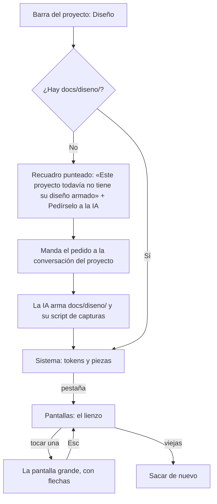
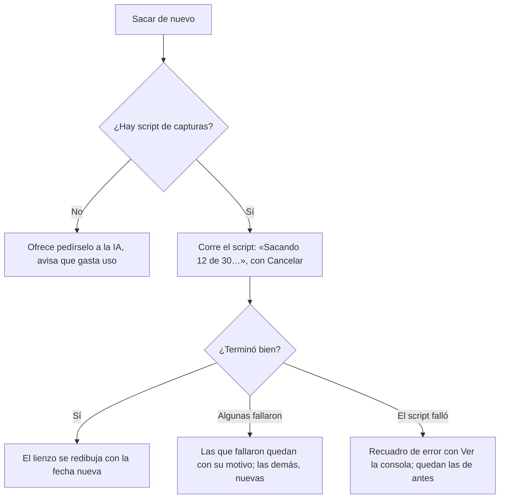
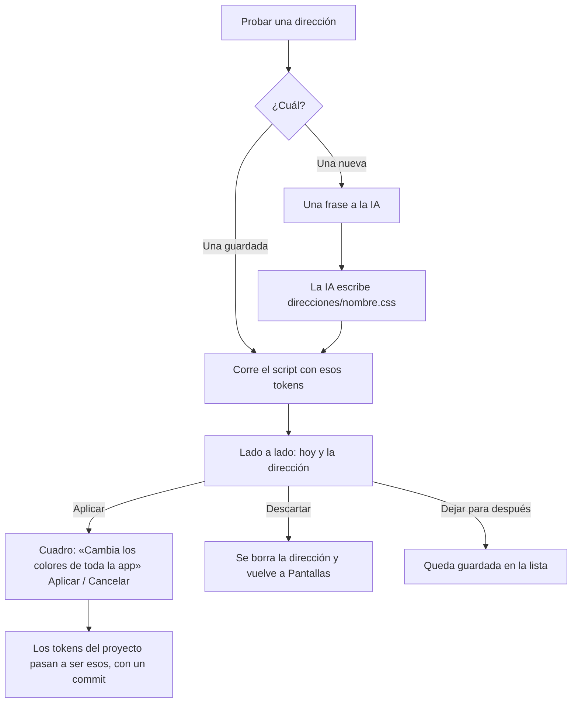

# UX del módulo: Diseño

**Fecha:** 2026-11-07
**Base:** `definicion.md`, D-102, D-103 y D-104 (un solo tema, el negro). Mirado sobre las 30 pantallas de `tools/salida/auditoria/1440x900/` y `1440x900-negro/` (la 11, el detalle de Ideas, no salió: T-53) y sobre los 13 archivos de estilos de `src/renderer/estilos/`, con los criterios de las skills `design-critique` y `design-system`.

Este paso tiene dos partes: el **inventario** (qué arma cada sección a mano, qué pieza lo reemplaza y qué cajas y bordes sobran), que es lo que construye DI-I1, y la **sección Diseño** (historias, flujos y pantallas), que construyen DI-I2 y DI-I3.

## Parte 1 — Inventario

### Lo que se ve en las 30 pantallas
Con el negro los colores ya cambian desde un solo archivo, pero el ruido sigue, y es de estructura:

1. **Cajas dentro de cajas.** La Bandeja de entrada es el peor caso: la pregunta es una caja con borde, cada casilla es otra caja con borde y la nota de cada casilla, una tercera. Lo mismo, con dos niveles, en Ideas (la caja de Anotar con su selector y su botón con borde), en el compositor de la conversación, en Skills › Framework (la lista en una caja y cada fila con su botón con borde) y en el Mapa (el bloque de frentes con borde y cada hito en un cuadrado con borde).
2. **Todo lleva borde.** De las 213 reglas de estilo con borde o fondo, la mayoría dibujan un recuadro: cada script de Scripts, cada archivo cambiado de Git, cada opción de Tono en Ajustes, cada tarjeta de la grilla, cada «framework viejo» y cada «Frena» como píldora.
3. **Botones de cinco clases distintas.** Hay `btn primario`, `btn secundario`, `chip`, `btn-ic` y una docena de botones sueltos (`.cerrar`, `.actualizar`, `.atras`, `.reabrir`, `.mini-link`, `.aviso .x`, `.enlace-frente`…). Casi todos los botones visibles son secundarios con borde, así que nada se distingue: en la grilla, en la cabecera de la conversación y en cada fila de Scripts y de Framework hay botones con recuadro.
4. **Dos líneas de cabecera.** En un proyecto, la barra del proyecto («Iridium · Hito 10») y la cabecera de la sección llevan cada una su línea abajo; con los filtros, son tres franjas antes del contenido.
5. **Títulos de cuatro estilos.** «CAMBIOS», «HISTORIAL», «ARCHIVOS» e «IRIDIUM» van en mayúsculas y letra fija; «Frenan el proyecto», «En curso 1» y «Propias 2», en gris normal; «Próximo paso» del Mapa, en gris chico. Son lo mismo: el título de un bloque.
6. **Dos formas de leer markdown.** La conversación (`.md`) y Docs y la Bandeja (`.doc-texto`) tienen cada una sus estilos de tablas, citas y código; las tablas de Docs llevan borde en todas las celdas.
7. **Medidores donde alcanza un número.** El uso de 5 h y de la semana lleva barra y número; la barra repite el número.
8. **El foco se ve con el ratón.** El título de la sección («Bandeja de entrada», «Skills») queda con un recuadro blanco al entrar con un clic: el foco tiene que verse solo con el teclado.

### Las piezas (PZ-n)
El juego que deja DI-I1, con lo que reemplaza de hoy. La regla general: **se separa con espacio y con una línea gris solo donde hace falta; el borde es del Recuadro, de los Campos y del botón secundario; la sombra, de lo que flota.**

| Pieza | Variantes | Reemplaza (clases de hoy) | Dónde se usa |
|---|---|---|---|
| PZ-1 — Botón | principal (blanco, letra negra), secundario (con línea), sin fondo, peligroso; normal y chico; con ícono o solo ícono | `btn primario`, `btn secundario`, `chip`, `btn-ic`, `btn peligro`, `.cerrar`, `.actualizar`, `.atras`, `.reabrir`, `.mini-link`, `.aviso .x`, `.estado-barra button.chip`, `.principal > .cabecera button.chip` | todas las secciones, la conversación, los cuadros |
| PZ-2 — Fila | simple, con detalle debajo, elegida, con acciones (se ven al pasar o con el foco; la principal, siempre) | `.sk-fila`, `.sk-proy`, `.tb-fila`, `.fila-com`, `.commit`, `.arch`, `.script-fila`/`.script`, `.proy`, `.mapa .fila`, `.fila-git`, filas de Ideas | Skills, Framework, Trabajo, Ideas, Revisión, Git, Scripts, Bandeja (columna de proyectos), Mapa |
| PZ-3 — Bloque | con título o sin título; el título con cuenta | `.columna`, `.sk-grupo`, `.bloque-frentes`, `.hito-card`, `.proximo`, `.remoto`, `.plegable`, `.git-det .cuerpo`, `.panel-doc`, `.respuesta`, `.pend` (la caja de cada pregunta), los títulos en mayúsculas de Git, Archivos y Skills | Bandeja, Mapa, Git, Skills, Trabajo, Ideas |
| PZ-4 — Recuadro | aviso (ámbar), error (rojo), vacío, punteado (lo que falta) | `.mensaje`, `.aviso`, `.aviso-doc`, `.aviso-detalle`, `.aviso-git`, `.aviso-grilla`, `.aviso-afuera`, `.sin-guia`, `.recuadro-simple`, `.falla-motor`, `.ajustes-error`, `.rev-vacio`, `.mudanza`, `.sk-avisos`, `.falla` | avisos de toda la app y los vacíos con acción |
| PZ-5 — Campo | texto, área de texto, selector, casilla, opción (radio), interruptor | `.campo-ajuste input`, `.anotar input`, `.campo`, `.reabrir textarea`, `.tono`, `.opcion`, `.gp-casilla`, `.interruptor`, `.cab-2 .filtro.menu`, `.destino .menu-boton` | Ajustes, Bandeja, Ideas, Trabajo, Revisión, Nuevo proyecto |
| PZ-6 — Filtros | con cuenta; como pestañas de texto (el elegido en blanco con una línea debajo) | `.filtros`/`.filtro` (hoy píldoras con borde), `.ancho-lectura` (Angosto · Normal · Ancho) | Bandeja, Trabajo, Revisión, Skills › Framework, Docs |
| PZ-7 — Cuenta y señal | número gris, número ámbar (frena), punto ámbar, punto rojo, etiqueta de texto (sin píldora) | `.cuenta-bandeja`, `.badge`, `.frena-punto`, `.aviso-punto`, `.tarjeta .aviso-fw`, la píldora «framework viejo», «Frena» y el frente de cada pregunta (`.frente-q`), `.medidor` | grilla, Bandeja, Mapa, Skills, barra de estado |
| PZ-8 — Menú y cuadro | menú, menú contextual, cuadro (confirmar, Nuevo proyecto, Eliminar), ventana (Ajustes) | `.menu-lista`, `.menu-contextual`, `.dialogo` y `.velo`, `.ajustes` | menús de la tarjeta, de las conversaciones y de Ideas; los cuadros |
| PZ-9 — Cabecera de sección | título con cuenta, acciones (una principal como mucho), filtros debajo | `Cabecera` (W-9) y las cabeceras propias de Docs (`.barra-doc`), del detalle de Skills (`.sk-detalle .cab`) y de la conversación (`.chat-cab`, `.cab-panel`) | todas las secciones |
| PZ-10 — Pestañas | de la barra lateral (íconos), de los proyectos abiertos, de una ventana (Ajustes), de una vista (Resumen · Archivos en Skills) | `.act`, `.ses`, `.ajustes nav button`, la navegación del detalle de Skills, la fila de hitos del Mapa (`.h`) | el marco, Ajustes, Skills, Mapa |
| PZ-11 — Árbol | carpeta, archivo, elegido, con marca a la derecha (M, A) | `.arbol`/`.nodo` de Archivos, los archivos del detalle de Skills, la lista de cambios de Git | Archivos, Skills, Git |
| PZ-12 — Texto de documento | lectura (Docs, Bandeja) y conversación; tablas con línea solo entre filas, citas, código | `.md` (conversación) y `.doc-texto` (Docs, Bandeja, panel de documento) | Docs, Bandeja, conversación, Mapa |

PZ-11 y PZ-12 no estaban en la tabla de `definicion.md`: aparecieron al mirar las pantallas (el árbol se arma tres veces y el markdown, dos) y se suman ahí.

**Se quedan como propias de su sección** (no se repiten en otro lado): la **tarjeta de proyecto** de la grilla (sin borde: un fondo un punto más claro que el negro, y «framework viejo» como texto gris), el **compositor** de la conversación (una sola línea alrededor, sin la caja de adentro), el **divisor** (`Divisor`, ya compartido), el **visor de código y de diferencias** (Archivos y Git) y las **capturas** de la Revisión.

### Cómo queda cada pantalla
| # | Pantalla | Lo que sobra hoy | Con las piezas |
|---|---|---|---|
| 01–03, 06 | Proyectos (grilla, archivados, ancho chico) | borde en cada tarjeta; «framework viejo» en píldora; «Nuevo proyecto» con recuadro; el interruptor de Archivados con pista | tarjeta sin borde; etiqueta de texto (PZ-7); «Nuevo proyecto» botón principal (es la acción de la pantalla); interruptor (PZ-5) |
| 04 | Menú de la tarjeta | ya va bien: es lo único con sombra | menú contextual (PZ-8), sin cambios de forma |
| 05 | Nuevo proyecto | el campo con borde blanco grueso; «Crear» gris aunque es el principal | cuadro (PZ-8); campo (PZ-5); «Crear» principal, apagado hasta que haya nombre |
| 07, 19 | Bandeja de entrada | tres niveles de caja: pregunta, casilla y nota; «Frena» en píldora ámbar con borde ámbar alrededor de toda la pregunta; el frente en píldora | cada pregunta es un bloque (PZ-3) con su código, el título y la señal ámbar al lado (PZ-7), sin borde; las casillas son filas (PZ-2) con la nota como campo a la derecha; una línea gris entre preguntas; «Enviar» principal |
| 08 | Skills › Framework | la lista en una caja con borde; «Pasar al framework» con recuadro en cada fila | filas sobre el fondo (PZ-2) con «Pasar al framework» como botón sin fondo, a la vista |
| 09 | Ideas | la caja de Anotar con su selector y su botón adentro | campo de una línea (PZ-5) con el destino y «Anotar» como botón chico; filas (PZ-2) |
| 10 | Detalle de una skill | dos cabeceras propias; «ARCHIVOS» en mayúsculas; «Abrir carpeta» con recuadro | cabecera de sección (PZ-9); pestañas Resumen · Archivos (PZ-10); árbol (PZ-11) |
| 11 | Detalle de una idea | (no salió la captura, T-53) | se revisa con la página de DI-I1 |
| 12–17, 27 | Ajustes | la ventana con su barra con borde; cada opción de Tono en una caja; «Cambiar de cuenta» con recuadro; el foco visible al abrir | ventana (PZ-8) con pestañas (PZ-10); opciones (PZ-5) como filas con su punto; Apariencia sin el selector de tema (D-104) |
| 18, 20, 30 | Mapa | el bloque de frentes con borde; cada hito en un cuadrado con borde; «Abrir 10-operacion.md» y «Abrir estado.md» con recuadro | hitos como pestañas de números (PZ-10); el frente activo como bloque (PZ-3) sin borde; las líneas de abajo como filas; «Abrir» como botones sin fondo |
| 21 | Trabajo | «Anotar una idea» y el selector de frente con recuadro; filtros en píldora | filtros (PZ-6); el frente como selector sin borde dentro de los filtros; filas (PZ-2) como hoy |
| 22 | Revisión | filtros en píldora; el vacío como texto suelto | filtros (PZ-6); vacío (PZ-4) con lo que hay que hacer (F8) |
| 23 | Docs | tablas con borde en cada celda; el ancho del texto en un grupo con recuadro | texto de documento (PZ-12) con línea solo entre filas; el ancho como filtros (PZ-6) |
| 24 | Archivos | «IRIDIUM» en mayúsculas; el vacío centrado sin recuadro | árbol (PZ-11) con el título como bloque; el vacío como texto gris, sin caja |
| 25 | Git | cada archivo cambiado en una caja; «CAMBIOS» e «HISTORIAL» en mayúsculas | árbol y filas (PZ-11, PZ-2); los títulos como bloques (PZ-3) |
| 26 | Scripts | cada script en una caja con «Ejecutar» con recuadro | filas con detalle debajo (PZ-2), una línea gris entre scripts y «Ejecutar» como botón sin fondo |
| 28 | Un proyecto en ancho chico | las mismas cajas, más apretadas | lo mismo que cada sección |
| 29 | Otro proyecto | — | igual que su sección |
| todas | El marco | la barra del proyecto y la cabecera de la sección con una línea cada una; «Nueva» y «Seguí» con recuadro; «Claude · max» con recuadro; medidores de uso | una sola línea, debajo de la cabecera de la sección; «Seguí» principal (es la acción de la conversación), «Nueva» sin fondo; el uso como números (PZ-7) |

### Reglas que quedan escritas para DI-I1
- **Un principal por pantalla como mucho.** En un proyecto es «Seguí»; en la grilla, «Nuevo proyecto»; en un cuadro, el que confirma.
- **Nunca un bloque dentro de otro, ni una caja dentro de un recuadro.** Lo que hoy es una caja dentro de otra pasa a ser filas.
- **Las acciones de una fila** son botones sin fondo. Si la fila tiene una sola acción que es lo que se viene a hacer (Ejecutar, Pasar al framework), está siempre a la vista; si son varias, aparecen al pasar el ratón o con el foco.
- **Un solo estilo de título de bloque**: gris, tamaño chico, con la cuenta al lado. Nada en mayúsculas.
- **El foco se dibuja solo con el teclado** (`:focus-visible`); con el ratón, nada.
- **Los estilos por sección** quedan para lo que es solo de ella (la tarjeta, el compositor, el visor de código, las capturas). Un botón, una fila o un recuadro escritos en un archivo de sección es un error que el control de estilos de DI-I1 marca.

## Parte 2 — La sección Diseño

### Historias (DS-n)
#### DS-1 — Ver el sistema de un proyecto
- Como usuario quiero ver los tokens y las piezas de un proyecto en un solo lugar para saber de qué está hecha su interfaz sin abrir el código.
  - Criterios de aceptación:
    - [ ] **Sistema** muestra los colores como muestras con su nombre, las letras con un ejemplo de cada tamaño, los espacios y las esquinas dibujados.
    - [ ] Cada pieza es una tarjeta con su nombre y sus variantes, una al lado de la otra.
    - [ ] Sin `docs/diseno/`, la sección dice qué falta y ofrece pedírselo a la IA.

#### DS-2 — Ver todas las pantallas juntas
- Como usuario quiero ver todas las pantallas de la app en un lienzo para juzgar el conjunto de un vistazo.
  - Criterios de aceptación:
    - [ ] **Pantallas** muestra todas las capturas en una grilla, con su nombre debajo, agrupadas por sección.
    - [ ] Tocar una la agranda a todo el lienzo; las flechas pasan a la anterior y la siguiente; Esc vuelve.
    - [ ] Dice cuándo se sacaron y, si el código cambió después, que están viejas, con **Sacar de nuevo**.

#### DS-3 — Sacar las pantallas de nuevo
- Como usuario quiero volver a sacar las pantallas con un botón para ver el estado de hoy sin pedírselo a nadie.
  - Criterios de aceptación:
    - [ ] **Sacar de nuevo** corre el script de capturas del proyecto y muestra el avance; al terminar, el lienzo se redibuja.
    - [ ] Si una pantalla falla, se ve su lugar vacío con el motivo, y las demás se ven igual.
    - [ ] Si el proyecto no tiene script de capturas, el botón ofrece pedírselo a la IA (gasta uso, lo dice).

#### DS-4 — Probar una dirección
- Como usuario quiero probar otro juego de tokens sobre todas las pantallas a la vez para decidir un cambio grande mirando el resultado.
  - Criterios de aceptación:
    - [ ] **Probar una dirección** deja elegir una dirección guardada en `docs/diseno/direcciones/` o pedirle una nueva a la IA con una frase («el negro con un azul muy apagado»).
    - [ ] Las pantallas con la dirección salen lado a lado con las de hoy, una fila por pantalla.
    - [ ] **Aplicar** la vuelve los tokens del proyecto (con un commit que se puede deshacer); **Descartar** la borra.

#### DS-5 — Ver el antes y el después de un cambio (DI-I1)
- Como usuario quiero ver las 30 pantallas de antes y de ahora lado a lado para aprobar el rediseño de una vez.
  - Criterios de aceptación:
    - [ ] Una página (en DI-I1, un archivo que abre `scripts.md`; desde DI-I2, la vista **Pantallas**) muestra cada pantalla de antes a la izquierda y la de ahora a la derecha.

### Flujos
#### DS-6 — Entrar a Diseño y mirar


#### DS-7 — Sacar las pantallas de nuevo


#### DS-8 — Probar una dirección


### Arquitectura de información
- **Diseño** es una sección más de la barra de cada proyecto **con framework**, después de Revisión y antes de Docs: es de mirar y decidir, como el Mapa y la Revisión; Docs, Archivos, Git y Scripts son las herramientas. No aparece en una carpeta simple.
- Adentro, dos pestañas (PZ-10): **Sistema** y **Pantallas**. Probar una dirección es una acción de la cabecera de Pantallas, no una tercera pestaña: se prueba mirando pantallas.
- Lo que lee, en el proyecto: `docs/diseno/` (el formato lo define el paso 5 con su lector y su control, D-086): los tokens, las piezas, las capturas con su fecha y las direcciones guardadas, y el script de capturas en `scripts.md`.
- La conversación sigue al lado, como en todas las secciones: lo que se ve se comenta ahí.

### Pantallas
#### DS-9 — Diseño › Sistema
- Propósito: ver de qué está hecha la interfaz.
- Elementos: la cabecera (Diseño, las pestañas, «Abrir tokens.css» sin fondo); el bloque **Colores** (muestras en fila, nombre y valor); **Letra** (cada tamaño con un ejemplo); **Espacios y esquinas**; **Piezas** (una tarjeta por pieza con sus variantes).
- Estados: sin `docs/diseno/` (recuadro punteado con Pedírselo a la IA); tokens sin piezas (los tokens y «Las piezas todavía no están anotadas»); un archivo dañado (recuadro de error con el archivo y la línea).

```
┌─────────────────────────────────────────────────────────────┐
│ Diseño   Sistema · Pantallas                [Abrir tokens]  │
├─────────────────────────────────────────────────────────────┤
│ Colores                                                     │
│ ■ fondo  ■ elevado  ■ línea  ■ texto  ■ texto-2  ■ ámbar    │
│                                                             │
│ Letra                                                       │
│ Lectura 14,5 — El usuario dirige con sus ideas              │
│ Chica 12 — Hace 10 min · 12 archivos                        │
│                                                             │
│ Piezas                                                      │
│ ┌ Botón ─────────────┐ ┌ Fila ──────────────┐ ┌ Bloque ──┐  │
│ │ [Principal] [Sec.] │ │ T-5 Biblioteca   › │ │ Título 3 │  │
│ └────────────────────┘ └────────────────────┘ └──────────┘  │
└─────────────────────────────────────────────────────────────┘
```

#### DS-10 — Diseño › Pantallas
- Propósito: ver todas las pantallas juntas.
- Elementos: la cabecera (Diseño, las pestañas, «Probar una dirección», «Sacar de nuevo» y la fecha de las capturas); el lienzo, agrupado por sección, con cada captura y su nombre; arriba a la derecha, el tamaño de las miniaturas (chico · grande).
- Estados: sin capturas (recuadro punteado con Sacar las pantallas); sacando (cada miniatura se reemplaza al llegar, con «Sacando 12 de 30» y Cancelar); viejas (una línea ámbar: «El código cambió después de sacarlas»); una que falló (su lugar con el motivo); muchas (el lienzo se desplaza, los grupos quedan como títulos).

```
┌─────────────────────────────────────────────────────────────┐
│ Diseño   Sistema · Pantallas   hoy 22:52  [Probar…] [Sacar] │
├─────────────────────────────────────────────────────────────┤
│ Proyectos                                                   │
│ ┌──────┐ ┌──────┐ ┌──────┐ ┌──────┐                         │
│ │      │ │      │ │      │ │      │                         │
│ └──────┘ └──────┘ └──────┘ └──────┘                         │
│ Grilla   Archiv.  Menú     Nuevo                            │
│ Un proyecto                                                 │
│ ┌──────┐ ┌──────┐ ┌──────┐ ┌──────┐ ┌──────┐                │
│ │      │ │      │ │      │ │      │ │      │                │
│ └──────┘ └──────┘ └──────┘ └──────┘ └──────┘                │
│ Bandeja  Mapa     Trabajo  Revisión Docs                    │
└─────────────────────────────────────────────────────────────┘
```

#### DS-11 — Una dirección, lado a lado
- Propósito: decidir si una dirección se aplica.
- Elementos: la cabecera con el nombre de la dirección, **Aplicar** (principal), **Descartar** y **Volver**; dos columnas, «Hoy» y la dirección, una fila por pantalla; tocar una fila la agranda con las dos.
- Estados: sacando (las de la derecha llegan de a una); falló (recuadro de error, la dirección queda guardada); aplicada (vuelve a Pantallas con las nuevas y la fecha).

### Principios de interacción
- **Nada se aplica sin un cuadro de confirmación** que diga qué cambia; Aplicar deja un commit, así que se puede volver atrás con Git.
- **Lo que gasta uso lo dice antes** (pedir el diseño o una dirección a la IA). Sacar las pantallas con el script no gasta.
- **Sacar las pantallas no toca los proyectos del usuario**: el script trabaja sobre una copia, como `auditoria-ux.ts` (D-082).
- Teclado: en el lienzo, las flechas mueven entre pantallas, Enter agranda y Esc vuelve.

### Accesibilidad
- El contraste del negro se mide con la tanda 5 (`tools/accesibilidad.ts`) al final de DI-I1: texto principal y secundario en AA sobre el negro y sobre el elevado.
- Cada captura del lienzo lleva su nombre como texto alternativo; la pantalla grande se anuncia con su nombre y su número («12 de 30»).

## Portón
- [x] Inventario de piezas sobre las 30 pantallas, con lo que reemplaza cada una.
- [x] Historias con criterios de aceptación para todo el mínimo (DI-I1 a DI-I3).
- [x] Flujos principales, con los de error.
- [x] Arquitectura de información: dónde entra la sección y qué lee.
- [x] Wireframes de Sistema y Pantallas; estados de cada pantalla.
- [x] Principios de interacción y accesibilidad.
- [x] ¿Cambia algo de los documentos generales? Sí: PZ-11 y PZ-12 en `definicion.md`; los códigos `PZ-n` y `DS-n` en `docs/README.md` (aplicado).
- [ ] El usuario recorrió los flujos y los aprobó (Q-150).
