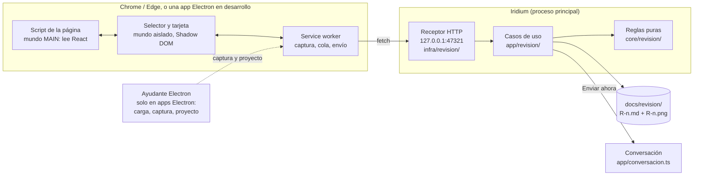

# Diseño técnico del módulo: Revisión de la app

**Fecha:** 2026-10-28
> Respeta la arquitectura, el stack y las convenciones de `05-arquitectura.md`. Diseña lo que pide `ux.md` › Para el diseño técnico, con lo comprobado en S-3 (`investigacion.md`, `research/revision-extension.md`). Decisión que lo resume: D-048.

## Piezas


| Pieza | Dónde vive | Responsabilidad | Lo prueba |
|---|---|---|---|
| **Script de la página** | `extension/src/pagina.ts` (mundo `MAIN`) | Del elemento elegido saca la pila de React (`_debugStack`) y los componentes que lo contienen. Nada más: no toca la página | Playwright con la extensión |
| **Selector y tarjeta** | `extension/src/selector/` (mundo aislado) | El modo comentar: aviso al entrar, resaltado, `Alt+↑/↓`, tarjeta, borradores. Todo dentro de un Shadow DOM cerrado, con sus estilos y las letras de Iridium (`ux.md` › Piezas de UI nuevas) | Playwright con la extensión |
| **Service worker** | `extension/src/sw.ts` | Captura y recorta (en Chrome y Edge), pregunta a Iridium por el proyecto, envía, guarda la cola y la vacía, número en el botón | Vitest (cola) y Playwright |
| **Ayudante Electron** | `extension/electron/ayudante.mjs` | En una app Electron en modo desarrollo: carga la extensión, le da la captura con `capturePage` y le dice la carpeta de la app | Prueba con una app Electron de prueba |
| **Receptor** | `src/main/infra/revision/receptor.ts` | Escucha en `127.0.0.1:47321`; valida origen, `Host`, tamaño y forma (Zod); pasa el pedido a los casos de uso | Vitest con pedidos reales a un puerto libre |
| **Casos de uso** | `src/main/app/revision/` | Resolver proyecto y archivo y línea, numerar, guardar, Enviar ahora, reabrir, listar | Vitest con carpetas temporales y el motor falso |
| **Reglas puras** | `src/main/core/revision/` | Leer y escribir el `R-n.md`, el próximo número, leer la pila, elegir el proyecto entre candidatos, armar el mensaje para la IA | Vitest, sin nada externo |
| **Sección Revisión** | `src/renderer/secciones/proyecto/Revision.tsx` | W-R3 y el mensaje W-R4 en la conversación | Playwright |

## Contrato con el núcleo
### Qué usa del núcleo
| Función / dato / servicio | Para qué |
|---|---|
| Lista de proyectos (`app/proyectos.ts`) | Elegir el proyecto de una dirección y ofrecer la lista cuando no se sabe |
| Conversación (`app/conversacion.ts` › `seguir` con texto) | Enviar ahora: si el proyecto está abierto en Iridium, el comentario entra como mensaje del usuario; si la IA trabaja, se suma al turno (D-037, ya funciona así) |
| Escritura atómica (`infra/escritura.ts`) | Guardar `R-n.md`, la captura y los cambios de estado sin dejar archivos a medias |
| Vigilancia (`infra/vigilancia.ts`) | Ver cuándo la IA cierra un comentario y actualizar la lista y el contador |
| Datos del Centro | `revision.json`: direcciones recordadas y última conexión de la extensión |
| Ejecutar (`infra/ejecutar.ts`) | Preguntarle a Windows qué proceso atiende un puerto |
| Instrucción de la sesión (`core/sesiones.ts`) | Avisarle a la IA cuántos comentarios abiertos hay (H-R6) |
| Archivos (sección) | Abrir un archivo en una línea desde un comentario |
| Lista de secciones del proyecto (B-11) | Sumar el ícono Revisión con su contador |

### Qué expone
| Función / evento / dato | Quién lo usa |
|---|---|
| HTTP `POST /estado` (dirección y versión; `POST` porque Chrome y Edge no mandan el origen de la extensión en un `GET`) | La extensión: si Iridium está, a qué proyecto va la dirección, si ese proyecto está abierto, la lista de proyectos cuando no lo sabe, la versión vigente de la extensión |
| HTTP `POST /comentarios` | La extensión: guarda (y si se pide, envía) un comentario. Responde el `R-n`, el proyecto y qué pasó con el envío (`enviado` · `sin-sesion`) |
| HTTP `POST /direcciones` | La extensión: recordar «esta dirección es de tal proyecto» (H-R3) |
| Puente: `listarComentarios(ruta)`, `leerComentario(ruta, R-n)`, `enviarComentario(ruta, R-n)`, `reabrirComentario(ruta, R-n, nota)`, `estadoExtension()`, `revisionElectron(ruta)` | La sección Revisión |
| Evento del puente `comentarios` (proyecto, abiertos) | El contador del ícono y la lista, en vivo |
| `docs/revision/R-n.md` y `R-n.png` en cada proyecto | La IA (los lee y los cierra), el usuario, el Gestor (no los usa) |

### Para plugins
No hay plugins (`05-arquitectura.md` › Puntos de extensión).

## Estructura interna
```
extension/                     # paquete aparte en el mismo repo (05-arquitectura.md › Puntos de extensión)
├── manifest.json              # MV3, con "key" fija: el mismo id en Chrome, Edge y Electron
├── src/
│   ├── pagina.ts              # mundo MAIN
│   ├── selector/              # aviso, resaltado, tarjeta (Shadow DOM)
│   ├── sw.ts                  # service worker
│   └── comun.ts               # forma del comentario y del /estado (la misma que valida Iridium)
├── electron/ayudante.mjs      # lo que llama la línea de cada app Electron
└── fuentes/                   # las letras de Iridium, como recursos de la extensión
src/main/core/revision/        # comentario.ts (leer/escribir R-n.md), pila.ts, proyecto.ts, mensaje.ts
src/main/app/revision/         # recibir.ts, resolver.ts (proyecto, archivo y línea), comentarios.ts, electron.ts
src/main/infra/revision/       # receptor.ts, puerto.ts (proceso que atiende un puerto), extension.ts (copia la extensión)
src/renderer/secciones/proyecto/Revision.tsx
```
- La extensión se arma con esbuild (ya viene con Vite) dentro de `pnpm build`, a `out/extension/`; electron-builder la lleva como recurso de la app.
- **Una carpeta fija para instalarla:** al arrancar, Iridium copia la extensión a `%APPDATA%\Centro de Desarrollo\extension\` si la versión cambió. Esa carpeta es la que el usuario carga una vez en Chrome y Edge (`scripts.md`) y la que usa el ayudante de Electron. Así no depende de dónde esté el repo ni de si se rearma.
- **Versión:** el `/estado` dice la versión vigente; si la extensión cargada es más vieja, el aviso del modo comentar y Revisión dicen «Actualizá la extensión» con cómo (en Chrome y Edge, Recargar en la página de extensiones; Electron la carga nueva en cada arranque).

## Datos
### El comentario: `docs/revision/R-n.md` (+ `R-n.png`)
Un archivo por comentario, en la carpeta `docs/` del proyecto, para que la IA lo lea con lo demás y lo cite como cualquier código (`R-14`). Se lee con tolerancia, como el resto de `docs/` (D-019).

```markdown
# R-14 — el botón queda muy pegado al título; separalo

**Estado:** abierto
**Dónde:** `src/Tarjeta.jsx`, línea 6
**Componentes:** Tarjeta › App
**Página:** http://localhost:5173/ajustes
**Elemento:** `button` · texto «Guardar» · selector `main > div.tarjeta > button`
**Captura:** 

## Comentario
el botón queda muy pegado al título; separalo

## Historia
- 2026-10-28 14:32 — dejado
- 2026-10-28 14:33 — enviado a la sesión
- 2026-10-28 14:50 — cerrado por la IA: separó el título con 12 px
```
- El título lleva las primeras palabras del comentario (hasta 60 caracteres); el texto entero va en **Comentario**.
- **Estado:** `abierto` o `cerrado` (palabras fijas). Lo que falte (archivo y línea, componentes, captura) no se escribe; nunca se inventa.
- **Numeración:** el próximo `R-n` es el mayor de la carpeta más uno. Los comentarios de un proyecto se guardan de a uno (una cola por proyecto en el proceso principal), así dos que llegan juntos no se pisan.
- **Cerrar (la IA):** cambia **Estado** a `cerrado` y suma a **Historia** «cerrado por la IA: <qué hizo>». **Reabrir (Iridium):** **Estado** a `abierto` y «reabierto: <nota>». Nadie borra un comentario desde la app.
- **Captura:** PNG del elemento recortado, a lo sumo 1600 px de ancho. Si falta, no hay línea **Captura**.

### Datos del Centro: `revision.json`
| Campo | Qué guarda |
|---|---|
| `direcciones` | `localhost:5173` → ruta del proyecto, con la fecha; lo que se eligió o se resolvió |
| `carpetas` | Carpeta de una app Electron instalada fuera de los proyectos → el proyecto que se eligió (D-052) |
| `extension` | Última conexión (fecha) y versión que reportó cada navegador o app |

Se puede rehacer: perderlo solo hace que se vuelva a resolver o a preguntar.

### En la extensión (`chrome.storage.local`)
- `cola`: los comentarios que no se pudieron entregar, completos (con la captura), en orden.
- `borradores`: texto a medio escribir por dirección y selector (H-R4).
- `direcciones`: copia de lo que respondió Iridium, para mostrar el proyecto en el aviso y la tarjeta aunque Iridium esté cerrado.

## Procesos centrales
### Activar el modo comentar
1. `F8` lo escucha el selector en la página (D-049; frena la tecla para que no llegue a la app) (también en Electron, que no tiene atajos de extensión); en Chrome y Edge, también el botón de la extensión.
2. El selector solo actúa en `localhost`, `127.0.0.1` y `[::1]`, o en una app Electron que cargó el ayudante. En cualquier otra página, la extensión no se activa (FR-6).
3. El service worker pide `POST /estado` con `localhost:5173` (con espera de 1,5 s). Con la respuesta, el aviso y la tarjeta dicen el proyecto, «¿De qué proyecto es esta app?» o «Iridium cerrado». Si dijo «cerrado», al abrir la tarjeta se vuelve a preguntar (R-I2): Iridium pudo abrirse o tardar en responder la primera vez, y con «cerrado» Enviar ahora está apagado.

### Qué proyecto es (C-39, H-R3)
Iridium prueba en este orden y se queda con el primero que da un solo proyecto:
1. **Lo dice la app:** en Electron, el ayudante pasa la carpeta de la app; se toma el proyecto que la contiene.
2. **Recordado:** `revision.json` › `direcciones`.
3. **Por el proceso:** el proceso que atiende el puerto (`Get-NetTCPConnection`, en IPv4 y en IPv6, porque Vite escucha en `::1`) y su línea de comandos (`Win32_Process`); el proyecto cuya carpeta aparece en ella. Tarda alrededor de un segundo: se hace una vez y se recuerda.
4. **Por el código:** con el primer comentario, el archivo que dio el mapa de fuentes (`/src/Tarjeta.jsx`) se busca entre los proyectos; si está en uno solo, es ese.
5. **Preguntar:** si nada resolvió, `/estado` trae la lista y la tarjeta pregunta; la elección va a `POST /direcciones`.
- Lo resuelto se recuerda. Elegir otro proyecto desde la cabecera de la tarjeta lo reemplaza.

### Dejar un comentario (FR-1)
1. Clic en modo comentar: el selector frena el clic (no llega a la app) y le pide al script de la página la pila de React y los componentes del elemento (marca el elemento con un atributo temporal y se hablan con `postMessage`).
2. Arma las pistas: selector CSS corto y estable, etiqueta, texto visible (hasta 120 caracteres), rectángulo, dirección y tamaño de la ventana.
3. Al **Dejar**, oculta el aviso, el resaltado y la tarjeta, espera dos cuadros y pide la captura al service worker:
   - **Chrome y Edge:** `captureVisibleTab` y recorte con `OffscreenCanvas`, contando la escala de la pantalla.
   - **Electron:** el ayudante la toma con `webContents.capturePage(rect)` (ver Ayudante).
4. El service worker hace `POST /comentarios`. Iridium:
   1. valida el pedido;
   2. resuelve el proyecto;
   3. resuelve archivo y línea: de la pila toma el primer renglón fuera de `node_modules`, baja ese módulo del servidor de desarrollo (solo direcciones locales), lee el mapa de fuentes con `@jridgewell/trace-mapping` y busca el archivo en el proyecto (primero la ruta del mapa desde la raíz, después por el final de la ruta, por proyectos como los de electron-vite, cuya raíz es `src/renderer`);
   4. numera y escribe `R-n.png` y `R-n.md`;
   5. responde `{ codigo, proyecto }`.
5. Si algo de 3.3 falla, el comentario se guarda igual con lo que haya (H-R4). Si el `POST` no llega, el comentario va a la cola de la extensión.

### Enviar ahora (FR-2, H-R2)
1. Igual que Dejar, con `enviar: true`.
2. Después de guardar, si el proyecto está abierto en Iridium (tiene su pestaña), el caso de uso llama a la conversación con el mensaje del comentario: si la IA trabaja, se suma al turno; si no, arranca uno (como Seguí con texto). Si no está abierto, responde `sin-sesion` y la tarjeta lo dice.
3. **El mensaje** que recibe la IA (`core/revision/mensaje.ts`):
   ```
   [Comentario R-14 de la Revisión · docs/revision/R-14.md]
   el botón queda muy pegado al título; separalo
   Dónde: src/Tarjeta.jsx, línea 6 · Captura: docs/revision/R-14.png
   ```
   La captura no viaja en el mensaje: la IA la abre si la necesita (lee imágenes). Así la interfaz `Motor` no cambia (D-025).
   Desde R-I2 el mensaje suma una última línea, «Al resolverlo, cerralo en su archivo: Estado `cerrado` y una línea en Historia con lo que hiciste», porque la instrucción de la sesión se arma al abrirla y puede no nombrar un comentario que llegó después. Lo arma y lo reconoce `src/compartido/mensaje-revision.ts` (no `core/revision/mensaje.ts`): la ventana también lo lee para la tarjeta.
4. **En la conversación (W-R4):** la ventana reconoce un mensaje del usuario que empieza con `[Comentario R-n` y lo muestra como tarjeta con la captura chica, que pide al puente. Como es el texto del mensaje, se ve igual al releer la conversación guardada, también la que se abrió en VS Code.
5. La historia del comentario suma «enviado a la sesión». Se escribe **antes** de mandarlo: si la IA lo cierra enseguida, no se le pisa el cierre.
6. «Abierto en Iridium» es que el proyecto tenga su pestaña (`config.json` › `pestanas`, D-043).

### La cola de la extensión (FR-4, H-R4)
1. Si Iridium no responde, el comentario completo va a `cola` y el botón de la extensión muestra cuántos esperan (Chrome y Edge).
2. El service worker intenta vaciarla al activarse el modo comentar, en cada `/estado` que responde y con una alarma cada minuto. Manda de a uno, en orden; sale de la cola solo lo que Iridium confirmó.
3. Si Iridium recibe uno repetido (un envío que se cortó después de guardar), lo reconoce por su `id` (lo genera la extensión al crearlo) y no lo duplica: el `id` va escrito en el `R-n.md` como comentario HTML invisible.
4. Lo que salió de la cola no se envía a la sesión, aunque se hubiera pedido: Enviar ahora está apagado sin Iridium.

### Ayudante de Electron (D-047, H-R7, D-051)
1. **La línea** que se agrega al proceso principal de cada app Electron. Corre en modo desarrollo y en la versión armada (D-052); con `IRIDIUM_REVISION=no` el ayudante no hace nada (para las pruebas que lo necesiten). En Iridium se saltea en las pruebas (`IRIDIUM_DATOS`); en otra app, solo en desarrollo (`OTRA_APP_URL_DESARROLLO`, Q-71):
   ```ts
   // Revisión de Iridium: F8 comenta la app y el comentario llega a este proyecto.
   void import(pathToFileURL(join(process.env.APPDATA ?? '', 'Centro de Desarrollo', 'extension', 'electron', 'ayudante.mjs')).href)
     .then((m) => m.revision())
     .catch(() => {})
   ```
   Si Iridium no está instalado o la carpeta no existe, no pasa nada. Ya está en Iridium, otras apps; la guía la pide en las apps nuevas (`hitos-desarrollo-app` › hito 7).
2. `revision()` (`extension/electron/ayudante.mjs`) espera a `ready` y:
   1. registra un *preload* para los service workers de la sesión (`session.registerPreloadScript`, `extension/electron/preload-sw.cjs`) que expone `iridiumElectron.capturar(idPestaña, rect)` y `carpeta()`;
   2. del lado principal atiende esos dos pedidos **solo** al service worker de la extensión (`ServiceWorkerMain.ipc.handle`, cada vez que arranca): `capturar` toma `capturePage(rect)` de esa ventana (contando el zoom, a lo sumo 1600 px de ancho); `carpeta` devuelve `app.getAppPath()`;
   3. carga la extensión desde su carpeta (`session.extensions.loadExtension`, con acceso a `file://` para la versión armada) y recarga una vez la ventana que ya había cargado sin sus scripts (le falta la marca que deja `pagina.js`).
   Con `IRIDIUM_REVISION=no` no hace nada.
3. El service worker usa esas funciones cuando existen; si no, las de Chrome. En Electron no hay botón de la extensión, ni alarmas, ni `captureVisibleTab`: lo que los usa se saltea (la cola se vacía con cada `/estado`).
4. **El proyecto:** `/estado`, `/comentarios` y `/direcciones` llevan la carpeta de la app y manda el proyecto que la contiene (paso 1 de «Qué proyecto es»); si no está dentro de ninguno (una app instalada), el que se eligió para esa carpeta (`revision.json` › `carpetas`). La dirección no se recuerda: varias apps Electron usan `localhost:5173` en distintos momentos.
   En la versión armada no hay archivo ni línea (React de producción no deja la pila), pero sí componentes, elemento, página y captura.
5. **Sesiones blindadas:** si la app filtra los pedidos (`webRequest`, como otra app), en desarrollo deja pasar `chrome-extension://lnjpddimnapkmhoggokbjkoleaanbfhd/` y `http://127.0.0.1:47321/`.
6. **Interfaz propia (D-073):** con `revision({ esquemas: ['otra-app'], captura: false, textoElemento: false, extension: false })` el ayudante no usa la extensión. Registra `preload-marco.cjs` (puente `iridiumPuente` en el mundo aislado 1047, con política de contenido propia) y, en cada carga de una página de esos esquemas, mete `js/pagina.js` en el mundo de la página y `js/inyectado.js` (reemplazo de `chrome.*` sobre el puente + el selector) en el 1047; si la página cargó antes que el puente, la recarga una vez. El proceso principal atiende `estado`, `dejar` y `direccion` como el service worker (con el origen de la extensión ante el receptor), borra la captura y el texto si la app no los permite y guarda la cola en `%APPDATA%\Centro de Desarrollo
evision-cola-electron.json`. `detener()` la apaga sin cerrar la app. `capacidades.json` dice qué soporta, para que la app lo lea sin ejecutar nada.
- **Riesgo resuelto (Electron 44):** el *preload* del service worker habla con el proceso principal. No tiene `location`: no puede saber de qué worker es, por eso el filtro está del lado principal (a los service workers de la app, `invoke` les falla).

### ¿Esta app es Electron y ya la carga? (H-R7)
- Electron: su `package.json` tiene `electron` entre las dependencias.
- Ya la carga: algún archivo de su código (fuera de `node_modules` y `out`) contiene `ayudante.mjs`.
- **Pedírselo a la IA** escribe en el campo de la conversación: «Agregá al proceso principal de la app la línea de la Revisión de Iridium, como pide la guía hitos-desarrollo-app (references/07-construccion.md › Revisión de Iridium)». No lo envía (R-I2: la línea corre también en la versión armada, D-052, y está en la guía, no en `scripts.md`).

### Que la IA los encuentre y los cierre (H-R6)
1. **En las sesiones de Iridium:** la instrucción de la sesión suma, si hay abiertos, «Hay 3 comentarios de la Revisión abiertos en `docs/revision/`: leelos, resolvelos y cerralos (Estado `cerrado` y una línea en Historia)». Se arma al abrir la sesión, con los números del momento.
2. **En VS Code:** la guía `hitos-desarrollo-app` suma una regla y una línea en su plantilla de `CLAUDE.md`: «Si hay `docs/revision/`, los `R-n` abiertos son comentarios del usuario sobre la app; cerralos al resolverlos». Va con los demás cambios a la guía (Pendientes de `estado.md`, Q-62).
3. Iridium **no edita el `CLAUDE.md` de los proyectos** (D-048): lo cubren la instrucción y la guía.

### Sección Revisión (W-R3)
1. Lee `docs/revision/*.md` del proyecto (con `core/revision/comentario.ts`) y arma Abiertos y Cerrados.
2. La vigilancia ya mira `docs/`: cuando la IA cierra uno, la lista y el contador cambian solos.
3. El enlace del archivo abre Archivos en esa línea; si el archivo ya no está, el enlace dice «ya no está».
4. «Extensión: conectada por última vez…» sale de `revision.json`.

## Seguridad
Hereda P2 (`05-arquitectura.md` › Seguridad). Lo propio del módulo:

| Requisito | Cómo se cumple |
|---|---|
| El receptor solo escucha en la PC | `listen(47321, '127.0.0.1')`. Si el puerto está ocupado, Iridium lo registra, sigue funcionando y Revisión lo dice |
| Una página web no le escribe a Iridium | Solo se aceptan pedidos con `Origin: chrome-extension://<id fijo>` (el `key` del manifiesto hace que el id sea el mismo en todos lados). Una página no puede falsear ese encabezado. Sin ese origen: 403, sin cuerpo |
| Ni por un nombre de dominio que apunte a la PC | El encabezado `Host` tiene que ser `127.0.0.1:47321`; si no, 403 |
| Pedidos de tamaño acotado y con forma conocida | Hasta 10 MB; cada pedido se valida con Zod antes de tocar nada |
| Iridium no baja nada de afuera | Para el mapa de fuentes solo pide a `localhost`, `127.0.0.1` o `[::1]` |
| Los comentarios no escriben fuera de su lugar | Solo `docs/revision/` del proyecto resuelto; el nombre del archivo lo pone Iridium (`R-n`), nunca la extensión. Escritura atómica |
| La extensión no manda nada a internet | Solo habla con `127.0.0.1:47321`; sus scripts corren solo en `localhost`, `127.0.0.1` y `[::1]`. Pide permiso sobre todos los sitios solo porque Chrome y Edge lo exigen para la captura (D-050) |
| El texto del comentario no ejecuta nada | En Revisión se muestra como texto; el `R-n.md`, con el lector de documentos sin HTML crudo |
| En la versión armada, solo lo propio | Desde D-052 el ayudante corre también en la versión armada de Iridium y otra app, que lo cargan de `%APPDATA%\Centro de Desarrollo\extension\` (escribible solo por el mismo usuario). La extensión actúa solo en direcciones locales y en `file://` (en los navegadores, solo con el permiso de archivos, apagado de fábrica). otra app instalada no la carga (Q-71) |

## Pruebas
- **Lógica del módulo (Vitest):** leer y escribir `R-n.md` con muestras (completo, sin archivo, sin captura, cerrado, reabierto, roto); numeración y comentarios simultáneos; leer la pila de React con la salida real de S-3; elegir el proyecto con cada fuente (y los empates); el mensaje para la IA; la cola (orden, repetidos).
- **Receptor (Vitest):** pedidos reales a un puerto libre: origen correcto, otro origen, sin origen, `Host` distinto, cuerpo grande o mal formado.
- **De punta a punta (Playwright):** Chromium con la extensión cargada sobre una app de prueba con React y Vite (dentro de `tests/`) e Iridium con datos aparte y el motor falso: activar, resaltar, `Alt+↑`, dejar, ver `R-1.md` con archivo y línea y captura; Iridium cerrado → cola → se manda al abrir; Enviar ahora con el proyecto abierto → mensaje en la conversación; Revisión: lista, detalle, reabrir. Capturas para el usuario.
- **Electron:** una app Electron de prueba con la línea, abierta con Playwright: el comentario llega con proyecto y captura.
- **A mano (el usuario):** una `Q-n` de prueba por iteración, en Edge y en una app propia.
- **Que no rompa el resto:** toda la batería actual (`pnpm test`, `pnpm e2e`); el receptor se puede apagar en las pruebas que no lo usan (`IRIDIUM_REVISION=no`).

## Cambios requeridos en el núcleo
| Cambio | Motivo | Decisión |
|---|---|---|
| Iridium escribe en `docs/revision/` de cada proyecto (guardar, reabrir, «enviado») | Hasta ahora solo escribía `respuestas/`; los comentarios viven en el proyecto para que la IA los encuentre | D-048 |
| La instrucción de la sesión suma los comentarios abiertos | H-R6 sin editar el `CLAUDE.md` de los proyectos | D-048 |
| Archivos abre un archivo en una línea dada | El enlace de cada comentario | D-048 |
| Un mensaje del usuario que empieza con `[Comentario R-n` se muestra como tarjeta | W-R4 | D-048 |
| `05-arquitectura.md`: entidad Comentario y `revision.json` en Modelo de datos; `extension/` en Estructura del repo; filas del receptor en Seguridad; la dependencia `@jridgewell/trace-mapping` | Documentar lo que agrega el módulo | D-048 |

## Plan de iteraciones del módulo
Antes de construir: el paso 6 (prototipo del modo comentar, la tarjeta y Revisión, para que el usuario recorra UX y UI juntas).

| ID | Objetivo | Qué se ve al terminar |
|---|---|---|
| R-I1 | **Comentar en el navegador:** la extensión en Chrome y Edge (modo comentar, resaltado, tarjeta, Dejar, captura, borradores), el receptor, guardar `R-n` con archivo y línea, el proyecto por proceso y recordado, preguntar si no se sabe, la cola | En Edge, sobre una app propia, un comentario aparece como `docs/revision/R-1.md` con su captura y su archivo y línea; con Iridium cerrado, espera y llega al abrirlo |
| R-I2 | **Revisión en Iridium:** la sección (lista, detalle, reabrir, enlace a Archivos en la línea, contador en vivo, si la app Electron ya carga la línea y Pedírselo a la IA), Enviar ahora y el mensaje en la conversación, la instrucción a la IA | Un comentario enviado entra a la sesión del proyecto; la IA lo resuelve, lo cierra y pasa a Cerrados; uno se reabre |
| R-I3 | **Electron:** el ayudante (carga, captura, proyecto) y la línea en las apps (adelantada, D-051); detectar si la app lo carga y Pedírselo a la IA pasan a R-I2 | En Iridium mismo, o en otra app, en modo desarrollo, `F8` comenta con captura y llega al proyecto correcto |

Cada una cierra con su prueba automática, capturas y una `Q-n` de prueba para el usuario. Después, el *Should* (otros frameworks, marcas sobre la app, sumarlos a VS Code) va a pendientes.
