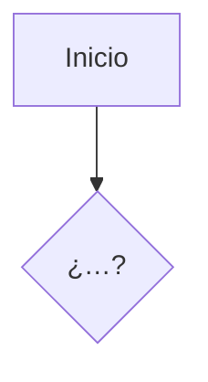

# Hito 4 — UX

**Objetivo:** diseñar cómo una persona usa la app: qué hace, en qué orden, qué ve en cada momento y qué pasa cuando algo sale mal. Se trabaja en baja fidelidad, sin estilo visual: estructura y comportamiento.

**Duración típica:** una a varias sesiones.

## Preguntas

1. Recorramos un uso típico de principio a fin: ¿qué hacés primero al abrir la app?
2. ¿Cuál es la tarea más frecuente? ¿Cuántos pasos debería tomar?
3. ¿Qué tiene que ver el usuario la primera vez, cuando todavía no hay datos?
4. ¿Qué errores pueden pasar y cómo debería enterarse el usuario?
5. ¿Hay acciones destructivas o irreversibles? ¿Cómo se confirman o se deshacen?
6. ¿Hay usuarios con necesidades de accesibilidad a considerar? (teclado, lector de pantalla, contraste, tamaño de texto)
7. ¿Qué apps te resultan cómodas de usar? ¿Qué patrones te gustan?

## Actividades

**1. Historias de usuario.** Por cada funcionalidad *Must*: "Como [usuario] quiero [acción] para [beneficio]", con criterios de aceptación concretos.

**2. Flujos.** Diagrama los recorridos principales (diagramas Mermaid en el markdown funcionan bien y la IA los puede leer y editar). Incluye caminos alternativos y de error.

**3. Arquitectura de información.** Cómo se organiza el contenido: secciones, navegación, jerarquía, qué se agrupa con qué. En apps con muchos tipos de contenido, define una taxonomía.

**4. Wireframes.** Bocetos de baja fidelidad de cada pantalla principal: qué elementos tiene y dónde, sin colores ni estilo. Pueden ser ASCII en el markdown, imágenes en `docs/ux/`, o bocetos en una herramienta de diseño. Lo importante es la estructura.

**5. Estados de cada pantalla.** Para cada pantalla define: vacío (primera vez), cargando, con datos, error, y casos extremos (mucho contenido, nombres muy largos, archivos dañados).

**6. Principios de interacción.** Reglas generales de la app: cómo se confirma, cómo se deshace, atajos de teclado, qué se guarda automáticamente.

**7. Validación.** Recorre los flujos con el usuario como si usara la app ("hago clic acá, ¿qué pasa?"). Ajusta.

> **Con impeccable:** si la skill `impeccable` está instalada, `shape` puede ayudar a bajar un flujo complejo a una pantalla concreta. Ver `referencias/integraciones.md`.

## Checklist de salida
- [ ] Historias de usuario con criterios de aceptación para todo el MVP.
- [ ] Flujos principales diagramados, incluidos los de error.
- [ ] Arquitectura de información definida.
- [ ] Wireframes de todas las pantallas del MVP.
- [ ] Estados (vacío, carga, error, extremos) definidos.
- [ ] Principios de interacción escritos.
- [ ] El usuario recorrió los flujos y los aprobó.

## Cómo escala según el perfil
La UX es igual de completa en todos los perfiles. Desde P4 se suman: onboarding para usuarios que no conocen la app, accesibilidad formal (WCAG AA como referencia) y, si se puede, pruebas con usuarios reales.

## Errores comunes
- Diseñar solo el "camino feliz".
- Meterse en colores y tipografías: eso es el hito 6.
- Wireframes de pantallas que no están en el MVP.

## Plantilla — `docs/04-ux.md`

~~~markdown
# UX

**Fecha:** AAAA-MM-DD

## Historias de usuario
### H-1 — [Funcionalidad]
- Como … quiero … para …
  - Criterios de aceptación:
    - [ ] …

## Flujos
### F-1 — [Nombre del flujo]

## Arquitectura de información
[Secciones, navegación, taxonomía]

## Pantallas
### W-1 — [Pantalla]
- Propósito:
- Elementos:
- Wireframe: `ux/…` o boceto en línea
- Estados: vacío / cargando / con datos / error / extremos

## Principios de interacción
- …

## Accesibilidad
- …
~~~
