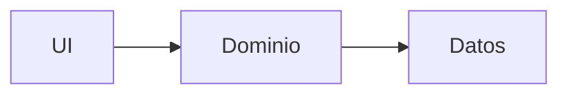

# Hito 5 — Arquitectura técnica

**Objetivo:** decidir cómo se construye la app: tecnologías, estructura del código, modelo de datos, lógica central, integraciones, seguridad y despliegue. Se apoya en la definición (qué), la investigación (con qué) y la UX (cómo se usa).

**Puede avanzar en paralelo con el hito 6.** Lo que la UI necesita de la arquitectura (por ejemplo, el framework de interfaz) conviene decidirlo primero.

**Duración típica:** una a varias sesiones.

## Preguntas

1. ¿Tenés preferencia o rechazo por algún lenguaje o framework? (La IA escribe todo el código, así que la experiencia del usuario no es un requisito; sí importan sus preferencias y su criterio.)
2. ¿Preferís una tecnología probada y aburrida o algo nuevo? (afecta el riesgo)
3. ¿Dónde va a correr? (repasa plataforma del perfil)
4. ¿Cuánto creés que van a crecer los datos? (cantidad de archivos, usuarios, registros)
5. ¿Hay tareas pesadas? (procesar archivos grandes, renderizar 3D, indexar)
6. ¿Cómo querés distribuir o instalar la app?

## Actividades

**1. Requisitos técnicos.** Deriva de los documentos previos los requisitos no funcionales: rendimiento, tamaño de datos, offline, plataformas, accesos al sistema, nivel de protección.

**2. Stack.** Para cada pieza (lenguaje, framework de interfaz, almacenamiento, librerías clave) propone 2–3 opciones con ventajas, desventajas y una recomendación. Criterios: encaje con los requisitos, experiencia del usuario, madurez, comunidad, licencia, y qué tan bien la conoce la IA (como la IA escribe todo el código, es un criterio de peso: afecta la velocidad y la calidad de construcción). La elección del stack se **discute** con el usuario: la IA presenta las opciones explicadas por sus consecuencias (qué permite, qué limita, qué cuesta cambiar después), da su recomendación y el usuario decide. Cada elección va a `decisiones.md`.

**3. Estructura de la app.** Componentes o módulos principales y sus responsabilidades. Separar claramente:
- Interfaz (lo que el usuario ve).
- Lógica de aplicación o dominio (las reglas: qué es un recurso, cómo se activa, cómo se valida).
- Acceso a datos y servicios externos (archivos, base de datos, APIs).

Esta separación permite probar la lógica sin la interfaz y cambiar una parte sin romper las otras. Incluye un diagrama (Mermaid).

**4. Modelo de datos.** Entidades, atributos y relaciones, partiendo del glosario del hito 2. Dónde se guarda cada cosa y en qué formato. Si la app lee formatos externos, separa el modelo externo (como viene el archivo) del interno (como lo usa la app).

**5. Lógica central.** Describe los procesos importantes paso a paso (por ejemplo, "importar un pack": detectar, validar, extraer, indexar, mostrar). Identifica qué partes son puras (fáciles de probar) y cuáles tocan el mundo exterior.

**6. Integraciones.** Para cada servicio o sistema externo: cómo se conecta, qué pasa si falla, credenciales necesarias.

**7. Seguridad.** Aplica la lista del nivel de protección asignado (`referencias/perfil-proyecto.md`). Para cada requisito del nivel, indica cómo se cumple. Presta atención especial a la entrada externa: archivos, datos de APIs, contenido de usuarios.

**8. Manejo de errores y registros.** Cómo se detectan, se informan al usuario (según la UX) y se registran.

**9. Estructura del repo y convenciones.** Carpetas, nombres, estilo de código, formato de commits, gestión de dependencias.

**10. Estrategia de pruebas.** Qué se prueba con tests automáticos (como mínimo la lógica central), qué manualmente. Se detalla en el hito 8, pero se decide acá para que la arquitectura lo permita.

**11. Despliegue.** Cómo se ejecuta en desarrollo y cómo llega a los usuarios (ejecutable, web, tienda). En detalle en el hito 9.

**12. Spikes.** Si una decisión tiene riesgo técnico alto, valídala con un prototipo descartable antes de cerrarla.

**13. Puntos de extensión** (solo si `02-definicion.md` prevé módulos o plugins). Diseña cómo se conectan las partes con vida propia al núcleo:
- **Secciones:** qué interfaces internas del núcleo usan, para que cada sección se pueda construir sin tocar las demás.
- **Sistema de plugins:** qué puede hacer un plugin, ciclo de vida (carga, activación, fallo sin tumbar la app, desinstalación), permisos, cómo acceden al design system, y versionado del contrato con política de compatibilidad. Si habrá plugins de terceros, aislamiento y procedencia según el nivel de protección.
- **Productos hermanos:** qué piezas se comparten (tokens, componentes, lógica de dominio) y cómo (mismo repo o paquetes publicados).
Ver `referencias/modulos.md`.

## Checklist de salida
- [ ] Requisitos no funcionales listados.
- [ ] Stack decidido, cada elección registrada en `decisiones.md`.
- [ ] Diagrama de componentes con responsabilidades.
- [ ] Modelo de datos.
- [ ] Procesos centrales descritos.
- [ ] Integraciones con su manejo de fallos.
- [ ] Requisitos de seguridad del nivel asignado cubiertos.
- [ ] Estructura del repo y convenciones.
- [ ] Estrategia de pruebas decidida.
- [ ] Riesgos técnicos validados con spikes o aceptados explícitamente.
- [ ] Puntos de extensión diseñados, si hay módulos o plugins previstos.

## Cómo escala según el perfil
La arquitectura siempre se documenta completa. Lo que escala es la sección de seguridad, la infraestructura de despliegue y la observabilidad (ver niveles). Evita sobreingeniería en P1–P2: microservicios, colas y Kubernetes rara vez se justifican.

## Errores comunes
- Elegir tecnologías por moda sin compararlas con los requisitos.
- Mezclar la lógica del dominio con la interfaz.
- Dejar la seguridad "para después".
- Confiar en que los archivos externos siempre vienen bien formados.

## Plantilla — `docs/05-arquitectura.md`

~~~markdown
# Arquitectura técnica

**Fecha:** AAAA-MM-DD
**Nivel de protección:** P_

## Requisitos no funcionales
- …

## Stack
| Pieza | Elección | Alternativas consideradas | Motivo (ver decisiones.md) |
|---|---|---|---|

## Componentes

| Componente | Responsabilidad |
|---|---|

## Modelo de datos
[Entidades, relaciones, dónde se guarda cada una]

## Procesos centrales
### [Proceso]
1. …

## Integraciones
| Sistema | Cómo se conecta | Si falla… |
|---|---|---|

## Seguridad (nivel P_)
| Requisito | Cómo se cumple |
|---|---|

## Errores y registros
- …

## Estructura del repo
```
/
├── docs/
├── src/
└── …
```

## Convenciones
- …

## Estrategia de pruebas
- …

## Despliegue
- …
~~~
